# Retro Nim UI

**Developed by Sultan Al Isaiee [@foxoman](https://github.com/foxoman)** --
[www.foxoman.net](https://www.foxoman.net) -- [sultan@foxoman.net](mailto:sultan@foxoman.net)

A **Windows 3.1 style UI toolkit for Nim** that builds business and desktop
apps for **Windows, macOS, Linux, Android and iOS** from one code base. The
package and module are called `retro`.

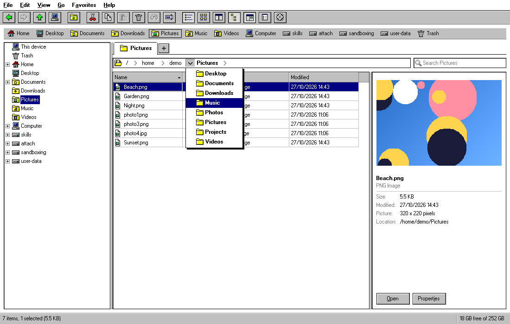

## Why Retro

- **Small.** A "hello" app is a single ~770 KB file (Linux x86-64, built
  with `retrokit small`); the full file manager is 1.6 MB and its APK
  about 1 MB; the gallery with every control, the map, 3D, the canvas and
  PDF is 2.7 MB. Fonts, icons, the PDF writer, the world map, the 3D view and
  the decoders are all built in, and only what an app calls is linked.
- **No dependencies.** You need Nim and a C compiler — nothing else to
  install, now or on the user's machine: no GTK, Qt, SDL, Electron, browser
  engine or Java toolchain. On Linux, X11 is loaded when the app starts, so
  building needs no `-dev` packages; sound, video and printing use whatever
  the system offers, loaded only when used.
- **Runs anywhere.** One code base for Windows, macOS, Linux/BSD (X11, and
  Wayland through XWayland), Termux:X11, Android 7+ and iOS. Touch, mouse and
  keyboard all work everywhere, and the layout adapts to phones, tablets,
  laptops and 4K screens.
- **Fast.** Immediate mode with a software renderer that redraws only the
  32-pixel bands that changed: a full 800×600 window takes about 0.4 ms, an
  unchanged frame costs nothing and is not sent to the screen, and the app
  uses no CPU while it waits. A 50,000-file folder or a 100,000-row grid
  scrolls in well under a millisecond per frame.
- **Reaches any OS API.** `retro/native` calls any Android Java API without
  writing Java, any macOS/iOS API through the Objective-C runtime, Win32 and
  COM, and any C library through `dlopen`, with ready-made cross-platform
  calls (battery, vibrate, dark mode, device name…).
- **Business ready.** Data grids with check boxes, colour status cells,
  drop-downs, buttons, per-cell colours and totals; forms with masked
  fields; record navigators; property grids; tree grids; 21 chart types;
  PDF reports from HTML templates, with printing; kanban, Gantt, agenda and
  org charts; maps; MDI windows; wizards.
- **Looks the part.** The 3.1 look down to the pixel — black outlines, the
  two-step bevels, the default button's ring, navy and white title bars,
  dithered scroll tracks, etched group boxes, hard menu shadows — in
  **MS W98 UI**, the MS Sans Serif of Windows 98 as outlines, drawn on its
  pixel grid so it is crisp at 100 %, on HD, 2K and 4K screens and at
  in-between scales (no licence: see "The font" below). **Kawkab Mono** (a
  monospaced Arabic and Latin font), **Retro Sans** (a recreation of MS
  Sans Serif with Arabic, bitmaps at 100 %) and DejaVu Sans are the other
  choices
  (`setUiFont`, or the user in `appearanceSettings`). 109 pixel icons in
  the manner of the period. Lists and pages glide when scrolled, and a
  flicked finger keeps them moving.
- **Safe.** Every decoder and parser (PNG, JPEG, BMP, GIF, WAV, zip, CSV,
  Markdown, HTML, OBJ, STL, templates) is fuzzed with hostile input, and
  the tests also run under AddressSanitizer.

| | |
|---|---|
| 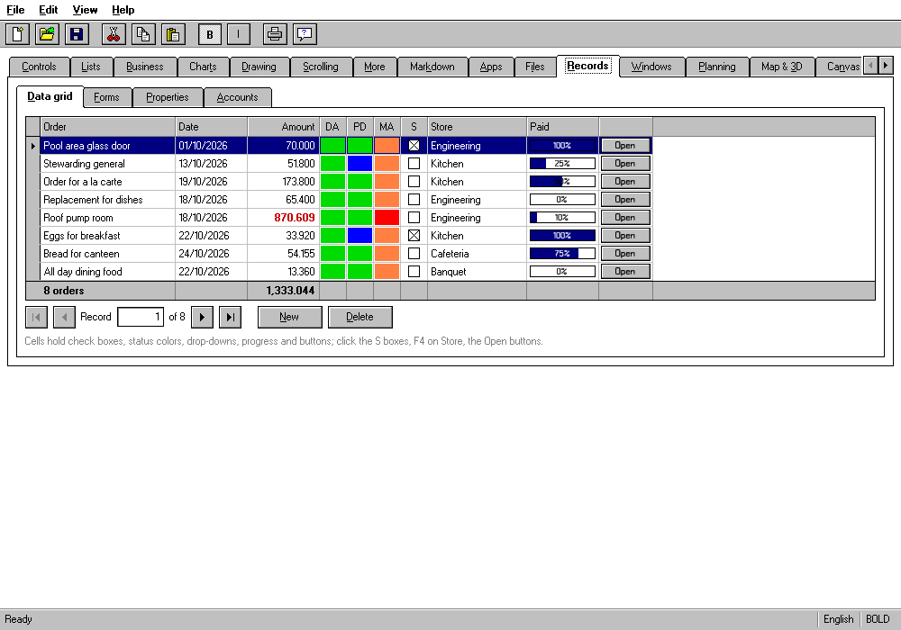 | 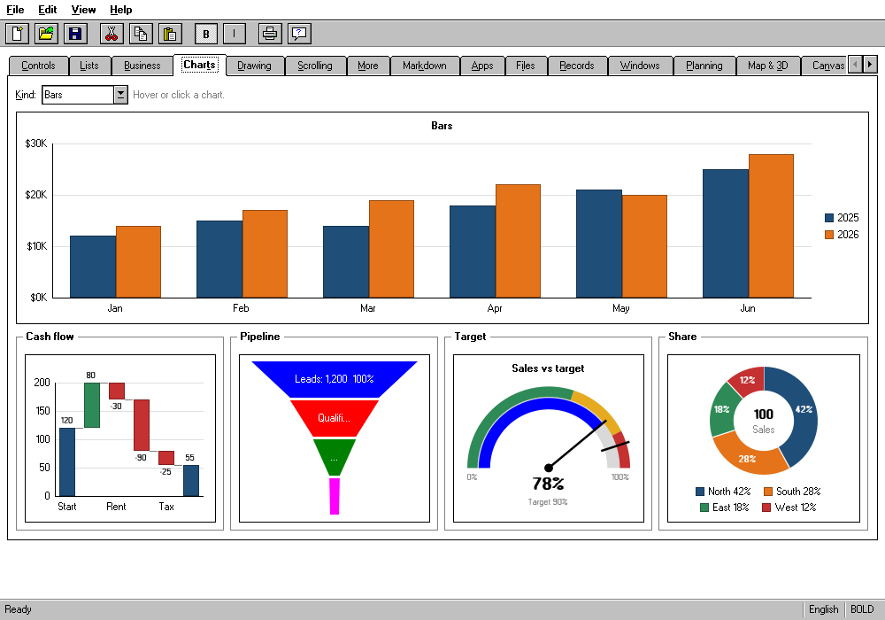 |
| 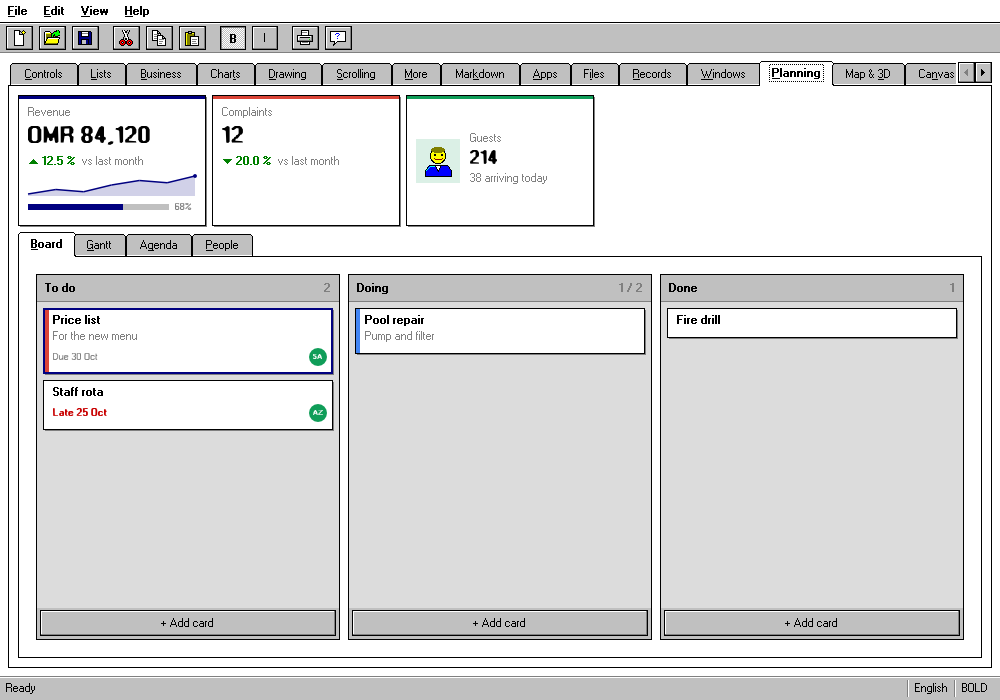 | 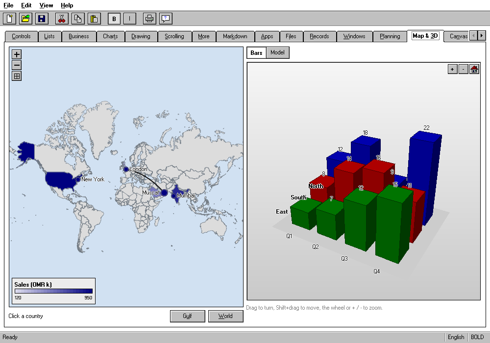 |
| 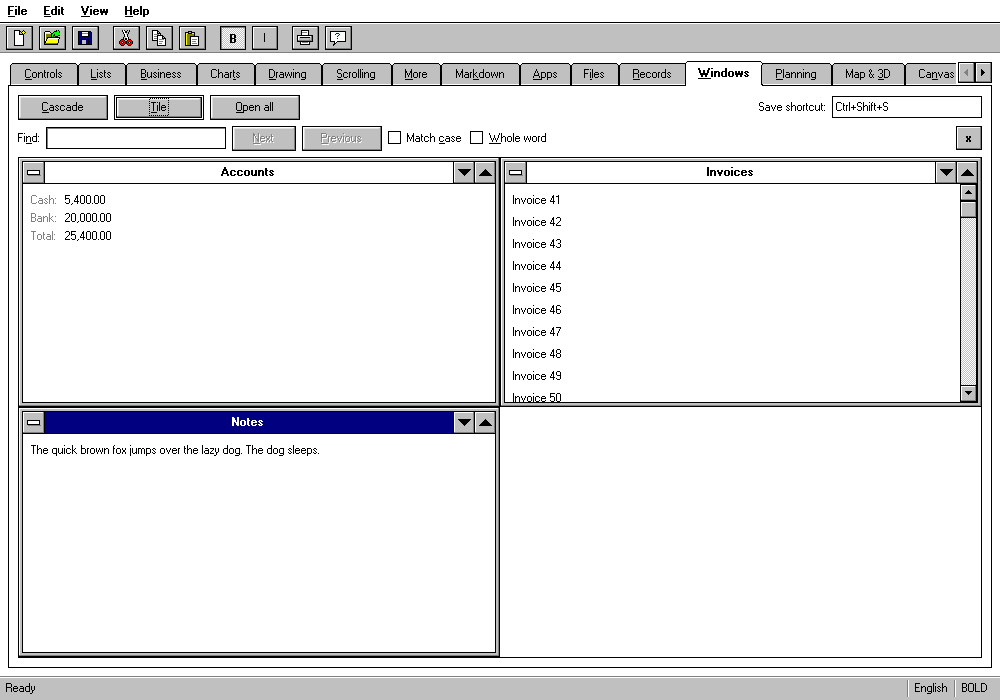 | 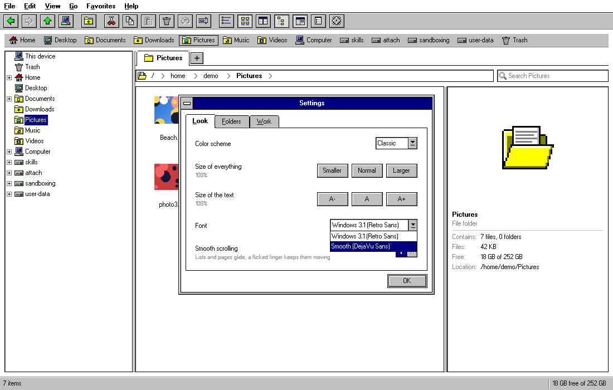 |
| 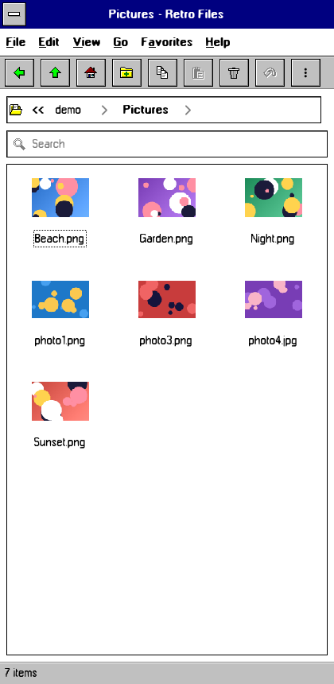 | 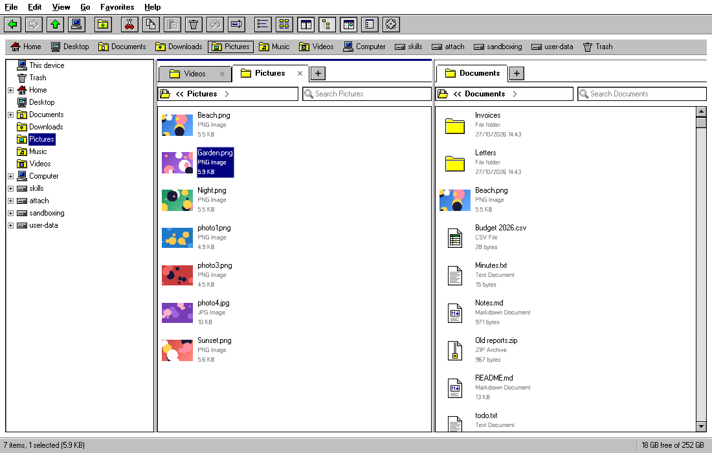 |
| 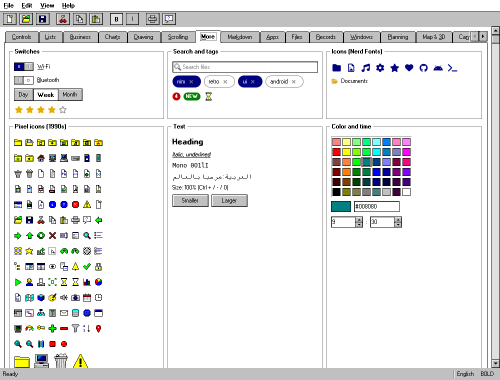 | 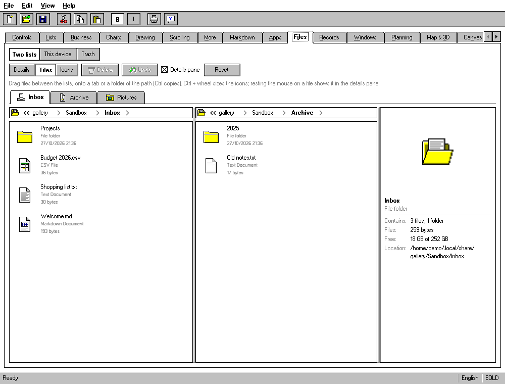 |

**Every control, its API and how it looks in each state** (normal, keyboard
focus, mouse over, pressed, disabled, open, touch screen, dark scheme) is in
**[docs/controls.md](docs/controls.md)**; the generated API reference of
every module is in `docs/api/` (open `docs/api/retro.html`).

## Contents

[Install](#install) · [Your first app](#your-first-app) ·
[How it works](#how-it-works) · [Controls](#controls) · [Layout](#layout) ·
[Text and icons](#text-and-icons) · [Business apps](#business-apps) ·
[Charts](#charts) · [Reports, PDF and printing](#reports-pdf-and-printing) ·
[Planning views](#planning-views) · [Desktop apps](#desktop-apps) ·
[Files](#files) · [Maps](#maps) · [3D](#3d-view) · [Canvas](#canvas) · [Whiteboard](#whiteboard) ·
[Image editing](#image-editing) · [Web and HTML](#web-and-html) · [Sound and video](#sound-and-video) ·
[The system's own APIs](#the-systems-own-apis) ·
[Platform services](#platform-services) · [Android](#android) · [iOS](#ios) ·
[Platforms](#platforms) · [Speed and size](#speed-and-size) ·
[Safety](#safety) · [Tests](#tests) · [Examples](#examples) · [FAQ](#faq) ·
[Limits](#limits) · [License](#license)

## Install

You need **Nim 2.0 or newer** and **a C compiler**:

| System | Get them | Notes |
|---|---|---|
| Windows | `choosenim` (brings MinGW-w64) | GDI, nothing else |
| macOS | `brew install nim`, `xcode-select --install` | Cocoa |
| Linux / BSD | your package manager: `nim`, `gcc` or `clang` | X11 is loaded at run time: no `-dev` packages |
| Android, on the device | Termux: `pkg install nim clang ndk-sysroot git` | builds APKs right on the phone |
| Android, from a desktop | nothing more: the first APK build fetches the NDK into `~/.retro/ndk` | no Java, no Gradle, no SDK, no OpenSSL |
| iOS | a Mac with Xcode | |

Then:

```sh
nimble install https://github.com/USER/retro   # the library and its tools
retrokit doctor                                # checks what this machine has
retrokit new myapp --kind:business             # a ready app: hello, form, business, files, charts
cd myapp && nimble run
```

`retrokit` is the helper that comes with the package:

| Command | What it does |
|---|---|
| `retrokit new NAME --kind:K` | a folder with `NAME.nim`, `NAME.nimble` (tasks run, small, apk) and an icon |
| `retrokit doctor` | checks Nim, the C compiler, the screen libraries, the Android tools, and says how to fix what is missing |
| `retrokit run app.nim` | builds in release mode and runs it |
| `retrokit small app.nim` | the smallest build (optimized for size, stripped), and its size |
| `retrokit apk app.nim` | an Android APK (the `retroapk` tool, below) |

From a clone of this repository:

```sh
nimble gallery        # every control in one window
nimble files          # Retro Files, the file manager
nimble ledger         # a small business app: invoices, customers, reports
nimble invoice        # an invoice from an HTML template: preview, PDF, printing
nimble charts         # Chart Viewer: a CSV file as charts, saved as PNG
nimble photo          # Retro Photo, the image editor
nimble board          # Retro Board, the whiteboard
nimble mail           # Retro Mail: Microsoft 365, Outlook.com and Gmail (mailexe, mailapk)
nimble apk            # Retro Files as an Android APK (build/RetroFiles.apk)
nimble photoapk       # Retro Photo as an APK (photoinstall: build and adb install)
nimble galleryapk     # the gallery as an APK
nimble boardapk       # Retro Board as an APK (boardinstall: build and adb install)
nimble photoexe       # Retro Photo for Windows, with its icon (from Linux or macOS: MinGW; build/win/)
nimble filesexe       # Retro Files for Windows (galleryexe, boardexe: the others)
nimble photoappimage  # Retro Photo as a Linux AppImage, with its icon and menu entry (one file, runs anywhere:
nimble filesappimage  # Retro Files as an AppImage      built against glibc 2.31 with zig when it is there)
nimble apks           # every app as an APK            (the apps: the table in retro.nimble)
nimble exes           # every app for Windows
nimble appimages      # every app as an AppImage
nimble macapps        # every app for macOS, zipped .app (on a Mac: build/mac/)
nimble apps           # every example for this computer, into build/
nimble dist           # the apps and all the APKs, into build/
nimble test           # the headless tests
nimble fuzz           # the fuzzers
nimble docs           # the API reference (docs/api) and docs/controls.md
```

Every task builds with what `nimble install` brought: the APK tasks fetch
the Android NDK once (about 700 MB, into `~/.retro/ndk`; `nimble ndk` does it
now, `ANDROID_NDK_HOME` uses yours), sign with a key made for you in
`~/.retro/android` (`RETRO_KEYS` another folder), and need no Java, Gradle, SDK, OpenSSL or apksigner. In
Termux the compiler is installed with `pkg` the first time.

GitHub builds them too: **CI** runs the tests and compiles every example on
Linux, Windows and macOS for each push; **Release** (by hand, or a `v...`
tag, which also makes a GitHub release) makes every app as an AppImage, a
Windows .exe, an APK and a macOS .app. Its APKs are signed with the key in
the secrets `ANDROID_KEY_PEM` and `ANDROID_CERT_DER` (base64 of the files in
`~/.retro/android`), so a new one installs over the one before.

## Your first app

```nim
import retro

var name = "World"
var greeting = ""

app "Hello", 320, 120:
  row([50, -1]):
    label "&Name:"
    edit name
  row:
    if button("&Greet", isDefault = true):
      greeting = "Hello, " & name & "!"
    if button("E&xit"): quitApp()
  label greeting
```

```sh
nim c -r -d:release -d:useMalloc hello.nim   # or: retrokit run hello.nim
retrokit small hello.nim          # optimized for size, LTO, stripped: about 1.1 to 1.5 MB, one file
retroapk hello.nim --install      # on a phone in Termux
```

For the smallest program add `-d:retroNoW98 -d:retroNoKawkab` (two fonts
left out: Retro Sans and DejaVu Sans Mono stand in). On Windows from
Linux: `nim c -d:release -d:useMalloc -d:lto --opt:size --passL:-s -d:mingw
--cpu:amd64 --app:gui hello.nim`.

Build with `-d:useMalloc` (or put `switch("define", "useMalloc")` in your
`config.nims`; `retroapk` adds it by itself): with Nim's own allocator a
program never gives memory back to the system, and one that shows many
pictures only grows. The toolkit warns at compile time without it, and
`retro/memwatch` gives back what the program lets go of
(`trimHeap`, by itself when it rests and when it goes to the background).

`app` opens the window and runs its body once per frame. Each widget
draws itself and returns what happened: `button` is `true` when it is
clicked, and `edit name` edits `name` in place and returns `true` when it
changes.

## How it works

- **Immediate mode.** The UI is plain code that runs every frame, and
  widgets are procs bound to your own variables. There are no callbacks
  and no widget objects to create, keep or free; whatever your code draws
  is what the screen shows. A widget is known by the variable it is bound
  to or by its label, so you never manage ids (use `pushId` / `withId` for
  rows of the same widgets).
- **Frames only when needed.** A frame runs when input arrives, when a
  timer asked for one (`wakeIn(ms)`) or when work on a background thread
  finished. Between frames the app sleeps. Drawing commands carry hashes:
  an unchanged frame is skipped, and a changed one redraws only the bands
  that changed.
- **Input, the same everywhere.** Mouse: click, double-click, the wheel
  (Shift for sideways, Ctrl to zoom where it makes sense), drag, the right
  button for menus, the middle and side buttons. Keyboard: Tab and
  Shift+Tab move the focus (shown as the dotted 3.1 rectangle), Space and
  Enter activate, arrows/Home/End/PageUp/PageDown move, Esc closes,
  Alt+letter for `&` mnemonics, the menu key or Shift+F10 for context
  menus. Fingers: a tap activates (a drag cancels it), dragging scrolls
  lists and pages, a long press is the right click, and a held-then-moved
  finger drags items. Hover effects appear only for a real mouse.
- **Looks.** The 3.1 look (bevels, X check boxes, navy selections, group
  boxes, bold menus) in eight colour schemes (`builtinThemes`: Classic,
  Gray, Dark, Ocean, Desert, Plum, Hot Dog, Paper), or your own `Theme`
  (`ui.theme = Dark`).
  Text is MS W98 UI (the default), Kawkab Mono (monospaced Arabic and
  Latin), Retro Sans, the 3.1 font with Arabic (bitmaps at 100 %, smooth outlines on HD
  screens), or DejaVu Sans (`setUiFont`); icons are the
  3.1-style pixel icons or the Nerd Fonts symbols.
- **Sizes.** Layout uses design pixels that follow the screen's density
  (Xft.dpi, GDK_SCALE, the monitor's real size, Android's density, Windows
  per-monitor DPI), in whole pixels so lines stay sharp. Users can make
  everything larger (Ctrl + / − / 0, `setUiScale`) or just the text
  (`setTextScale`). Touch screens get finger-sized metrics.
- **Content larger than its place scrolls**, always with the standard 3.1
  scroll bar (on touch screens too, where a finger can also drag the
  content): the window's page (both ways), dialogs, panes, lists, grids,
  MDI windows, the details pane.

## Controls

The full catalogue, with every signature, a usage example and pictures of
each state, is **[docs/controls.md](docs/controls.md)**. In short:

| Group | Controls |
|---|---|
| Text | `label`, `paragraph`, `heading`, `styledText`, `link`, `badge`, `icon`, `iconLabel`, `tooltip` |
| Buttons | `button` (also with a picture: icon only, text only, text below or beside the icon -- `ButtonLook`), `barButton` (tool bars; `setToolbarLook`), `buttonAt`, `toolButton`, `menuButton`, `splitButton`, `segmented`, `buttonRow` |
| Choices | `checkbox`, `radio`, `toggle` (3.1 slide switch), `chips`, `tagInput`, `rating`, `knob` |
| Text input | `edit`, `editArea`, `searchBox`, `autocomplete`, `maskedEdit`, `comboEdit`, `hotkeyEdit` |
| Numbers, dates, colours | `spin`, `intEdit`, `numberEdit`, `slider`, `rangeSlider`, `progress`, `datePicker`, `calendar`, `dateRange`, `timePicker`, `colorPicker` |
| Lists | `listbox`, `combo`, `checkList`, `grid` (with cell kinds), `tree`, `treeGrid`, `iconView`, `lineView`, `dualList`, `propertyGrid` |
| Status | `progressRing`, `spinner`, `sparkline`, `usageBar`, `banner`, `toast`, `led`, `pill`, `timeline`, `emptyState`, `busyState`, `statusbar` |
| Containers | `group`, `card`, `tabs`, `tabStrip`, `expander`, `accordionHeader`, `form`/`field`, `split`, `vsplit`, `sidePane`, `scrollPanel`, `adaptive`, `row`, `col` |
| Menus and bars | `menubar`, `menu`, `menuItem`, `submenu`, `contextMenu`, `popupMenu`, `toolbar`, `statusbar`, `breadcrumb`, `pathBar`, `driveBar`, `pager`, `stepper`, `recordNav`, `findBar` |
| Dialogs | `dialog`, `msgBox`, `inputBox`, `progressBox`, `wizard`, `aboutBox`, `fileDialog` (3.1), `filePicker` (modern), `propertiesDialog` |
| Desktop | `mdiArea` / `mdiWindow`, `mdiWindowMenu`, `hotkeyPressed`, `findIn`, `replaceAllIn` |
| App parts | `settingToggle`, `settingChoice`, `settingSlider`, `settingButtons`, `settingCombo`, `settingLink`, `appearanceSettings`, `avatar`, `factList`, `bottomNav`, `fab`, `captionBar` |
| Business views | `chart` (21 kinds), `gauge`, `kanbanBoard`, `ganttView`, `agendaView`, `kpiTile`, `statCard`, `orgChart`, `reportView` |
| Files | `fileList`, `filePreview`, `folderTree`, `placesView`, `trashList`, `driveBar`, `pathBar`, `textFileView`, `hexFileView`, `runJobDialog` |
| Media and more | `mapView`, `view3d`, `canvas2d`, `htmlView`, `webView`, `markdownView`, `imageView`, `animation`, `videoView` |

Buttons with a picture show it four ways -- icon only (the label becomes the
tooltip), text only, the text below the icon, or beside it -- and a tool bar
shows all of its `barButton`s one way, which the app can offer as a setting
(Explorer 98's "Text Labels"):

```nim
setToolbarLook(blTextBelow)            # labels under the icons; the bar grows
toolbar:
  if barButton(pxBack, "Back"): goBack()
  if barButton(pxCopy, "Copy", tip = "Copy (Ctrl+C)"): copy()
if button("Open", pxOpen, blTextBeside): openIt()
if button("Save", glyphPic(nfSave), blIconOnly): saveIt()
```

Drawing your own: `canvas(w, h)` gives a rectangle to draw into with
`fill`, `box`, `hline`, `vline`, `line`, `text`, `image`, `drawBitmap`
and the smooth shapes `disc`, `ring`, `roundRect`, `polygon`,
`thickLine`, `pieSlice`; `canvas2d` adds the whole HTML5 Canvas API.

## Layout

```nim
row([120, -1, -2]):             # fixed, one share, two shares
  label "Name:"
  edit name
  edit notes
row:
  label "Total: 120"
  spring()                       # the buttons go to the right end
  button "OK"
  button "Cancel"
adaptive(260):                   # 1 column on a phone, 3 on a desktop
  card "Sales": ...
  card "Stock": ...
  card "Orders": ...
if isCompact(): ...              # sizeClass(): scCompact, scMedium, scExpanded
let cols = responsive(1, 2, 3)
```

Widths in rows, `col(w)`, dialogs and grid columns are design pixels:
they grow with the screen and the user's size. `dp(13)` scales your own.
Content larger than the window scrolls both ways under the fixed menu,
tool and status bars, always with the standard scroll bars (on touch
screens too): the wheel (Shift + the wheel goes sideways), a finger,
PageUp / PageDown, Ctrl+Home / End, and Tab brings the focused control
into view. A dialog taller than the screen scrolls inside; `scrollPanel`
scrolls a part of a page (`scrollPanel -1:` down to the bottom).

**Smooth scrolling.** Lists, grids, trees, text areas and pages glide a
short way per wheel notch or key, follow a finger pixel for pixel and fly
on when it is flicked; a finger landing on a flying list stops it without
picking an item. `setSmoothScrolling(false)` (or the user, in
`appearanceSettings`) makes every scroll jump at once. Views of your own
get the same with `scrollWheel`, `scrollPan`, `scrollTo` / `scrollBy` /
`scrollShow` and one `scrollTick` a frame.

**Sizes.** The UI follows the display's density: whole pixels keep lines
sharp (2x, 3x) and the text and controls make up the rest (a 1.33x tablet
gets 1x lines and 1.33x text). `setUiScale(125)` (and Ctrl + / - / 0, and
the phone title bar's menu) scales everything; `setTextScale(120)` only
the text (controls grow with it); `setBaseTextSize(13)` changes the 100%
size. Try layouts on a desktop with `RETRO_SIZE=420x840`, `RETRO_TOUCH=1`,
`RETRO_CAPTION=1` (the phone title bar), `RETRO_SCALE=150`, `RETRO_ZOOM=2`.

## Text and icons

```nim
text(x, y, "Plain", c)
text(x, y, "Big bold", c, style(bold = true, size = 2.0))
text(x, y, "مرحبا بالعالم", c)                  # joined, right to left
label nfFolderOpen & " Documents"              # an icon inside text
toolButton(nfCopy, "Copy", size = 1.3)
image(x, y, glyphIcon(nfFolder, color(222, 170, 40), 24))   # as an Icon
```

`TextStyle` has `bold`, `italic`, `mono`, `underline`, `strike`, `size`
(times the UI's text size) and `rtl`. `textWidth`, `lineHeight` and
`FontH` measure. The icon constants (`nfFolder`, `nfCog`, `nfGithub`...,
`nerdIconNames` lists them all) come from Font Awesome, Material Design,
Seti and Devicons via Nerd Fonts. Characters in no built-in font (CJK,
emoji) are drawn by the platform.

**Drawing.** Apps draw into one software framebuffer cut in tiles: only
the tiles whose commands changed are drawn (on all cores) and sent, and a
picture changed in part (`changed(bitmap, rect)`) only there; nothing at
all when nothing changed. Where the platform has OpenGL ES 2 / OpenGL 2.1
(EGL on Linux and Android, WGL on Windows -- loaded at run time, nothing
to link) the frames are drawn by the GPU instead: the same commands as
rectangles from textures the CPU makes once (text, icons, shapes),
pictures as textures sent only where they changed. A start-up self-test,
a fall back to the CPU and a guard against a crash at start keep a bad
driver from hurting; `setGpuMode(gmAuto/gmGpu/gmCpu)` or "Drawing" in
`appearanceSettings` chooses. On HD and 4K screens MS W98 UI is drawn from
smoothed outlines (MS W98 UI HD), pixel icons are scaled with Scale2x and
Scale3x, and small marks at the screen's resolution (`setHdText(false)`:
the pixels of 1998, magnified). There is a true-black OLED theme; in it (and in Dark) the pixel icons are
drawn as their line twins -- Nerd Fonts symbols in the text's color, crisp
at any size (`setIconStyle`).

**Big images.** The photo engine (`retro/photo`) shows a change being made
with the mouse -- a layer moved, transformed, adjusted -- before it is done
(`LivePart`): the view's pixels are composited straight from the layers at
the view's size, and the full-size pixels change once, when it is put down
(`touchWhole` hands the old ones to the undo step without a copy). On a
70-megapixel photo, dragging a layer costs about 8 ms a frame and Free
Transform 25 ms.

**The font.** Every app's text is **MS W98 UI** unless it chooses
otherwise: the MS Sans Serif of Windows 98 made outlines by Lev Leontev
(2019) and fixed by martyr— (MARTYR X LTD, 2022,
github.com/MARTYR-X-LTD/ms-w98-ui), regular and bold. Its glyphs are put on
its pixel grid at every scale, so it looks as it did on a 1998 screen and
stays crisp at 2x and in between; Arabic, and characters it does not
have, come from the other fonts. **It has no licence.** Its authors call
it free to use, but the letters are Microsoft's MS Sans Serif, and nobody
has granted rights to them; `src/retro/fonts/NOTICE-MSW98UI.txt` says
what is known. For a program you sell or publish, build with
`-d:retroNoW98` (it is left out, and Retro Sans is the default) or choose
another font with `setUiFont`. `setUiFont(ufKawkab)` gives **Kawkab
Mono**: Abdullah Arif's monospaced Arabic (with the Latin of Source
Code Pro), SIL OFL 1.1, built for the kit by `tools/genkawkab.py`. Its
stems are fitted to whole pixels and its letters are a whole number of
screen pixels wide at every scale (100 %, 2x, 125 %, 150 %...), so the
text is crisp on any screen and lines up in columns; Arabic joins and
lam-alef is one letter. `setUiFont(ufRetro)` gives **Retro Sans**, the
3.1 look: a recreation of the Windows 3.1 MS Sans Serif (after lou's,
CC BY-SA 3.0), regular and bold, with the Arabic of GNU Unifont joined
and right to left. At 100 % it is drawn from its bitmaps, one screen
pixel per font pixel, as on a 1992 screen; larger, and on HD, 2K and 4K
screens, from smoothed outlines of the same shapes, so it stays sharp and
keeps its character at every size. `setUiFont(ufSmooth)` switches to
DejaVu Sans; `loadUiFontFile(path)` to a font of the user's (a .ttf; a
pixel font is drawn on its grid, crisp) (before `app` for one app's default, or at any time);
`uiFont()` tells which is on; `appearanceSettings` puts the choice in an
app's Settings and `storeAppearance` / `restoreAppearance` keep it.
Monospaced text (code, hex) is DejaVu Sans Mono with both. The fonts are
also in `src/retro/fonts` as TrueType files for other programs:
`RetroSans.ttf`, `RetroSansBold.ttf` and `RetroSansArabic.ttf` (the
bitmaps as square pixels) and `RetroSansHD*.ttf` (the smoothed outlines).
The Arabic is its own file because its licence (OFL) and that of the
Latin letters (CC BY-SA) do not allow one merged file; the toolkit joins
them when it draws.

**Pixel icons** (`retro/pixelicons`) are used the same way, as text:

```nim
toolButton(pxCopy, "Copy", size = 1.3)          # a 3.1-style tool bar icon
iconLabel(pxFolder, "Documents")
image(x, y, glyphIcon(pxComputer, black, 32))   # the 32x32 art at 32
label retroOr(pxSave, nfSave) & " Save"         # pixel icon, or the Nerd one
```

There are 109 (`pixelIconNames` lists them): folders and places, drives,
file kinds, the tool bar's actions, the message box signs, the
hourglass, charts, maps, mail, calendar, clock, media keys and more. Each has 16x16 and 32x32 art and is drawn at a whole number
of screen pixels per art pixel; disabled ones look embossed. Set
`retroIcons = false` to have `retroOr` (and the toolkit's own parts) use
the Nerd icons. The art is original, drawn in the manner of 3.1, made by
`tools/genicons.py`.

## Business apps

### The data grid

`grid` shows rows that come from a proc, so 100,000 rows cost only what
the visible ones cost. Click a header to sort, drag its edge to resize;
arrows, Home, End, PageUp/PageDown; F2, a double click or typing edits an
`editable` cell, Enter commits, Esc cancels. Pass `marked` for multi-select
(Ctrl/Shift click, Ctrl+A, a rectangle, check boxes on phones).

Columns can hold more than text — the controls of a business screen:

| Column | Cells show | Interaction |
|---|---|---|
| `column`, `numberColumn` | text, numbers (right aligned) | edited in place when `editable` |
| `checkColumn` | a check box ("1", "yes", "x"…) | a click or Space flips it: `ev.toggled` |
| `colorColumn` | a block of colour ("#RRGGBB", "green", "orange"…) | status lights |
| `progressColumn` | a bar ("0.62" or "62%") | |
| `choiceColumn` | text picked from a list | F4 or a click drops the list: `ev.edited` |
| `buttonColumn`, `linkColumn` | a push button, a link | `ev.clicked` |
| `iconColumn` | a pixel icon or icon-font glyph | |
| `customColumn` | anything you draw in `paint(row, rect, selected)` | |

`style(row, col)` gives any cell its own text and background colours and
bold text; `rowHeaders` adds the record indicator column (an arrow at the
current row, a star while it is edited); `footer(col)` adds a totals row.

```nim
var cols = @[column("Order", 160), numberColumn("Amount", 90),
             colorColumn("Status"), checkColumn("Paid"),
             choiceColumn("Store", ["Kitchen", "Engineering"], 110), buttonColumn("", 60)]
let ev = grid(cols, orders.len, proc (r, c: int): string = orders[r][c], sel,
              height = -1, rowHeaders = true,
              style = proc (r, c: int): CellStyle =
                if c == 1 and isLate(r): cellStyle(fg = color(200, 0, 0), bold = true)
                else: CellStyle(),
              footer = proc (c: int): string = (if c == 1: total() else: ""))
if ev.edited: orders[ev.row][ev.col] = ev.text   # typed, picked or a check box flipped
if ev.clicked: openOrder(ev.row)                 # its button
```

### Forms and records

```nim
form 0:
  field "&Customer:": comboEdit draft.customer, customers   # suggests as you type
  field "&Phone:":    maskedEdit(draft.phone, "+### #### ####")
  field "&Date:":     datePicker draft.date                 # Alt+Down or F4 drops it
  field "&Amount:":   numberEdit draft.amount, lo = 0
  field "&Period:":   dateRange(fromDay, toDay)             # with This month, Last year...
  field "Status:":    checkbox "&Paid", draft.paid
case recordNav(pos, customers.len, dirty)                     # |< < 3 of 20 > >|  New Delete Save
of raNew: addCustomer()
of raSave: saveCustomer()
else: discard
```

- `maskedEdit` types into a mask (`#` digit, `A` letter, `U` upper case,
  `X` letter or digit, `*` anything; Arabic-Indic digits count as digits);
  `maskFormat`, `maskFull`, `maskRaw` read the value.
- `dualList(available, chosen)` moves items between two lists (buttons,
  double click, Enter, up/down order).
- `propertyGrid(props, sel)` edits properties by category: text, numbers,
  yes/no, choices, colours and dates, with a help line.
- `treeGrid(cols, rows, sel)` is a tree with columns (a chart of accounts).
- `wizard(open, title, step, steps, width): body` is a dialog of steps
  with Back / Next / Finish; `stepDone(false)` keeps Next disabled.

`Date` is a plain `(year, month, day)` with `today()`, `addDays`,
`addMonths`, `weekday`, `parseDate`, `$` in `dateStyle`, `presetRange`.
`formatNumber` / `parseNumber` read and write "1,234.50".

`examples/ledger.nim` puts it together: a tree, a splitter, a sortable,
editable grid, an invoice form, CSV import and export, reports, settings.

## Charts

`chart` draws 21 kinds of business chart from the same few lines:

| Kind | | Kind | |
|---|---|---|---|
| `chBar`, `chBarH` | bars, up or sideways | `chScatter`, `chBubble` | points, sized points |
| `chStacked`, `chStacked100` | stacked, as shares | `chWaterfall` | changes adding up to a total |
| `chLine`, `chArea`, `chStackedArea` | lines and areas (`smooth`) | `chFunnel` | the stages of a pipeline |
| `chCombo` | bars with a line on a second axis | `chGauge` (`gauge`) | one value on a dial, a target, bands |
| `chPie`, `chDonut` | shares (the total in the hole) | `chCandle` | open, high, low, close |
| `chHistogram` | how values spread | `chHeatmap` | a table as colours |
| `chRadar` | series around the labels | `chTreemap` | shares as rectangles |
| `chBullet` | values against targets | | |

```nim
let months = ["Jan", "Feb", "Mar", "Apr"]
chart("Sales", chBar, months, [series("2025", [12.0, 15, 9, 20]),
                               series("2026", [14.0, 18, 11, 24])])
chart("Revenue and margin", chCombo, months,
      [series("Revenue", rev), lineSeries("Margin %", margin)],
      opts = ChartOpts(format: NumFormat(prefix: "$", short: true),
                       format2: NumFormat(percent: true)))
gauge("Target", 0.82, lo = 0, hi = 1, target = 0.9, format = NumFormat(percent: true))

# Straight from a CSV file (comma, semicolon or tab; quotes; a BOM):
let t = readCsv("sales.csv")
let ev = chart("By region", chDonut, t, "Region", ["Amount"], height = -1)
if ev.clicked: showRegion(ev.index)        # a bar, point or slice (or Enter)
exportPng(ui.lastRect, "chart.png")        # the chart as a picture
```

Every chart has round axis numbers, a legend (click an entry to hide that
series), a tooltip (the mouse, a tap, or the arrow keys once it has the
focus) and numbers written as money, shares, or 1.2K / 3.4M (`NumFormat`).
`ChartOpts` sets the titles, axis names, legend place, data labels, axis
range, bands and palette. Empty, missing (NaN), negative and huge values
are drawn as well as they can be, never a crash.

**A chart app in a minute.** `examples/charts.nim` is a ready Chart
Viewer: open a CSV, pick the kind, the label column and the value columns,
and save the PNG. `retrokit new sales --kind:charts` starts your own.

## Reports, PDF and printing

Invoices, quotes, statements and lists are laid out on pages and come out
as PDF files, PNG pictures, an on-screen preview, or paper — all in Nim,
with nothing to install, and linked only into apps that use them (PDF
alone adds about 45 KB). The fonts are embedded, the text in the PDF can
be selected and searched, and Arabic is joined and runs right to left.

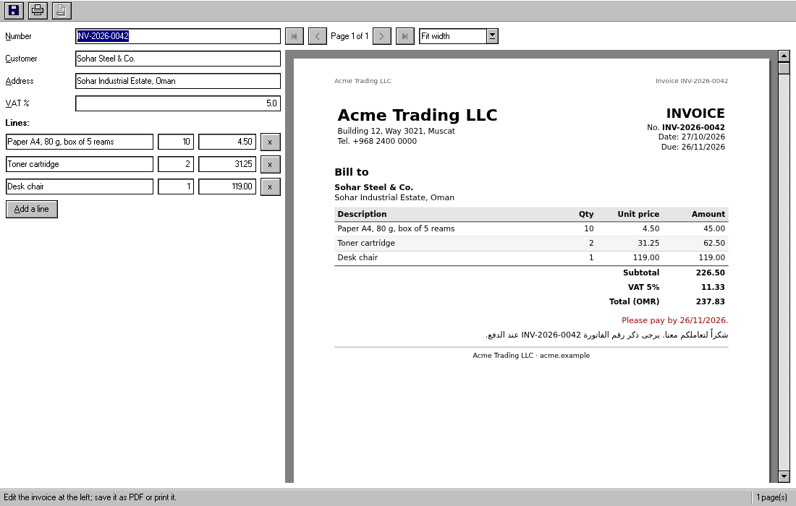

**From an HTML template and data** — the way most business apps do it.
Templates are Mustache style: `{{name}}` (escaped), `{{{raw}}}`,
`{{#items}}…{{/items}}` repeats, `{{^items}}` for "none", `{{a.b}}`,
`{{price|n2}}` formats a number:

```nim
import retro, std/json

const tpl = """
<header><span>Acme Trading</span><span>Invoice {{number}}</span></header>
<footer><span>{{date}}</span><span>Page {page} of {pages}</span></footer>
<h1>Invoice {{number}}</h1>
<p>Bill to: <b>{{customer}}</b></p>
<table>
<thead><tr><th width="60%">Item</th><th align="right">Price</th></tr></thead>
{{#items}}<tr><td>{{name}}</td><td>{{price|n2}}</td></tr>{{/items}}
<tfoot><tr><td>Total</td><td>{{total|n2}}</td></tr></tfoot>
</table>"""

let doc = reportFromHtml(renderTemplate(tpl, %*{"number": 42, "date": $today(),
  "customer": "Sohar Steel", "items": [{"name": "Paper", "price": 45}], "total": 45}))
doc.savePdf("invoice.pdf")          # or: reportView(doc) / printReport(doc) / savePng(doc, 0, "p1.png")
```

The HTML it reads: `h1`–`h4`, `p`, `div`, `br`, `hr`, `pre`, lists, `b`,
`i`, `u`, `code`, `small`, links, `span` / `font` with colour, weight,
style and size, tables (`thead`, `tfoot` for totals, `th`, `td`,
`colspan`, `width`, `align`, `bgcolor`; `border="1"` for a grid,
`class="plain"` for layout), local pictures, `text-align`, `dir="rtl"`,
`page-break-before`, and `<header>` / `<footer>` for every page with
`{page}`, `{pages}`, `{title}`, `{date}`.

**From Nim code**, when the document is built by the program:

```nim
var doc = newReport("Invoice 42", author = "Acme Trading LLC")
doc.header("Acme Trading LLC", "", "Invoice 42")
doc.footer("", "Page {page} of {pages}", "")
doc.heading("Invoice 42")
doc.paragraph([span("Bill to: "), span("Sohar Steel", bold = true)])
var t = newTable(["Item", "Qty", "Price"], widths = [-3.0, -1, -1],
                 aligns = [alLeft, alRight, alRight])
t.addRow(["Paper A4", "10", "45.00"])
t.addTotals(["Total", "", "45.00"])
doc.table(t)
doc.savePdf("invoice.pdf")
```

Pages flow by themselves: a table's header row comes again on each page,
rows are never cut, headings stay with what follows, and `keepTogether`
keeps a group on one page. `reportView(doc)` shows the pages on a gray
desk with page buttons and zoom (wheel, keys, fingers, the standard
scroll bars). `retro/pdf` draws PDF pages directly (`newPdf`, `addPage`,
`text`, `line`, `rect`, `image`, `link`) for forms and labels.

**Printing:** `printReport(doc)` (or `printPdf(path)`) returns
`(ok, message)`:

| Platform | How it prints |
|---|---|
| Linux, BSD, macOS | CUPS (`lp`): the default printer or the one named |
| Windows | the app that prints PDF files (a PDF reader must be installed) |
| Android | the system's print dialog (printers, Save as PDF) |
| iOS | not yet: save the PDF and share it |

`examples/invoice.nim` is a complete invoice app: edit the customer and
lines at the left, the pages follow at the right; save the PDF or print.

## Planning views

What a project, sales or service app shows its work with:

```nim
kpiRow:                                              # numbers of a dashboard
  kpiTile("Revenue", "$1.24M", delta = 0.12, trend = weekly)
  kpiTile("Open tickets", "37", delta = -0.08, lowerIsBetter = true)
  statCard(nfUsers, "Customers", "1,208", "+52 this month")
let k = kanbanBoard(lanes, cardSel)      # drag cards between lanes (a finger: hold, then move)
let g = ganttView(tasks, taskSel, scale) # bars move and stretch; parts fold; links between tasks
let a = agendaView(meetings, day, mode)  # month, week or day; drag to move or resize
let o = orgChart(staff, person)          # who reports to whom; branches fold
```

- `kanbanBoard`: lanes (`KanbanLane`: title, cards, a work limit) of cards
  (`KanbanCard`: title, detail, colour tag, due date, who has it). Drag,
  or Ctrl + the arrows, to move one; Enter opens it.
- `ganttView`: `GanttTask` (name, start, finish, progress, colour, level,
  dependencies, milestone) on a day, week or month scale with weekends and
  today marked; drag a bar to move it, its ends to change its dates.
- `agendaView`: `Appointment` (title, day, start and end minutes, all day,
  colour) by month, week or day.
- `kpiTile`, `statCard`, `kpiRow`: a value with its change (green or red),
  a target and a sparkline; `kpiRow` wraps them to the width.
- `orgChart`: `OrgNode` (name, title, parent, colour) as boxes and lines.

All of them take mouse, keyboard and fingers, draw only what is in view
(thousands of tasks or cards stay fast) and scroll with the standard
scroll bars.

## Desktop apps

- **Menus and bars:** `menubar` / `menu` / `menuItem` (shortcuts, check
  marks, `submenu`), `contextMenu` (right click, long press, the menu
  key), `popupMenu` (drop it down under a button), `toolbar` (buttons that
  do not fit go into a "more" menu), `statusbar`.
- **Windows in the window (MDI)**, as in Program Manager:

  ```nim
  var accounts = MdiWindow(title: "Accounts", open: true)   # keep them in globals
  var invoices = MdiWindow(title: "Invoices", open: true)
  menu "&Window": mdiWindowMenu()           # Cascade, Tile, the window list
  mdiArea(-1):
    mdiWindow(accounts): grid(...)
    mdiWindow(invoices): listbox(...)
  ```

  They have the 3.1 frame (a thick sizing border, the control-menu box,
  a navy title bar when in front and a white one behind), move by their
  title bars, size by their edges, minimize to icons, maximize (also with
  a double click on the title), and come to the front with a click; Ctrl+F6 goes to the next
  one and Ctrl+F4 closes; their content scrolls when it is taller.
- **Find and replace:** `findBar(state)` (Enter / F3 next, Shift+F3
  previous, Esc closes; Match case, Whole word, Replace, Replace all) with
  `findIn` and `replaceAllIn` for the text.
- **Shortcuts the user chooses:** `hotkeyEdit(keys)` takes the next key
  pressed ("Ctrl+Shift+S"); `hotkeyPressed(keys)` tells when it is pressed.
- **About:** `aboutBox(open, "Ledger", "2.0", ["(c) 2026 ..."], tagline = ...,
  iconPng = staticRead("icon.png"), whatsNew = [...], credits = [...])`: a
  banner in the blue of a 1994 Setup screen with the icon, name, version
  and a rainbow; pages About (with the system, the screen, the toolkit's
  and Nim's versions), What's New and Credits; Copy Info.
- **Dialogs:** modal `dialog`s with a 3.1 frame that drag by their titles
  and scroll when taller than the screen; `msgBox`, `inputBox`,
  `progressBox`, the 3.1 `fileDialog` and the modern `filePicker`.

## Files

```nim
for f in listFolder(dir): echo f.name, " ", sizeText(f.size), " ", kindName(f)
let job = newJob(jkCopy, @["a.txt", "photos"], "/backup")   # also jkMove, jkDelete,
while job.state == jsRunning: job.run(12)                   # jkZip, jkUnzip, jkMeasure
# job.progressOf, job.conflict + resolve(cfReplace / cfSkip / cfKeepBoth), cancel()

zipFolder("photos", "photos.zip"); extractZip("photos.zip", "out")
let pic = loadPicture("IMG_0001.jpg", 1600, 1600)   # PNG, JPEG (baseline, progressive,
drawBitmap(rect(10, 10, 160, 120), pic)              # EXIF turned), BMP; more on phones
```

File jobs work in slices so the window stays alive, never follow links
out of a folder they delete, refuse to copy a folder into itself, and
leave no half-written file when cancelled.

Slow work goes to worker threads, and big files are read a window at a
time:

```nim
let t = folderAsync(dir)                  # or pictureAsync(path, 1600, 1600)
for r in finished():                      # every frame: what is done
  if r.ticket == t: items = r.items       # (pictures: r.toBitmap)
discard pictureAsync(path, 800, 800, onDone = proc (r: var TaskResult) =
  photo = r.toBitmap)                     # or a callback, on the UI thread

var log = openTextFile("huge.log")        # opens at once, any size
textFileView(log, sel)                    # lines counted a few ms a frame
hexFileView(openHexFile("app.bin"), sel)  # any file as hex, read as shown
```

### Files on screen

`retro/filewidgets` has what a file manager, an Open dialog or a photo
app is made of:

```nim
var folder = newFolderModel(getHomeDir())        # listed on a worker thread
app "Files", 900, 600:
  sidePane(true, previewW, previewH):            # beside, or under on phones
    let ev = fileList(folder, fvIcons)           # or fvDetails; thumbnails
    if ev.activated and ev.item.isDir: folder.open(ev.item.path)
  do:
    let p = filePreview(folder)                  # picture or text, sizes...
    if p.open: openFile(p.item.path)
```

- `FolderModel`: `open`, `goBack`, `goForward`, `goUp` (the folder you
  were in stays selected), `reload`, `setFilter`, `search` (through the
  subfolders, a few milliseconds a frame), `patterns` (`["*.png"]`),
  natural sorting, a selection (`marked`, `selectedItems`, `selectAll`),
  `makeFolder`, `makeFile`, `rename`, and it lists the folder again when
  another program changes it. The old listing stays until the new one is
  there, so a slow folder never blanks the window.
- `fileList`: details (sortable, resizable columns, rename in place) or
  icons with picture thumbnails; empty, searching and "reading..." states.
- `filePreview`: the details pane -- the picture (decoded in the
  background) or the start of a text, size, what a folder holds
  (measured as you look), dates, picture size, Open / Share / Properties.
- `folderTree`: places (home, documents, storage, drives) and favorites.
- `cachedPicture`, `drawPicture`, `pictureBox`: pictures decoded on
  worker threads and kept up to a memory budget (`PictureCache`).
- `runJobDialog(job, "Copying")`: runs a file job with its progress box
  and asks "Replace / Keep both / Skip"; `propertiesDialog`; `filePicker`.
- `fileGlyph`, `fileIcon`: an icon and a color for each kind of file.
- `fileList` views: `fvDetails`, `fvTiles` (icon, name, kind, size) and
  `fvIcons` at any `iconSize`; Ctrl + the wheel reports `ev.zoom` so the
  app can step through sizes. Hovering a row highlights it, and after a
  short rest `filePreview(m, followHover = true)` shows that item.
  Dragging from the empty part draws a selection rectangle.
- Drag and drop: rows and tiles drag as `"files"`; folders in the list,
  in `folderTree`, on `tabStrip` tabs and on the folders of `pathBar` take
  them, and each reports a `FileDrop` (`paths`, `into`, `copy` when Ctrl
  is held). `jobFor(drop)` makes the move, copy or trash job and
  `runJobDialog(job, jobTitle(job.kind))` runs it. On touch screens a
  finger held on a file until its menu opens, then moved, drags it.
- `pathBar(path)`: the folders as buttons, as in Windows Explorer: a
  click on one goes there, the arrow after each drops a menu of the
  folders in it, "<<" lists the folders that do not fit; a click on the
  empty part, or `editNow` (F4, Alt+D, Ctrl+L), turns it into a box with
  the subfolders suggested.
- `placesView`: "This device" -- places and favorites as tiles with how
  full their disks are.
- The trash: `moveToTrash`, `trashItems`, `restore`, `deleteForever`,
  `emptyTrash` (the freedesktop.org trash on Linux and Android, the
  Recycle Bin on Windows, ~/.Trash on macOS) and `trashList`, a widget
  with Restore, Delete forever and Empty the trash. `jkTrash` jobs.
- Undo: `remember(job)` after a job (or `remember(UndoStep(...))` after
  a rename); `canUndo`, `undoLabel`, `undo()` moves things back.
- `driveBar(current, favorites)`: the drive buttons of the 3.1 File
  Manager (places and favorites), taking drops.
- A folder not shown yet comes in two steps: the names at once, then the
  sizes and dates (`listFolder(dir, quick = true)` gives `stub` items),
  so thousands of photos on a phone's shared storage show without
  waiting.

**Other apps' files** (`retro/docfs`). On Android, an app's files are
its own; one that shares them offers a documents provider. Termux does,
for its home, and Retro's file parts treat it as a folder:
`/data/data/com.termux/files/home` is listed, opened, copied to and
from, moved, zipped, renamed and deleted like any other (the `v...`
procs -- `vIsDir`, `vOpen`, `vWalk`, `vMove`... -- go through the provider
there and to the disk elsewhere; the file jobs use them). Until the user
allows it, a `FolderModel` showing it has `needsAccess`, and `fileList`
offers "Allow access", which opens the system's folder picker at
Termux's home (`askAccess`), asked once. `localCopy` gives viewers a
file to read. Inside Termux itself its files are simply files, and
"Termux home", "Termux system" and "Shared storage" are among the places.
The parts any app can use for this:

```nim
# drag and drop of anything
if dragStarted: startDrag("cards", [cardId], label = "1 card")
case dropTarget(lane, "cards")          # dsOver: draw it highlighted
of dsDropped: moveCard(ui.drag.items, laneId)
else: discard

let t = tabStrip(names, cur, closable = true, addButton = true)  # browser tabs
if t.closed >= 0: names.delete(t.closed)
toast("Copied 12 items", title = "Files")    # a yellow Windows 95 balloon
```

### Retro Files

`examples/filemanager.nim` (about 2,100 lines: the rest is the toolkit's)
is **Retro Files 3.3.2**, a complete file manager in the manner of the Windows 98
Explorer -- the Standard Buttons with their labels under the icons (View >
Toolbars > Text Labels), the Address bar, View as Web Page (the folder's
name large and the selection described at the left), Large and Small icons,
Details, Tiles, Columns (each folder of the way a column, as Finder has it,
with type-ahead and the picked file's preview), Arrange Icons, Explorer Bar >
Folders, Tools > Find (F3),
Folder Options, the zone in the status bar -- and what one does today:
tabs (Ctrl+T, Ctrl+W, drag files onto a tab) -- or each folder in a
window of its own, as the 3.1 File Manager had them (View > Folders in
Windows: Cascade, Tile, Always on Top) -- two panes side by side
(F9, F6 to switch, copy or move to the other pane), drag and drop
between lists, the tree, tabs and the path bar (Ctrl copies), a
path bar whose folders are clicked or dropped down as in Explorer and
that takes a typed path with suggestions (F4, Alt+D, Ctrl+L), "This device"
with how full each disk is, the trash with restore (Delete moves there,
Shift+Delete deletes for good), undo of renames, moves, copies, new items
and trashing (Ctrl+Z), details, tiles and five icon sizes (Ctrl + the
wheel), a selection rectangle, a preview that follows the mouse, file
name extensions shown or hidden, copy speed and time left,
folder tree with places and favorites, the 3.1 drive bar, picture
thumbnails, pixel icons, a tab menu (duplicate, close the others, move to
the other pane), the middle button opening a folder in a new tab, the
mouse's back and forward buttons, a selection bar on phones, Termux's
home folder (after "Allow access"), a preview
pane (the picture or the start of a text,
size, contents of folders, picture size, Open / Share / Properties; under
the listing on phones), natural sorting ("photo 2" before "photo 10"),
multi-select (check boxes on phones), cut / copy / paste in the background
with progress and "Replace / Keep both / Skip", rename in place (F2),
delete, new folders and files, zip and extract, search in the folder or
all its subfolders, properties with folder sizes and permissions, viewers
for text of any size (with editing and saving for small ones), Markdown
(preview and source), pictures (next / previous, fit / 1:1, a slide show),
PDF documents (pages drawn as you scroll, zoom, a page box), videos and
sounds (with the folder's sounds as a play list), zip archives and hex,
pictures of PDFs and videos in the lists, renaming many by a pattern,
Select Matching, Duplicate, Open Terminal Here, open with and share, a Settings dialog in tabs (look, sizes,
the font -- Kawkab Mono, Retro Sans or DejaVu Sans --, smooth scrolling, thumbnails,
preview, single tap, confirm delete, start folder, Termux access), an
About box that fits any screen, mouse hover, and settings that stick.

New in 3.1: very big pictures (gigapixel scans, huge maps) are shown and
thumbnailed a band at a time (`retro/bigpicture`), and in Arabic a line
that mixes Arabic with numbers reads right to left. New in 3.0: thumbnails of almost every picture (camera raw photos by
their own previews, PSD and Retro Photo documents, SVG, JPEG XL,
WebP, TIFF, EXR, HEIC/AVIF) **kept on disk**, so a folder of photos opens
at once the second time; **smart memory** -- the pictures kept are a share
of the device's memory and are let go when it runs short or the app goes
to the background (`retro/memwatch`, `retro/thumbcache`); an **Arabic
interface** mirrored right to left; Tools > **Folder Sizes**; Copy To /
Move To Folder, Send To, Share; Help > **Report a Problem** (a fault no
longer closes the app).

Fast with big folders and big files: lists glide when scrolled (a flick
goes on, a tap stops it), folders are listed and pictures
decoded on worker threads (the window never waits), a 1 GB log opens at
once and its lines are counted while you read, zip files are read from
their directory only. On Android it asks for "All files access" and
starts in the internal storage; Back goes back through the folders, File
> Exit leaves.

```sh
nimble files                                                # desktop
retroapk examples/filemanager.nim --name:"Retro Files" --id:org.retro.files \
  --storage --icon:examples/assets/filemanager-icon.png --install
```

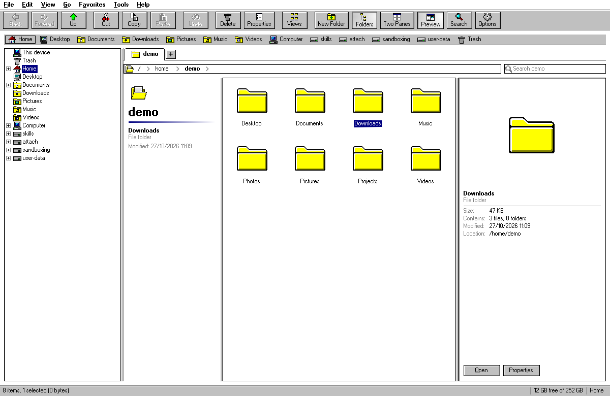


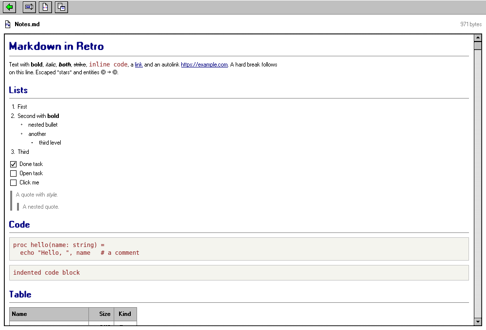

## Maps

A world map for dashboards that needs nothing from the network: the
countries of Natural Earth (public domain) are built in, about 70 KB, and
linked only into apps that use the map.

```nim
var world = MapState()
let ev = mapView(world,
  values = [("OM", 120.0), ("AE", 340.0), ("Saudi Arabia", 210.0)],  # codes or names
  markers = [cityMarker("Muscat"), cityMarker("Dubai")],
  routes = [MapRoute(fromLat: 23.6, fromLon: 58.4, toLat: 51.5, toLon: -0.1)])
if ev.clicked and ev.country >= 0: showCountry(ev.name)
fitTo(world, ["OM", "AE", "SA"])          # or zoomTo, resetView
```

Countries are coloured by value with a legend, markers are dots or bubbles
with labels, routes are great-circle arcs. Drag to move, the wheel, a
double click, + / − or the corner buttons to zoom; the country under the
mouse is lit and named, and a click or a tap reports it. The map is drawn
anti-aliased into a picture of its own only when the view or the colours
change.

## 3D view

A small 3D view drawn by the kit itself — no GPU, no OpenGL, no
libraries — for product viewers, 3D bar charts and simple scenes.

```nim
var scene = Scene3()
discard scene.add box(1, 1, 1, color(0, 0, 160))
discard scene.add loadModel("part.stl")             # or .obj
scene.addGrid(); scene.addAxes()
var cam = camera3()
fitView(scene, cam)
let ev = view3d(scene, cam, height = -1)            # drag turns, Shift+drag moves, wheel zooms
if ev.clicked and ev.picked >= 0: echo scene.meshes[ev.picked].name
var bars = bars3d([@[3.0, 5, 4], @[4.0, 6, 7]], ["2025", "2026"], ["Q1", "Q2", "Q3"])  # a 3D bar chart
discard render3d(scene, cam, 800, 600).savePng("scene.png")
```

Meshes: `box`, `sphere`, `cylinder`, `cone`, `plane`, or `loadObj` /
`loadStl` (text and binary) / `loadModel`; flat or smooth lighting,
outlines, labels. Triangles are filled with a z-buffer at the screen's own
resolution, and only when the scene, the camera or the size changed.

## Canvas

`retro/canvas2d` is the HTML5 Canvas 2D API in Nim — the same names, so
any canvas tutorial or JavaScript drawing code carries over — drawn by
the kit's own anti-aliased rasterizer at the screen's resolution (crisp on
4K screens and phones). No browser, no GPU, no library.

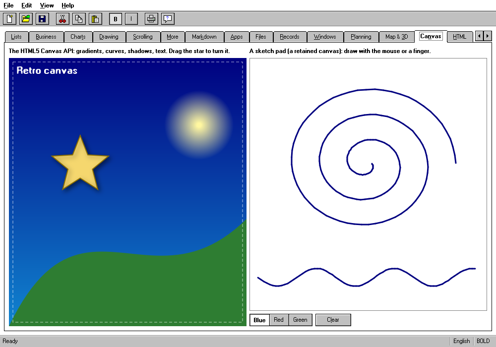

```nim
import retro, std/math
var angle = 0.0
app "Canvas", 420, 320:
  canvas2d(ctx, 400, 280):
    let g = ctx.createLinearGradient(0, 0, 400, 0)
    g.addColorStop(0, "#000080")
    g.addColorStop(1, "#00a0ff")
    ctx.fillStyle = g
    ctx.fillRect(0, 0, 400, 280)
    ctx.translate(200, 140)
    ctx.rotate(angle)
    ctx.fillStyle = "gold"
    ctx.beginPath()
    ctx.arc(0, 0, 60, 0, 2 * PI)
    ctx.fill()
    if ctx.input.down: angle += ctx.input.dx / 100    # drag to turn it
```

- **Paths:** `beginPath`, `moveTo`, `lineTo`, `quadraticCurveTo`,
  `bezierCurveTo`, `arc`, `arcTo`, `ellipse`, `rect`, `roundRect`,
  `closePath`, `Path2D`; `fill` (non-zero or even-odd), `stroke`, `clip`.
- **Style:** colours as CSS strings (`"#c00"`, `"rgba(0,0,0,.5)"`,
  `"gold"`) or `Color`; linear, radial and conic gradients; patterns; line
  width, caps, joins, miter limit, dashes; `globalAlpha`; 16
  `globalCompositeOperation` modes; shadows with blur.
- **Transforms:** `translate`, `rotate`, `scale`, `transform`,
  `setTransform`, `save` / `restore`.
- **Text:** `fillText`, `strokeText`, `measureText`, `font`,
  `textAlign`, `textBaseline` (the built-in Sans, Bold and Mono; Arabic
  is shaped).
- **Pictures:** `drawImage` (any `Bitmap`: loaded PNG / JPEG, another
  canvas), `getImageData`, `putImageData`, `createImageData`.
- **Input:** `ctx.input` has the pointer, buttons, fingers, the wheel and
  keys in the canvas's coordinates; `isPointInPath` / `isPointInStroke`
  tell which shape is under them — for diagrams, games, signature pads.
- **Speed:** immediate mode like the rest of the kit — the canvas is
  drawn again only when what you drew changed; `canvas2dWith(...,
  CanvasOptions(retained: true))` keeps the picture between frames (a
  paint program). `newCanvas2D(w, h)` draws without a window, and
  `savePng` / `toBitmap` take the result (charts for a report, thumbnails
  on a server).

`canvas(w, h)` is the simpler, faster alternative for pixel-exact 3.1
drawing (`fill`, `box`, `line`, `text`, `disc`, `polygon`…).

## Mail

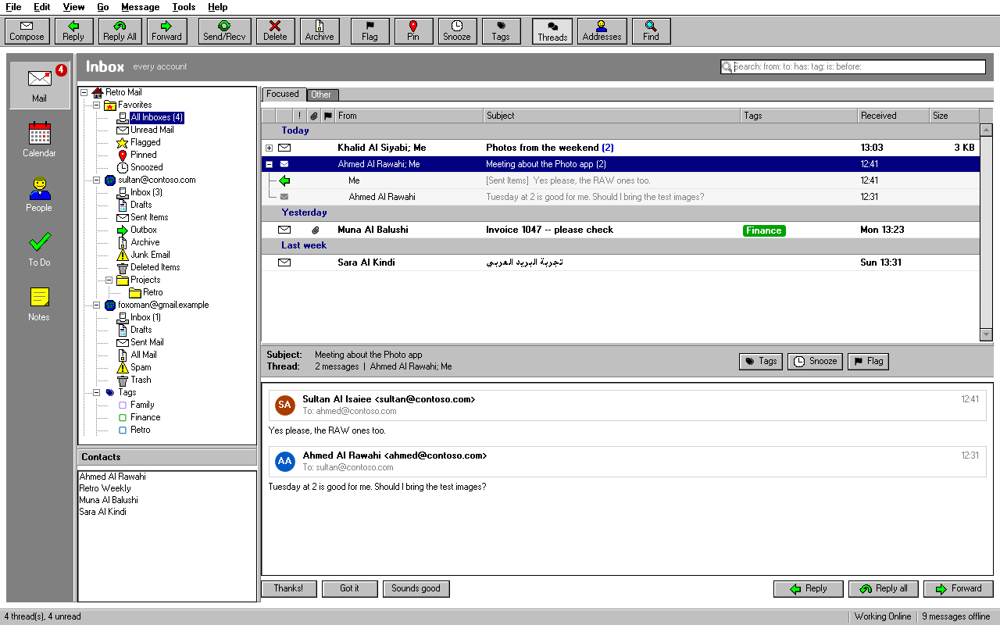

`examples/mail.nim` is **Retro Mail 1.0**: Outlook Express 4 to look at and to
use, with what the new Outlook does, for Microsoft 365, Outlook.com and Gmail.
It is the toolkit's network modules at work:

- `retro/oauth` signs in in the system browser (OAuth 2.0, PKCE, a loopback
  address) and `retro/secrets` keeps the tokens (DPAPI, the keychain,
  libsecret): no password is ever typed into the app.
- `retro/http` talks to Microsoft Graph and the Gmail API from the sync
  thread (WinHTTP, libcurl, Java's HTTP on Android).
- `retro/db` keeps every message in SQLite with a full-text index: search
  is offline and instant; `retro/mime` reads and writes the messages.
- `htmlView` draws the mail -- newsletters' nested tables and styles,
  hidden preheaders, quotes, Arabic -- with no browser and no script;
  pictures from the web wait until asked.
- `retro/richedit` writes it: bold, colors, lists, quotes, links,
  signatures.

Threads with + and - boxes, Focused and Other, tags in their colors,
flags, pin, snooze, quick replies, send later, the calendar, people, to do
and notes; on a phone, swipe a message right to archive it, left to delete
it. Adding an account is one click: Microsoft or Google, the browser opens
its sign-in page, done (`docs/retromail.md`: the app registrations a build
carries, made once).

| | |
|---|---|
| 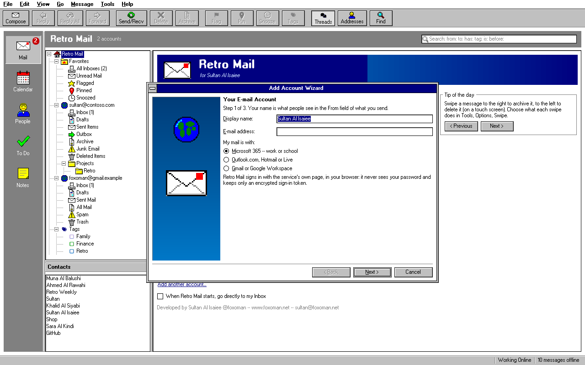 | 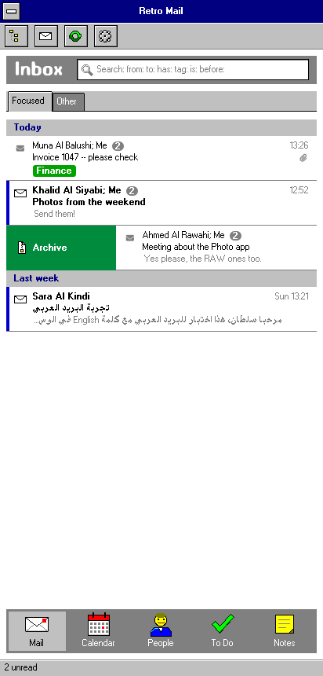 |

## Whiteboard

`retro/board` is a whiteboard's document, in the manner of tldraw: pages
of shapes on an endless canvas, with undo and redo, hit-testing, snapping
and the outlines each shape is drawn with -- at any zoom, on the CPU or the
GPU (`fillContours`). `retro/freehand` is its ink: the outline of a stroke
from a pen, a finger or the mouse, thinner where it was drawn fast or
pressed lightly (real pressure from a pen), tapered if asked, as one
polygon.

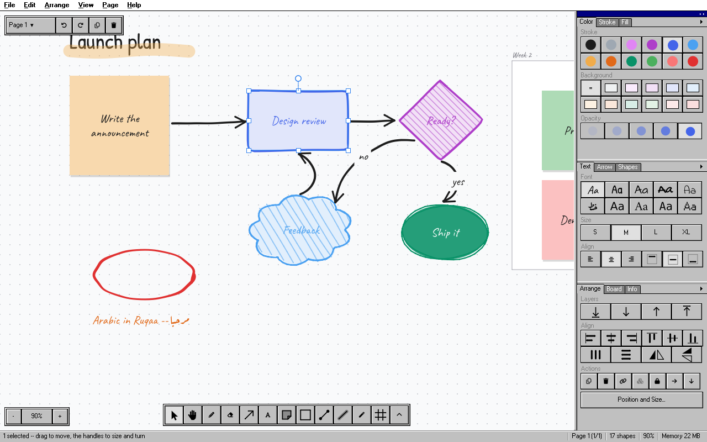

```nim
import retro/board
let b = newBoard()
b.change("Flow"):                       # one step to undo
  let a = b.addShape(b.geoShape(gkRectangle, 0, 0, 200, 120))
  var n = b.noteShape(400, 60, "Ship it")
  let c = b.addShape(n)
  var ar = b.arrowShape(0, 0, 0, 0)     # held by both: it follows them
  ar.t0 = Terminal(bound: a, nx: 0.5, ny: 0.5)
  ar.t1 = Terminal(bound: c, nx: 0.5, ny: 0.5)
  discard b.addShape(ar)
writeFile("flow.png", encodePng(b.renderBitmap([], scale = 2)))
writeFile("flow.svg", b.toSvg([]))
b.saveBoard("flow.board")
```

- **Shapes:** freehand ink and the highlighter; 31 geometric shapes
  (rectangle, rounded, ellipse, diamond, star, cloud, heart, check box,
  cylinder, document, speech bubble, cube, person, lightning, moon,
  arrows…) with labels; arrows that hold on to shapes (to their edge, or a point
  of them), bent, with seven kinds of head and a label; lines through
  points, straight or smooth; text (wrapped or as wide as its words);
  sticky notes; frames; pictures; groups.
- **Styles:** twelve colors (light and dark sets), fill none / semi /
  solid / pattern, hand-drawn / dashed / dotted / solid / sketch lines
  (sketch: each edge drawn twice, loosely, the pattern a quick hatching),
  four sizes, alignment, opacity; ten fonts -- six handwriting fonts the
  module carries (Caveat, Patrick Hand, Architects Daughter, Gochi Hand,
  Indie Flower, and Aref Ruqaa for Arabic; SIL OFL, about 480 KB) and
  Sans, Serif, Mono, Retro. A letter the font lacks is set in another
  (`fontSpans`): Arabic after a handwriting font in Aref Ruqaa.
- **As Excalidraw's options:** a fill color of its own (`fillColor`),
  fills hachure / cross-hatch / zigzag / dots (`fillLines`), sloppiness
  (`roughness`: architect, artist, cartoonist), sharp or round edges
  (`round`, `roundCorners`), straight, curved and elbow arrows (`elbow`,
  `elbowPath`), the canvas's color (`paper`, `paperColors`), links
  (`link`), the next step of a flowchart (`addConnected`), `findText`.
- **Editing:** move, size and turn (about any point, rotated shapes in
  their own frame), flip, align, distribute, order, group, lock, copy and
  paste (`toClipboard`, `pasteShapes`), duplicate; `snapBox` lines edges
  and middles up; `textCaret` / `textIndexAt` for typing in a shape.
- **Memory:** a picture is kept once (`addAsset`), however often it is
  moved or undone; the steps to undo keep at most `undoBudget` bytes, the
  drawings `drawingBudget` (`forgetDrawings` when memory is short).
- **Files:** `.board` (JSON, pictures inside), PNG (`renderBitmap`: any
  scale, transparent or on the canvas's color), SVG and PDF (vectors,
  text as outlines).

`examples/retroboard.nim` is **Retro Board 1.3.1**, a whiteboard app made of
it: the 3.1 title bar on phones and tablets, a status bar (the tool's
hint, page, shapes, zoom, memory), the color schemes and Appearance, a
floating tool bar (select, hand, draw, highlighter, eraser, laser,
shapes, arrow, line, text, note, frame, picture), pages, zoom; Excalidraw's
options in Retro Photo's docked panels (`retro/dock`), tabs grouped by
what they are about -- **Color, Stroke, Fill** (stroke and background
colors, opacity; stroke style, width, sloppiness, edges; hachure,
cross-hatch, zigzag, dots), **Text, Arrow, Shapes** (fonts, size, align;
arrow type and arrowheads; all 31 shapes) and **Arrange, Board, Info**
(layers, align, distribute, flip, actions; pages, the canvas's color,
grid and snap; the memory) -- dragged, floated, folded to icons (on a
phone, a strip of them), hidden with Tab, kept between runs; lines that
hold on to the shapes they are drawn from and to; links opened from
a badge, Ctrl+Arrow for a flowchart's next step, Find, Position and Size,
Stats (with the memory used, and Free Memory), Zen and View modes; pinch to
zoom and two fingers to pan on a phone (the toolkit's
`ui.pinch`, `ui.panDX` / `panDY`); a long press for the menu; the
keyboard shortcuts of tldraw on a desktop; saved as you go. About 2 MB as
an APK (`nimble boardapk`).

| | |
|---|---|
| 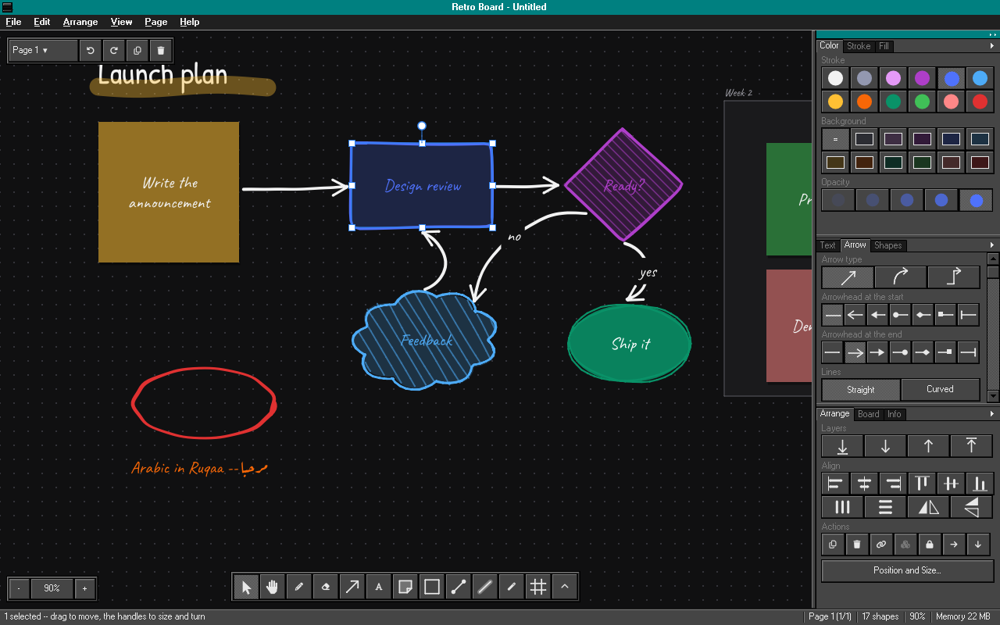 | 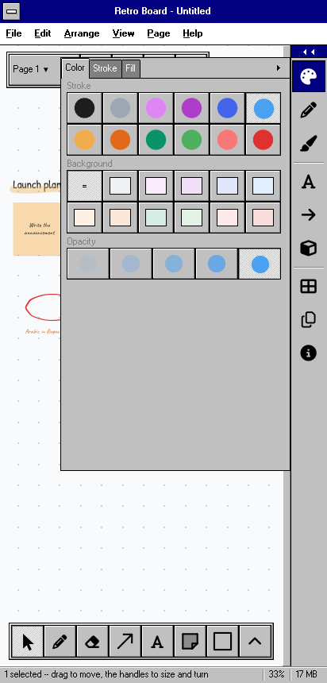 |

## Image editing

`retro/photo` is an image editor's engine: documents of layers (opacity,
29 blend modes from Multiply to Luminosity, Preserve Transparency, the
Background, layer masks, adjustment layers), a soft selection with
feathering, Grow, Border and Smooth,
alpha channels, Quick Mask, Bézier paths, and many undos (only the 64-pixel
tiles a change touched are kept). Its native files (.rpd) keep all of
that; PNG, JPEG and BMP are read and written (`openImage`, `saveFlat`), and
`retro/photofiles` reads and writes PSD and the other formats.
`retro/photopaint` paints on them: soft or hard brushes of any size,
angle and roundness (or cut from the image), the airbrush, pencil,
eraser, rubber stamp, smudge, blur and sharpen, dodge, burn and sponge,
the paint bucket, gradients, lines with arrowheads, type. `retro/photofx`
has over 45 filters (Gaussian Blur, Unsharp Mask, Motion Blur, Twirl,
Shear, Lens Flare, Emboss, Extrude, Crystallize...) and the color
adjustments (Levels, Curves, Color Balance, Hue/Saturation by color range,
Selective Color, Variations, Replace Color...), each with a preview.
`retro/photodevelop` makes a photo's everyday corrections in one go, as
camera raw programs do: white balance, exposure, contrast, highlights,
shadows, whites, blacks, clarity, dehaze, vibrance, saturation, noise
reduction, sharpening, vignette and grain, with Auto and presets; and
Auto Tone / Contrast / Color, Shadows/Highlights, Vibrance, Exposure,
Photo Filter, Black & White and Channel Mixer. `retro/photosmart` has the
smart tools, all worked out on the device: Content-Aware Fill, the
healing tools (Spot Healing, Healing Brush, Patch), red eye, Select
Subject and Select Sky, Content-Aware Scale and enlarging with Preserve
Details. `retro/photowarp` has Liquify, Lens Correction and Straighten.
Type layers stay editable: `retro/textengine` sets styled text in any
font of the system (tracking, kerning, leading, scales, caps, super- and
subscript, underline; paragraphs aligned and justified, indented; Arabic
and other right-to-left text; warps such as Arc, Flag and Fisheye; text
along a path), and `retro/photostyles` gives layers their styles (drop
and inner shadows, glows, bevel and emboss, satin, overlays, strokes).
`retro/photoshapes` makes shape layers (rectangles, rounded rectangles,
ellipses, polygons and stars, lines with arrowheads, 19 custom shapes, any
SVG path; combined, subtracted, intersected; filled with a color or a
gradient and stroked inside, centered or outside, solid or dashed) that
stay sharp at any size, and layers can be clipped to the one under them.
`retro/photofiles` opens and saves PSD documents (.psd and .psb:
layers, groups, masks, vector masks, shapes, clipping, adjustment and fill
layers, layer styles) and exports to JPEG, PNG, PNG-8, GIF, TIFF, Targa
and BMP with their options. `retro/photoinks` models printing inks for
the CMYK mode, Proof Colors and the gamut warning, with Lab and duotones.
Brushes have dynamics (jitter, scattering, flow, color) and symmetry, and
`retro/filterfactory` runs filters written as formulas, kept as plug-ins.
`retro/photowidgets` shows
a document (zoom 1:16 to 16:1, rulers, marching ants; drawn from smaller
copies when zoomed out) and has the editor's controls: the color picker,
the curves and levels editors, brush and swatch grids, layer rows.

All of it runs on every core (`retro/parallel`): a 24 megapixel photo
opens, blurs, sharpens and develops in about a second.

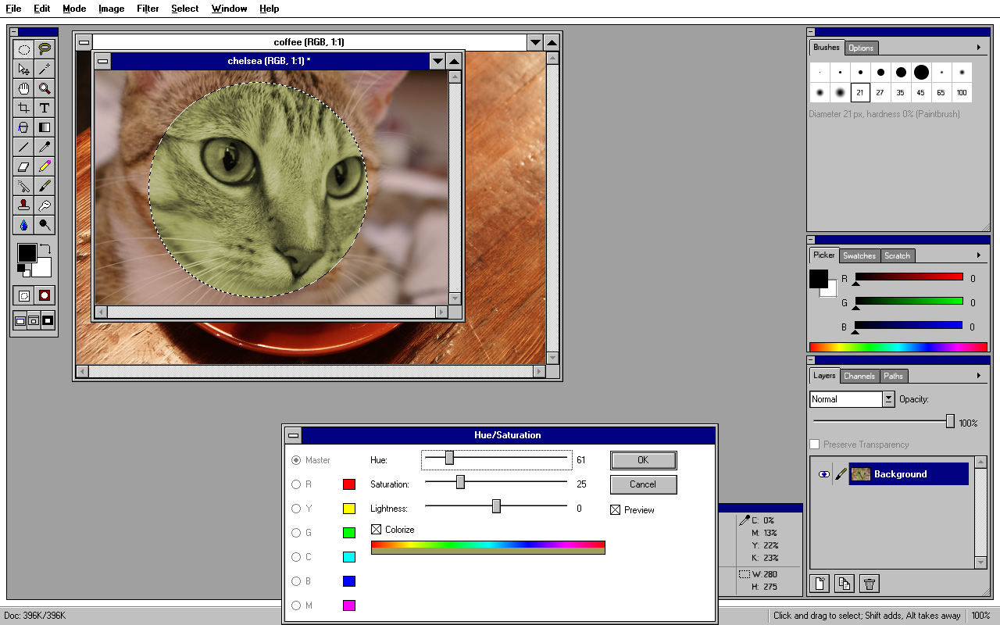

```nim
import retro/[photo, photopaint, photofx, photodevelop]
let d = openImage("cat.png")
d.setSelection(d.ellipseMask(80, 40, 360, 280))
d.feather(8)
d.beginStep("Hue/Saturation")                    # one undo step
d.applyFilter(0, hueSaturation(40, 25, 0, colorize = true))
d.endStep()
d.saveFlat("cat-sepia.jpg", "jpg", 90)

# a dull photo made right: Auto, then a little more of everything
let p = openImage("beach.jpg")
var s = autoDevelop(Img(w: p.w, h: p.h, px: p.layer.px))
s.clarity = 20
s.dehaze = 10
p.applyFilter(developMargin(s), develop(s))
```

`examples/photo.nim` is **Retro Photo 4.9.2**, an image editor in the manner
of the ones of 1994: the toolbox, the tabbed floating palettes (Brushes
and Options; Picker, Swatches and Scratch; Layers, Channels and Paths;
Info; Commands; Navigator, History and Actions; Properties), an options
bar, document windows, every menu of the time and its dialogs -- and
what a photo editor has since: layer groups, Smart Objects and Smart
Filters, Warp and Puppet Warp, the Blur Gallery, Select and Mask,
Content-Aware tools, Photomerge, Merge to HDR, Sky Replacement, actions
and Batch, color profiles, raw photos (DNG), saving in the background.
Since 3.6: documents in tabs, the status bar of today's image editors,
Preferences in pages, today's keys (or 1994's, or your
own), brush presets in folders with Brush Settings and tips from 1 to
5000 pixels, the standard preset files (.aco, .ase, .acv, .alv, .grd,
.pat, .abr), 16 bits a channel, autosave and recovery, recent files and
workspaces. Since 3.7: the canvas and the window drawn by the GPU when
there is one, the transform box on the Move tool (type stays
type), held keys (Space, Ctrl, Alt), Place Into (a picture inside type or
a frame), gradient masks, the Type Mask tool, Remove Background, the Object
Finder, Refine Hair, CMYK/Lab/Bitmap images from New, Color Settings and
Color Libraries (.acb books). Since 3.8: today's toolbar (one column,
grouped tools that open when held, Shift+letter to go through a group, Edit
> Toolbar), the Polygonal Lasso, and big photos that move, transform and
adjust live (the view made from the layers at its own size while dragging).
Since 4.0: the Perspective Crop, Background Eraser, Color Replacement,
Freeform and Curvature pens, Star and Spiral shapes; Illustrator's path
operations (Merge Shape Components, Offset Path, Outline Stroke, Simplify);
Neural Filters; Save Adobe PDF for the web, print or a press (up to 3500
ppi, CMYK, marks and bleed, type and shapes as outlines) and PDF
Presentation; PDF, Illustrator, PostScript and EPS files opened; Arabic set
on the canvas with kashida; Get Google Fonts; documents that come back at
the next start. Since 4.1: a faster engine (composite, open and save about
twice as fast), panels docked as in today's editors (`retro/dock`), documents
as tabs filling the workspace (windows of their own, MDI, as an option), a
status bar under each picture, Adjustment Presets, Clarity, Dehaze and
Grain, Layer Cleanup, Harmonize, Colorize, Content-Aware Expand, artboards,
the Frame tool, the Triangle, the Magnetic Lasso, Dynamic Text, RTL/LTR and
kashida lengths, and the selection tools as today's (a drag inside moves
the outline). Since 4.2: the Filter Gallery (30 filters) with Oil Paint, Lighting
Effects, Fibers, Displace and Smart Sharpen (`retro/photoartistic`), 109
custom shapes in 12 sets with Live Shape properties, the Slice, Note and
Count tools, and the toolbar docked at the left with the panels' header. Since 4.3:
32 Bits/Channel (HDR: Radiance and PFM files, HDR Toning), press-ready PDF
(PDF/X, printer's marks, bleed, type kept as editable text), Arabic
justified by the scribes' kashida rules with the tashkeel kept, text in
columns and flowing between boxes. Since 4.4: 16 bits a channel kept through filters,
adjustments, transforms and the composite; CMYK by any ICC profile; OpenType shaping
(Amiri built in), variable fonts, the OpenType, Character Styles and Paragraph Styles
panels; editable type and Smart Objects in PSD, layered TIFF; WebP, OpenEXR, camera
raw (NEF, ARW, CR2, ORF, RW2, PEF, RAF), HEIC/AVIF, SVG export; the Timeline (frame
animation, animated GIF and WebP); Rotate View, the Art History Brush, Vanishing Point;
scripts (File > Scripts); a pen's pressure and tilt; filters on the GPU; the interface
in Arabic, right to left. Since 4.5: File > New with presets and 23 templates, the
Assets window (free photos, icons, SVG, textures from open sources; the Retro Photo
Library of brushes, patterns, gradients, styles and designs), Quick Actions, Share,
Image Processor, Contact Sheet, Crop and Straighten Photos, Match Color, Focus Area,
Before & After, QR codes, JPEG XL, SVG, CR3, layers composited on the GPU (the
Timeline and video left to the toolkit: `photoanim`, `media`). Since 4.6: pictures too
big to edit whole open as a smaller copy or a part of them (read a band at a time),
JPEG XL written lossy too, Pexels and Unsplash in the Assets window. Since 4.8: the Move
tool as today's editors have it (handles that light up and take the pointer from further away, the
pointer showing what a drag does, a double-click on type to edit it, the layers under the
pointer on a right click, Auto-Select by Layer or Group), Smart Guides, the Selection
Brush, the Adjustment Brush and Content-Aware Tracing (`retro/edgetrace`), floating
images kept on top, the panels' side sized from its edge. Since 4.9: lines with arrowheads and other
ends that stay lines (their ends dragged with the Move tool), Image Size in pixels, percent, inches,
centimeters, millimeters, points or picas with a link for the proportions, Esc letting go of what is
under way, File > Save as PDF. `examples/magazine.nim` makes a three-page magazine with the
engine, tool by tool.

```nim
import retro/[adobefiles, photobrushes]
let swatches = readAco(readFile("Pastels.aco"))         # (name, color) pairs
writeFile("Pastels.ase", writeAse(swatches))
let curves = readAcv(readFile("Contrast.acv"))           # a curve a channel
let presets = defaultPresets()                           # 32 brushes in 4 folders
let pic = strokePreview(presets[0], 200, 40)             # as the Brushes palette shows it
```

```nim
import retro/[photo, photomerge, rawphoto, iccprofile]
let pano = photomerge(@[left, middle, right], amPerspective)   # layers and their blending masks
let hdr = exposureFusion(@[dark, normal, bright])
let raw = readDng(readFile("IMG_0042.dng"))                  # light, white balanced
let img = developRaw(raw, Develop(exposure: 50))             # +0.5 stop, before 8 bits
var px = img.px
convertPixels(px, displayP3Profile(), srgbProfile())
```

```nim
import retro/[webp, gifanim, exr, core, lang_ar]
var frames: seq[tuple[px: seq[uint32]; delayMs: int]]
for (bmp, ms) in decodeWebpFrames(readFile("spin.webp")): frames.add (bmp.px, ms)
writeFile("spin.gif", encodeGifFrames(240, 240, frames))      # an animated GIF
let light = readExr(readFile("sky.exr"))                      # floats, brighter than white
setUiLanguage("ar", @toolkitArabic)                           # the toolkit in Arabic, right to left
```

### Following a tutorial

Retro Photo 4.9 is laid out as today's image editors are, so their tutorials
work step by step, in a 1994 window: the menus have today's names and
places (Image > Adjustments > Curves, Edit > Free Transform, Edit >
Transform > Flip Horizontal, Layer > New > Layer, Select > Modify > Feather,
Filter > Camera Raw Filter, View > Show > Grid), the panels are in Window A
to Z (Adjustments, Brushes, Channels, Character, Clone Source, Color,
Glyphs, Gradients, Histogram, History, Info, Layer Comps, Layers, Navigator,
Paragraph, Paths, Patterns, Properties, Shapes, Styles, Swatches, Tool
Presets), the tools have their names and letters (the Ruler and Straighten
Layer, the Color Sampler, the Magic Eraser among them), the keys are
today's (Ctrl+T, Ctrl+J, Ctrl+Shift+N, Shift+F6, Ctrl+Alt+F...), and Free
Transform keeps the proportions as it has since 2019. **Edit > Search**
(Ctrl+F) finds any command, panel or tool by name; the **Contextual Task
Bar** under the image offers the next steps. With the Retro Photo 1994 key
set (Preferences > Tools) the menus are 1994's.

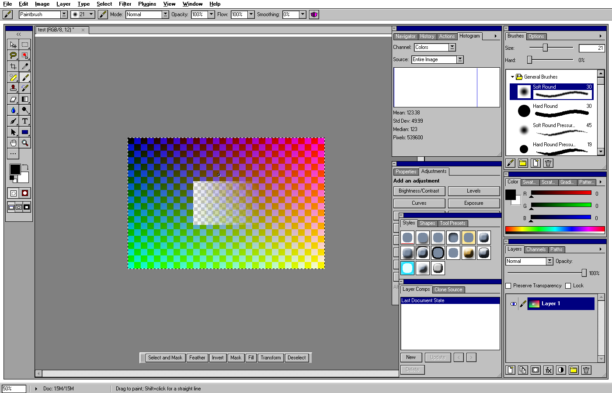

## Web and HTML

```nim
let ev = htmlView(readFile("help/index.html"), baseDir = "help")   # framed, scrolls
if ev.link.len > 0: discard openUrl(ev.link)
htmlBlock "<b>Bold</b> and <span style='color:red'>red</span> in a card"
let w = webView("https://nim-lang.org", key = "docs")   # a real browser page on Android
if button("Back"): webGoBack("docs")
```

`htmlView` shows a safe subset of HTML — headings, paragraphs, bold,
italic, underline, strike, code, marked and coloured text, links, lists,
quotes, preformatted text, tables, pictures next to the page, definition
lists — read by a forgiving parser. Scripts, styles, frames and forms are
left out, so no page can run code or reach the network. `htmlToMarkdown`
converts a page.

`webView` is a web page: on Android the system's WebView (the phone's
browser engine) placed over the widget, with `webGoBack`, `webReload`,
`webClose`; elsewhere local pages (`file://`, paths, `html:` text) are
shown with `htmlView` and pages on the web get a button that opens them in
the browser — the kit carries no browser engine.

### Markdown

```nim
var notes = readFile("README.md")
let ev = markdownView(notes, baseDir = ".")   # framed, scrolls
if ev.link.len > 0: openUrl(ev.link)          # "#heading" links scroll by themselves
if ev.task >= 0: toggleTask(notes, ev.task)   # a "- [ ]" box was clicked
markdown "**Inline** in a card or a page"
```

Headings (ATX and setext), paragraphs, **bold**, *italic*, ~~strike~~,
`code`, links (inline, reference, `<auto>` and bare `www.`), images,
fenced and indented code, block quotes (nested), bullet, numbered and
task lists (nested), tables with alignment, rules, hard breaks, escapes
and entities. Right-to-left paragraphs are aligned right, with Latin
words and numbers kept in their order.

## Sound and video

```nim
let ding = decodeWav(readFile("ding.wav"))       # WAV decoded by the kit
if button("&Ding"): discard playSound(ding)
discard playSound("music.mp3")                    # other formats: the system's player
tone(880, 150)                                    # a sound made on the spot
uiSound(usError)                                  # the toolkit's own sounds
let v = videoView("intro.mp4", height = 240)      # play / pause, position, time
animation(spinner)        # spinner = loadGif(readFile("spinner.gif"))
```

The kit decodes WAV and makes tones itself and plays them through the
system's own audio, loaded only when the first sound plays:

| Platform | WAV, tones | MP3, OGG, AAC… | Video |
|---|---|---|---|
| Linux, BSD, Termux:X11 | PulseAudio or ALSA | GStreamer, when installed | in the window (GStreamer) |
| Windows | waveOut | the system (MCI) | the system's player |
| macOS, iOS | AudioQueue | AVAudioPlayer | the system's player |
| Android | MediaPlayer | MediaPlayer | in the window (VideoView) |

Without a sound device, or a format the system cannot play, sounds are
quietly not heard; nothing waits or crashes.

## The system's own APIs

Retro never stands between an app and its system: `retro/native` reaches
**any** OS API from Nim, with nothing to install and no second language to
write.

```nim
import retro
echo deviceName(), ", ", osVersion(), ", battery ", batteryLevel(), "%"
if systemDarkMode(): ui.theme = Dark
vibrate(40); keepScreenOn(true)

# Any C library, on any system
let lib = nativeLib("libm.so.6")                    # .so, .dll, .dylib, a framework
let cbrt = nativeProc[proc (x: cdouble): cdouble {.cdecl.}](lib, "cbrt")
echo cbrt(27.0)

when defined(android):                              # any Java API, by reflection
  echo javaStatic("android.os.Build", "MODEL")
  echo javaActivity("getPackageName")
when defined(macosx) or defined(ios):               # any Objective-C API
  let info = objcSend(ObjcId, objcClass("NSProcessInfo"), "processInfo")
  echo toNim(objcSend(ObjcId, info, "hostName"))
when defined(windows):                              # Win32 and COM
  echo windowsDocumentsFolder(); taskbarProgress(0.4)
```

| | How |
|---|---|
| any system | `nativeLib`, `nativeProc`: a typed proc of any function in any shared library |
| Android | `javaStatic`, `javaActivity`, `javaCall`, `javaNew`, `javaRelease`, `onUiThread`: any Java API, no JNI or Java to write |
| macOS, iOS | `objcClass`, `sel`, `objcSend`, `nsString`, `toNim`, `autoreleasePool` |
| Windows | typed Win32 helpers and COM (`taskbarProgress`); anything else through `nativeProc` |
| Linux, Termux | `termuxApi` (Termux:API commands), any library through `nativeLib` |
| everywhere | `vibrate`, `deviceName`, `osVersion`, `batteryLevel`, `systemDarkMode`, `beepSystem`, `userName`, `keepScreenOn`, `openSettings` — neutral answers where a system has no such thing; they never raise |

Nim also compiles to C, so `{.importc.}` and C headers work as in any Nim
program; `examples/native.nim` shows each platform.

## Platform services

```nim
let dir = dataDir("myapp")         # a folder the app may write to (any platform)
var s = loadSettings("myapp")       # key = value, saved safely
s.put("theme", 2)
storeAppearance(s)                  # the look the user chose (restoreAppearance)
saveSettings("myapp", s)
openUrl("https://nim-lang.org")     # browser, mail, maps...
openFile(path); shareFile(path)     # the system's app for it; Android's share sheet
for (name, path) in places(): ...   # Home, Documents, Downloads, SD cards, drives
if not storageAccess(): requestStorageAccess()   # Android "All files access"
if isMobile(): ...                  # platformName(): "android", "ios", "windows"...
```

The clipboard works everywhere (`getClipboardText`, `putClipboardText`,
`Ctrl+C`/`Ctrl+V`, `Cmd` on iPad keyboards). `closeRequested()` /
`cancelClose()` catch the window's close button, Alt+F4 and, on Android,
the Back button.

## Android

`retroapk` compiles the app into `libmain.so` for Android's
`NativeActivity` and writes the APK itself: binary manifest, resource
table, icon, zip and APK Signature Scheme v2 signature. The Android side
is one C file in the driver plus a small Java activity that comes already
compiled inside the tool (soft-keyboard text, system-bar colors and
insets, opening and sharing files, decoding pictures, storage access) --
you never need Java or Gradle. The parts that need Android's own
classes come compiled the same way: the web view, sound and video,
printing, and the reflection calls of `retro/native`.

**On the phone or tablet, in Termux:**

```sh
pkg install nim clang ndk-sysroot openssl-tool git
nimble install https://github.com/USER/retro
retroapk ledger.nim --name:Ledger --install    # the installer asks to confirm
```

**On a desktop, with the Android NDK** (set `ANDROID_NDK_HOME`) and `adb`:

```sh
retroapk app.nim --name:"My App" --id:com.me.myapp --run
retroapk app.nim --abi:arm64-v8a,armeabi-v7a,x86_64     # more ABIs
```

Other options: `--icon:icon.png`, `--version:1.2 --code:3`,
`--orientation:portrait`, `--permission:INTERNET`, `--storage` (a file
manager; it may also see Termux), `--query:com.termux` (another app this
one looks for), `--debuggable`, `--key:key.pem --cert:cert.der` (else a debug
key is made once in `~/.retro/android`; keep it: updates must be signed
with the same key). `echo` output goes to `adb logcat -s retro`.

On Android the app gets the touch metrics, the window's real density,
its own navy title bar under a matching status bar, safe margins, the
soft keyboard while a text field has the focus, Back as Esc, pause and
resume.

## iOS

On a Mac with Xcode:

```sh
retroios app.nim --simulator --run                      # in the Simulator
retroios app.nim --sign:"Apple Development: Me (TEAMID)" \
           --profile:dev.mobileprovision --device:"My iPad" --run
```

The driver is UIKit in one Objective-C file: the frame is the view's
layer image, touches and the keyboard (`UIKeyInput`, hardware keys with
Cmd as Ctrl) come in. Without a Mac, `retroios app.nim --sdk:iPhoneOS.sdk`
cross-links an unsigned bundle with `lld`.

## Platforms

| Target | Driver | Build | Checked |
|---|---|---|---|
| Linux / BSD | X11 | `nim c -d:release app.nim` | run, screenshots, tests |
| Windows | GDI | `nim c -d:release --app:gui app.nim` | run under Wine 9 |
| Windows from Linux | GDI | `nim c -d:release -d:mingw --cpu:amd64 --app:gui --passL:-static app.nim` | built |
| macOS | Cocoa | `nim c -d:release app.nim` | not run yet |
| Android 7+ | NativeActivity | `retroapk app.nim` | built, signed, verified with `apksigner` and `aapt`; run on a tablet; driver tested against a simulated Android |
| iOS 14+ | UIKit | `retroios app.nim` | compiled and linked against the iOS 16.5 SDK |
| anywhere | SDL3 | `nim c -d:release -d:sdl3 app.nim` (needs the `sdl3` wrapper package) | built |

## Speed and size

Widgets record small drawing commands, each with a hash. At the end of a
frame the screen is cut into bands 32 pixels high: an unchanged frame
costs no drawing and no driver call at all, and otherwise only the bands
whose commands changed are drawn again and sent to the screen. Glyphs are
rendered once per size and kept; maps, 3D scenes, canvases and report
pages are drawn into pictures of their own only when they change; slow
work (listing folders, decoding pictures) runs on worker threads
(`retro/background`).

Measured on Linux (`nimble bench`, library cost without the OS; a small
2-core cloud machine, so the numbers wander by a third):

| | per frame |
|---|---|
| full redraw, 800×600, ~60 widgets | 0.26 ms |
| nothing changed | 0.05 ms, nothing sent |
| one value changed | 0.17 ms, only its bands drawn and sent |
| 100,000-row grid, tree and chart, full redraw | 0.42 ms |
| scrolling that grid with the wheel | 0.1 ms |
| a folder of 50,000 files: details / icons, full redraw | 0.42 / 0.4 ms |
| ... scrolling it with the wheel | 0.16 / 0.11 ms |

| | once |
|---|---|
| sort 50,000 names naturally | 16 ms |
| decode a 2000×1500 PNG | 65 ms |
| decode a 12 MP JPEG (baseline / progressive) | 330 / 780 ms |
| ... its thumbnail (1/8, the blocks' averages) | 40 ms |
| the world map at a new zoom | 32 ms (then nothing until it changes) |
| a 106-page table report laid out and written as PDF | 0.15–0.3 s |
| 1,000 filled and stroked canvas shapes, 800×600 | 15 ms |

JPEG colours are scaled up smoothly as libjpeg does (within 3 levels of it
on every pixel); on Android and iOS the system decodes pictures.

**Sizes** (Linux x86-64, `retrokit small`: optimized for size and
stripped; the APK holds the arm64 library):

| App | Size |
|---|---|
| `examples/hello.nim` | 0.77 MB |
| `examples/notepad.nim` (with the file dialogs) | 1.1 MB |
| `examples/ledger.nim` (grids, forms, CSV) | 1.1 MB |
| `examples/charts.nim` (Chart Viewer) | 1.2 MB |
| `examples/invoice.nim` (templates, reports, PDF, printing) | 1.4 MB |
| `examples/filemanager.nim` (Retro Files) | 1.6 MB; APK about 1 MB |
| `examples/gallery.nim` (everything: map, 3D, canvas, PDF, HTML, media) | 2.7 MB |

Only what an app calls is linked: an app without the map, the 3D view or
PDF does not carry them. The fonts (Kawkab Mono regular and bold, Retro
Sans with its bitmaps and HD outlines, its Arabic, DejaVu Sans, Bold, Mono
and the Nerd icons) add about 430 KB and the 109 pixel icons 12 KB, all stored compressed and
unpacked when first used.

## Safety

- **Every decoder and parser checks what it reads:** PNG, BMP, JPEG and
  GIF headers, Huffman tables and coefficient ranges, deflate streams, zip
  directories and dates, WAV chunks, CSV, OBJ and STL models, Markdown and
  HTML nesting (deeper than 24 levels is text), report templates. A damaged
  or hostile file is refused with an error, never a crash.
- **Limits on size:** pictures larger than `maxPicturePixels` (120 million)
  are refused, inflating stops at the size the file claims (a "zip bomb"
  cannot use up the memory), models, sounds and templates have limits of
  their own, and zip names that would climb out of their folder ("../")
  are refused.
- **Pages cannot run code:** `htmlView` leaves out scripts, styles, frames
  and forms and never reaches the network; report templates only read the
  data they are given.
- **Fuzzed:** `tests/fuzz/fuzz.nim` feeds hundreds of thousands of damaged
  files to every decoder; `fuzzui.nim` drives the widgets with random
  Unicode (Arabic, marks, bidi controls, broken UTF-8), keys, clicks,
  touches and hostile data — the explorer parts, the grids with every cell
  kind, masks, property and tree grids, MDI windows, find, the planning
  views, the map, the 3D view and HTML; `fuzz_charts`, `fuzz_htmlview`,
  `fuzz_view3d`, `fuzz_media`, `fuzz_canvas2d` and `fuzz_report` do the
  same for their modules. They found real bugs, now fixed and kept as
  tests.
- **Memory checked:** the tests also run under AddressSanitizer
  (`--cc:clang --passC:-fsanitize=address`), without a report.
- **Threads:** work on worker threads never shares state with the UI
  thread except through a locked queue; results are handed over at the
  start of a frame. A file that changes or shrinks while it is shown (a
  log rotated) is read safely.
- **Files written safely:** settings, PDFs and pictures are written to a
  temporary file and moved into place; file jobs leave no half-written
  file when cancelled and never follow links out of a folder they delete.
- **No exceptions out of the UI:** the widgets clamp what they are given
  (negative sizes, NaN, empty lists, a selection past the end) instead of
  raising.

## Tests

The tests swap the screen for a fake driver that plays back scripted
mouse, keyboard and touch input and keeps the pixels, so no window is
needed. `nimble test` runs them all; `nimble fuzz` runs the fuzzers.

| Test | What it checks |
|---|---|
| `test_widgets` | clicks, slide-off, default button, typing and the clipboard, Tab and Space, mnemonics, lists, modal dialogs, pixels, frame skipping, hover (mouse yes, finger no), Back versus Exit |
| `test_business` | dates, number formats, sorting; the grid (selection, multi-select, sorting, editing, resizing, every cell kind, cell colours, record indicator, totals); tree; icon view; calendar and date picker; check list; number fields; auto-complete; splitter; dialogs |
| `test_text` | fonts, kerning, Arabic joining and lam-alef, bidi order, the rasterizer, sizes, rows, `spring`, `adaptive`, forms, page scrolling both ways with the standard scroll bars, Tab scrolling into view, Markdown |
| `test_input` | every kind of input on the widgets that take it: the slide switch, the tab strip, chips, the bottom bar, the menu key, the mouse's side buttons, a tall dialog on a touch screen |
| `test_files` | listings (quick and full), natural sorting, copy / move / delete / zip / unzip jobs with conflicts, links and cancelling, JPEG decoding, big text and hex files, worker threads, thousands of damaged files, zip bombs, names that climb out |
| `test_apps` | settings rows, appearance, avatars, steps, pages, banners, the bottom bar, the folder model, the file list, thumbnails, the preview, text and hex views, properties, file jobs |
| `test_explorer` | drag and drop (mouse, Ctrl, Esc, a finger held then moved), drops and the jobs and undo they lead to, the tab strip, the path bar (clicks on folders, the folder menus, typing, suggestions), names first and then sizes, balloons |
| `test_docfs` | another app's folder through a fake documents provider: "Allow access", listing, reading and writing, renames, every file job in and out of it, undo |
| `test_records` | masked fields (typing, pasting, Arabic digits), the record navigator by mouse and keys, date ranges, the dual list, the property grid, the tree grid, the wizard |
| `test_desktop` | MDI windows (moving, sizing, min / max / restore, the control menu, z order, Ctrl+F6 and Ctrl+F4, cascade and tile, clicks blocked under windows), find and replace, hot keys, the About box |
| `test_charts` | every kind of chart with odd data (empty, NaN, negative, huge), axes, legends, tooltips by mouse and keys, events, CSV reading, PNG export |
| `test_planning` | the kanban board, Gantt, agenda and org chart by mouse, keys and finger; KPI tiles |
| `test_mapview` | the built-in countries, lookups, values, markers, routes, zoom and pan, hits |
| `test_view3d` | meshes, OBJ and STL (text and binary), the camera, picking, rendering |
| `test_htmlview` | the HTML parser, entities, nesting, tables, pictures, links, `htmlToMarkdown`, the web view's fallbacks |
| `test_media` | WAV decoding and encoding, tones, GIF frames, the video and animation widgets without a device |
| `test_native` | loading libraries and functions, the cross-platform calls, neutral answers where there is no such thing |
| `test_photo` | the image engine: blend modes, layers, undo and cancelled steps, the selection and channels, Quick Mask, paths, every painting tool, transforms, color modes, every filter and adjustment, .rpd / PNG / JPEG / BMP files |
| `test_canvas2d` | the Canvas 2D API: paths, fills and strokes, transforms, gradients and patterns, text, pictures, clipping, compositing, against expected pixels |
| `test_pdf`, `test_report` | the PDF writer (structure, fonts, pictures, cross-reference table), templates, HTML reports, page breaks, repeated headers, totals, previews |
| `test_apk` | the APK tool's SHA-256, CRC-32, deflate and PNG |
| `test_board`, `test_boardapp` | the whiteboard: ink, shapes, arrows held by shapes, typing, undo, files, PDF, the memory kept; Retro Board as a program -- its docked panels, Tab, the panels kept between runs, Zen and View mode and the button that leaves them |
| `android_mock/run.sh` | the real Android driver against a fake Android (looper, input queue, window, JNI): frames, taps, keyboard, Arabic text, insets, cancelled touches, keys, rotation, Back |

## Examples

| File | What it is |
|---|---|
| `examples/hello.nim` | the first app above |
| `examples/gallery.nim` | every control, page by page (also an APK: `nimble galleryapk`) |
| `examples/filemanager.nim` | Retro Files: an Explorer-class file manager (also an APK: `nimble apk`) |
| `examples/ledger.nim` | a small accounting app: grids, forms, CSV, reports |
| `examples/notepad.nim` | a 3.1 Notepad: open, save, cut / copy / paste, time and date, find, "Save changes?" |
| `examples/charts.nim` | Chart Viewer: open a CSV, pick a chart, save a PNG |
| `examples/invoice.nim` | an invoice from an HTML template: preview, PDF, print |
| `examples/native.nim` | calling the system's own APIs on each platform |
| `examples/photo.nim` | Retro Photo 4: an image editor of 1994 laid out as today's image editors -- layers and groups, Smart Objects, 62 tools, filters, Neural Filters, PDF for print, Arabic type, panoramas, raw photos |
| `examples/magazine.nim` | a three-page magazine made with Retro Photo's engine, tool by tool, saved as .rpd and PDF |
| `examples/retroboard.nim` | Retro Board: a whiteboard in the manner of tldraw -- ink, shapes, arrows, notes, frames, pages; PNG, SVG and PDF (also an APK: `nimble boardapk`) |

| | |
|---|---|
| 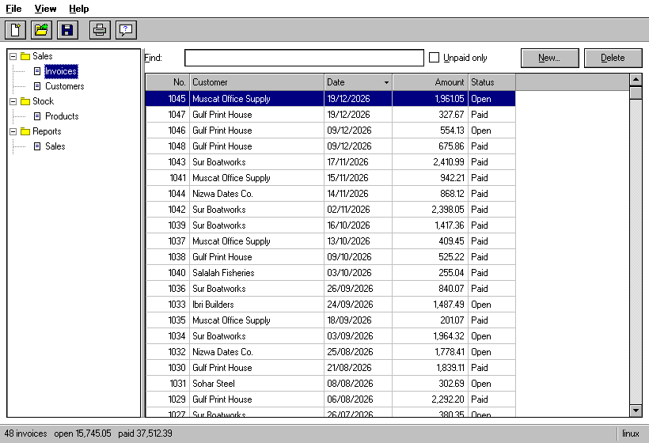 | 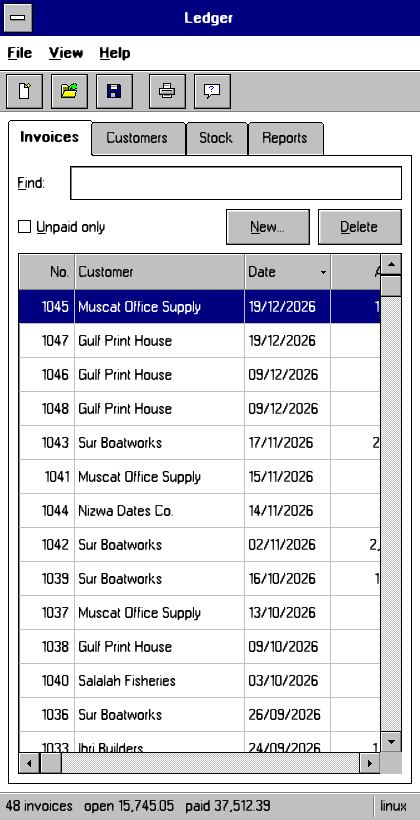 |
| 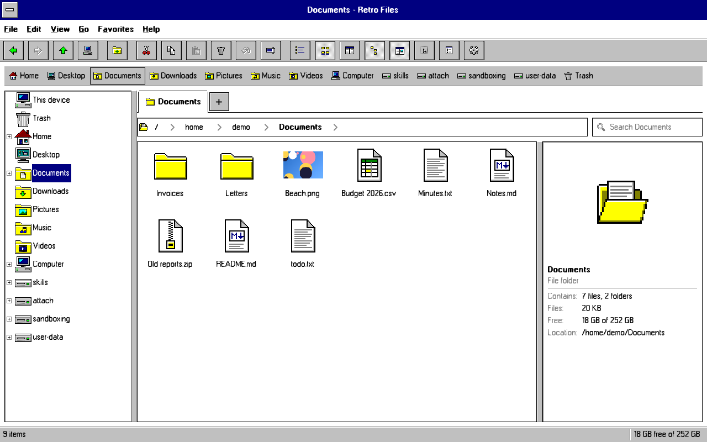 | 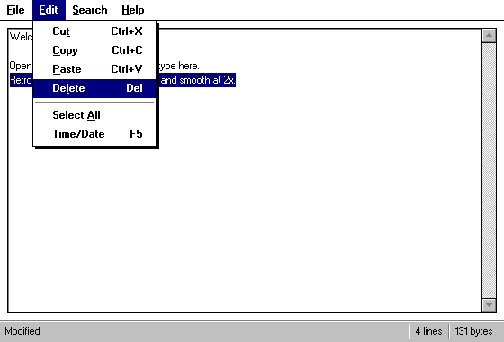 |

## FAQ

**Why Windows 3.1?**
Because its controls are the clearest ever made for business work: every
control looks like what it does, data is dense, the keyboard reaches
everything, and nothing moves for no reason. It is also cheap to draw,
which is why Retro is small and fast. Everything else is modern: touch,
high-DPI screens, Arabic text, phones, threads.

**Can it look less retro?**
Yes. `ui.theme` takes one of eight colour schemes or your own `Theme`;
`setUiFont(ufSmooth)` trades Kawkab Mono for DejaVu Sans (`ufRetro`:
the 3.1 font);
`retroIcons = false` uses the Nerd Fonts icons; `appearanceSettings()`
gives users the choices. Cards, banners, chips, bottom bars, floating
buttons and switches are there for app-style screens.

**Does the 3.1 look hold up on a 4K screen or a phone?**
Yes. Lines and bevels stay whole pixels (2x, 3x), Kawkab Mono's stems
and advances are fitted to the screen's pixels at every scale, Retro Sans
switches from its bitmaps to smoothed outlines of the same letters, and the pixel
icons are scaled by whole pixels. On touch screens the controls get
finger-sized, lists and pages scroll with momentum, and the layout folds
into one column (`adaptive`, `isCompact`).

**Can I use the font in my other programs?**
Yes: `src/retro/fonts/RetroSans*.ttf` are ordinary TrueType files under
CC BY-SA 3.0 (credit lou and Retro Sans; share changes to the font under
the same licence). Using the font in an app does not put the app under
that licence.

**What do my users need to install?**
Nothing. The app is one file (an `.exe`, a binary, an `.app`, an `.apk`).
On Linux it needs an X server (or XWayland, or Termux:X11), which every
desktop has; sound and video use the system's audio and, for compressed
formats, GStreamer when it is there.

**How big is an app?**
Under a megabyte for "hello" (`retrokit small`), 1.6 MB for a full
file manager, about 1 MB as an APK. Only what the app calls is linked:
an app without the map does not carry the map.

**Is drawing every frame slow, or bad for the battery?**
No. A frame runs only when something happened (input, a timer you asked
for with `wakeIn`, finished background work); an unchanged frame is not
drawn or sent; a changed one redraws only the bands that changed. An idle
app uses no CPU.

**Where do widget ids come from? What about lists of rows?**
From the variable a widget is bound to, or its label. When the same
widgets repeat (a row per record), wrap each in `withId(record.id): ...`
or `pushId(i)` / `popId()`.

**How do I show data from a database or a server?**
Retro is the UI only, so any Nim library works: `db_connector` for SQLite,
PostgreSQL or MySQL, `std/httpclient` for web services, `std/json`. The
grid asks for each cell through a proc, so it can show a query's rows
without copying them; slow work goes to a thread with `retro/background`
and comes back to the UI at the next frame.

**How do I make a report, a PDF or print?**
Write the report as HTML with `{{name}}` fields and `{{#items}}` loops
(Mustache style), or as Nim code; `retro/report` lays it out in pages (headers, footers, totals,
page numbers), shows a preview, saves a PDF and prints. See
[Reports](#reports-pdf-and-printing).

**Can I call something the toolkit does not wrap?**
Yes, always. `retro/native` loads any library and calls any Java (Android)
or Objective-C (macOS, iOS) API by reflection; Nim's `{.importc.}` works
as in any Nim program. See [The system's own APIs](#the-systems-own-apis).

**Does it work with right-to-left languages?**
Arabic, Persian and Urdu are shaped (joined letters, lam-alef) and laid out
right to left, mixed with Latin words and numbers in the right order, in
labels, fields, lists, Markdown, HTML, charts and PDFs.

**How do I try a phone layout on my desktop?**
`RETRO_SIZE=420x840 RETRO_TOUCH=1 RETRO_CAPTION=1 ./myapp`: a phone-sized
window with touch metrics and the phone title bar. `isCompact()` and
`responsive(1, 2, 3)` adapt the layout.

**Can I have more than one window?**
One top-level window per app; dialogs, popups and MDI windows
(`mdiArea`) live inside it, as in 3.1's Program Manager. On phones there
is only one window anyway.

**Does it support screen readers?**
Not yet. Everything works from the keyboard, with a visible focus, and
users can enlarge the UI or the text and pick the high-contrast Paper
scheme.

**Can I use it commercially?**
Yes: MIT, and the included fonts and data allow it (see
[License](#license)).

**Is the API stable?**
It is 0.x: names may still change between versions, and the CHANGELOG
says how.

## Limits

- Not run on a real phone in this release: Android was run on a tablet
  before; the Android parts new since 0.7 (the web view, sound and video,
  printing, the Java calls, the new look and font) build into the APKs and
  pass the desktop-side tests, and Termux's files are tested against a
  fake documents provider, but none of them has run on a device yet. iOS compiles and links but has
  not been run on a device or the Simulator.
- No screen reader support yet (everything works from the keyboard).
- Text shaping covers Latin, Greek, Cyrillic and Arabic (with Persian and
  Urdu letters); marks are placed without the font's positioning tables.
  Other scripts use the platform's text where it has one.
- `webView` is a real browser only on Android (elsewhere it shows local
  HTML and opens web pages in the browser); `htmlView` is a subset of HTML
  without CSS layout or scripts.
- Video plays in the window on Linux (with GStreamer) and Android; on
  Windows and macOS it opens in the system's player.
- One window per app (dialogs and MDI windows are inside it).
- Retro Photo: no Rotate View, 32-bit or Multichannel modes, or Generative
  Fill. PostScript and EPS files open by the picture they hold (or their
  preview): there is no PostScript interpreter. Get Google Fonts has not
  been tried against the live catalog in this release (only against saved
  copies of its answers).
- Retro Files: no List view (column-wise small icons) and no Paste Shortcut;
  sounds play from the start, without seeking, where neither GStreamer nor
  Android plays them (Windows and macOS use the system's sound playing).

## License

MIT; see `LICENSE`. Included: uirelays (MIT) -- with my changes, the same
code as the `uirelays` branch, which is upstream's history and my commits on
top, ready for a pull request (`src/retro/uirelays/RETRO.md`); **Kawkab Mono** by Abdullah
Arif, with the Latin of Adobe's Source Code Pro (SIL OFL 1.1,
`src/retro/fonts/LICENSE-KawkabMono.txt`); **Retro Sans**, adapted from
lou's MS Sans Serif recreations (CC BY-SA 3.0,
`src/retro/fonts/LICENSE-RetroSans.txt`; the licence covers the font, not
the apps that use it); the Arabic glyphs of GNU Unifont (SIL OFL 1.1,
`src/retro/fonts/LICENSE-Unifont.txt`); the DejaVu fonts (Bitstream Vera
license, `src/retro/fonts/LICENSE-DejaVu.txt`); the Nerd Fonts symbols
(MIT and SIL OFL, `src/retro/fonts/LICENSE-NerdFonts.txt`); the countries
of Natural Earth (public domain, `src/retro/fonts/LICENSE-NaturalEarth.txt`);
the handwriting fonts of `retro/board` -- Caveat, Patrick Hand, Architects
Daughter, Gochi Hand, Indie Flower and Aref Ruqaa (SIL OFL 1.1,
`src/retro/fonts/hand/OFL-*.txt`).
The look follows Windows 3.1 as recreated by the Win31 project of
Wiesław Šoltés (MIT); no Microsoft code, fonts or pictures are included,
and the pixel icons are original, drawn in the manner of the period.
`tools/genretro.py`, `tools/genfonts.py`, `tools/genunifont.py`,
`tools/genicons.py` and `tools/genworld.py` rebuild the fonts, the icons
and the map.

## Developer

Retro Nim UI, Retro Photo, Retro Files and the examples are developed by
**Sultan Al Isaiee (@foxoman)** -- [www.foxoman.net](https://www.foxoman.net),
[sultan@foxoman.net](mailto:sultan@foxoman.net). Every app made with the kit
says so in its About box (`RetroCredit`, `RetroWebsite`, `RetroEmail` in
`retro/core`).
