# Controls

Every control of Retro Nim UI: what it does, how to call it, and how it looks in
its states. The pictures are drawn by `tools/shots.nim` from the example code
shown with each control (headless, with the built-in fonts), so they always
match the toolkit. `nim c -r -d:release tools/shots.nim` makes them again.

Every control works with the mouse, the keyboard (Tab, arrows, Space, Enter,
Esc, `&` mnemonics, the menu key) and fingers (tap, drag to scroll, long press
for the menu). "Disabled" pictures pass `enabled = false`.

**Contents:** [Text](#text) · [Buttons](#buttons) · [Choices](#choices) · [Text input](#text-input) · [Numbers, dates, colors](#numbers-dates-colors) · [Lists](#lists) · [Progress and status](#progress-and-status) · [Containers](#containers) · [Menus and bars](#menus-and-bars) · [Dialogs](#dialogs) · [App parts](#app-parts) · [Files](#files) · [Charts](#charts) · [Planning and dashboards](#planning-and-dashboards) · [Maps and 3D](#maps-and-3d) · [HTML and Markdown](#html-and-markdown) · [Canvas and reports](#canvas-and-reports) · [Sound and video](#sound-and-video)

## Text

### label, paragraph, heading

```nim
proc label*(s: string; bold = false; color = Color(); enabled = true)
```

Static text; '\n' starts a new line, '&' underlines the next letter
(Alt + that letter moves the focus to the control after the label, as
in a 3.1 dialog).
Wider than the room it is in (a narrow dialog, a phone), it wraps, as
a 3.1 static text does.

```nim
proc paragraph*(s: string; w = 0; color = Color())
```

Word-wrapped text as wide as the space it is in (or `w`).

```nim
proc heading*(s: string; level = 1; color = Color())
```

A title in large bold text (level 1 largest .. 4).

Example:

```nim
heading("Quarterly report", 2)
label "&Name: (a label with a mnemonic)"
paragraph("A paragraph wraps to the room it has, as 3.1\'s static text did.")
```

| Normal | Touch screen | Dark scheme |
|---|---|---|
| 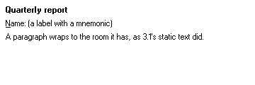 | 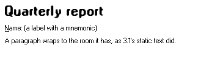 | 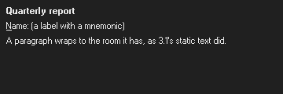 |

### styledText, link, badge

```nim
proc styledText*(s: string; st: TextStyle; color = Color())
```

One line of text in any style (`style(italic = true, size = 1.2)`).

```nim
proc link*(caption: string; enabled = true): bool {.discardable.}
```

Underlined clickable text; true when clicked (or Enter/Space).

```nim
proc badge*(s: string; bg = color(200, 0, 0); fg = color(255, 255, 255))
```

A small rounded count or status label ("3", "NEW").

Example:

```nim
styledText("Bold, italic and mono", style(bold = true))
styledText("Italic, underlined", style(italic = true, underline = true))
row:
  if link("Open the website"):
    discard
  badge("3")
  badge("NEW", color(0, 128, 0))
```

| Normal | Touch screen | Dark scheme |
|---|---|---|
| 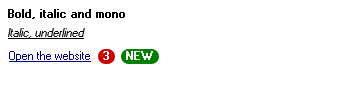 | 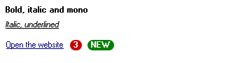 | 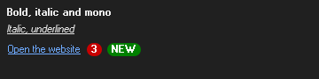 |

### icon, iconLabel (pixel icons and Nerd icons)

```nim
proc icon*(rows: openArray[string]): Icon
```

Pixel art in the 16 VGA colors: k black, w white, s silver, g gray,
r red, m maroon, y yellow, o olive, l lime, G green, c cyan, t teal,
b blue, n navy, p pink, P purple; '.' is transparent.

```nim
proc icon*(glyph: string; color = Color(); size = 1.0): Rect {.discardable.}
```

An icon of the icon font (`nfStar`...) as a widget, `size` times the
text size; returns where it is.

```nim
proc iconLabel*(glyph, s: string; color = Color(); iconColor = Color();
                bold = false)
```

An icon followed by a label: `iconLabel(nfFolder, "Documents")`.

Example:

```nim
row:
  for g in [pxFolder, pxComputer, pxTrashFull, pxWarning, pxPrint, pxSave]:
    icon(g, size = 2.0)
iconLabel(pxDocuments, "Documents")
iconLabel(nfGithub, "Nerd Fonts icons too", iconColor = color(0, 0, 128))
```

| Normal | Touch screen | Dark scheme |
|---|---|---|
| 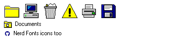 | 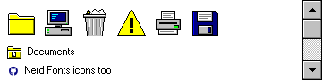 | 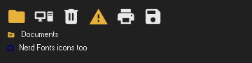 |

## Buttons

### button

```nim
proc button*(label: string; isDefault = false; enabled = true;
             w = 0): bool {.discardable.}
```

A push button; true when clicked. `isDefault` = Enter clicks it.

```nim
proc button*(label: string; pic: ButtonPic; look = blTextBeside; isDefault = false;
             enabled = true; w = 0; h = 0): bool {.discardable.}
```

A push button with a picture: icon only (the label its tooltip), text
only, the text below the icon, or beside it. True when clicked.

```nim
proc button*(label: string; glyph: string; look = blTextBeside; isDefault = false;
             enabled = true; w = 0; h = 0): bool {.discardable.}
```

`button` with a glyph of the icon font as its picture (`pxSave`,
`nfCopy`...).

Example:

```nim
row:
  if button("&OK", isDefault = true):
    inc okClicks
  button("Cancel")
```

| Normal | Keyboard focus | Mouse over | Pressed | Disabled | Touch screen | Dark scheme |
|---|---|---|---|---|---|---|
| 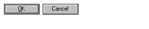 | 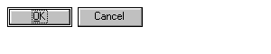 | 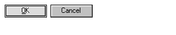 | 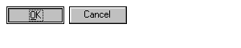 | 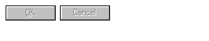 | 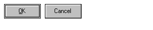 | 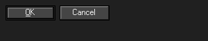 |

### toolbar, toolButton, toolSeparator

```nim
template toolbar*(body: untyped)
```

A bar of tool buttons below the menu bar.

```nim
proc toolButton*(ic: Icon; tip = ""; down = false;
                 enabled = true): bool {.discardable.}
```

A tool bar button with a 16x16 icon. `down` shows it pressed in.

```nim
proc toolButton*(caption: string; tip = ""; down = false; bold = false;
                 enabled = true; size = 1.0): bool {.discardable.}
```

A tool bar button showing a short text, or an icon of the icon font
(`toolButton(nfCopy, "Copy", size = 1.3)`).

```nim
proc toolSeparator*()
```

A gap between groups of tool buttons.

Example:

```nim
toolbar:
  toolButton(pxNew, "New")
  toolButton(pxOpen, "Open")
  toolButton(pxSave, "Save")
  toolSeparator()
  toolButton(pxCut, "Cut")
  toolButton(pxCopy, "Copy")
  toolButton(pxPaste, "Paste", down = true)
```

| Normal | Mouse over | Pressed | Touch screen | Dark scheme |
|---|---|---|---|---|
| 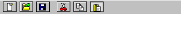 | 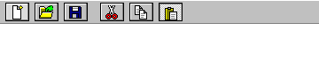 | 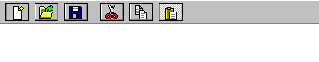 | 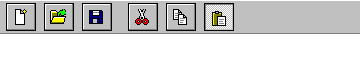 | 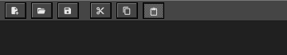 |

### segmented

```nim
proc segmented*(options: openArray[string]; sel: var int; w = 0;
                enabled = true): bool {.discardable.}
```

Buttons joined in a row, one of them pressed in: a choice of a few.
A click or a tap picks one; Left, Right, Home and End move the choice;
Alt + a letter picks that one.

Example:

```nim
segmented(["Day", "Week", "Month"], view2)
```

| Normal | Keyboard focus | Pressed | Disabled | Touch screen | Dark scheme |
|---|---|---|---|---|---|
| 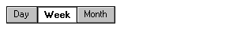 | 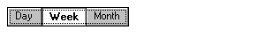 |  | 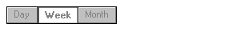 | 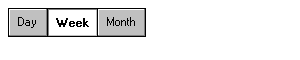 | 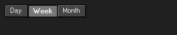 |

## Choices

### checkbox

```nim
proc checkbox*(label: string; v: var bool; enabled = true): bool {.discardable.}
```

A check box bound to `v`; true when toggled.

Example:

```nim
checkbox("&Auto save", autoSave)
checkbox("Keep &backups", backups)
```

| Normal | Keyboard focus | Pressed | Disabled | Touch screen | Dark scheme |
|---|---|---|---|---|---|
| 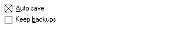 | 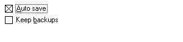 | 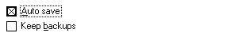 | 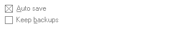 | 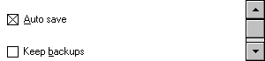 | 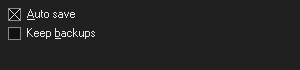 |

### radio

```nim
proc radio*(label: string; v: var int; value: int;
            enabled = true): bool {.discardable.}
```

One option of a group: selected when `v == value`; true when chosen.
The options sharing `v` are a group: the arrow keys move the choice
(and the focus) between them, as in 3.1.

Example:

```nim
radio("&Small", size, 0)
radio("&Medium", size, 1)
radio("&Large", size, 2)
```

| Normal | Keyboard focus | Pressed | Disabled | Touch screen | Dark scheme |
|---|---|---|---|---|---|
| 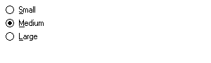 | 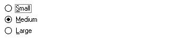 | 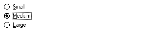 | 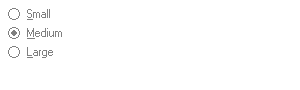 | 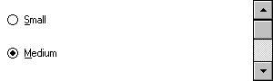 | 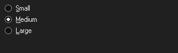 |

### toggle (a 3.1 slide switch)

```nim
proc toggle*(label: string; v: var bool; enabled = true): bool {.discardable.}
```

An on/off slide switch with a label; true when flipped. Click, tap or
slide it; Space, Left and Right with the focus; Alt + its letter.

```nim
proc switchSize*(): tuple[w, h: int]
```

The size of a switch's slot (bigger on touch screens).

Example:

```nim
toggle("&Wi-Fi", wifi)
```

| Normal | Keyboard focus | Pressed | Disabled | Touch screen | Dark scheme |
|---|---|---|---|---|---|
| 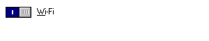 | 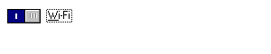 | 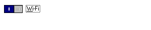 | 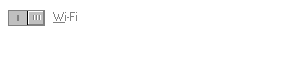 |  | 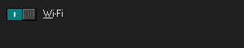 |

### chips

```nim
proc chips*(items: openArray[string]; selected: openArray[bool] = [];
            closable = false; enabled = true): ChipEvent {.discardable.}
```

Rounded tags in a row that wraps: filters, labels, recipients. One
stop for Tab: Left / Right move between them, Space or Enter clicks
one, Delete closes it (`closable`).

Example:

```nim
let ev = chips(tags, tagOn, closable = true)
if ev.clicked >= 0:
  tagOn[ev.clicked] = not tagOn[ev.clicked]
```

| Normal | Keyboard focus | Mouse over | Touch screen | Dark scheme |
|---|---|---|---|---|
| 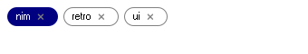 | 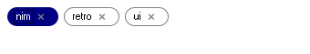 | 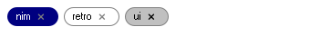 | 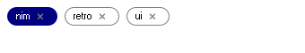 | 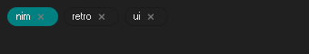 |

### rating

```nim
proc rating*(v: var int; stars = 5; enabled = true): bool {.discardable.}
```

Stars to click or tap, 0..`stars`; clicking the current one clears it.
With the focus: Left / Right one star less / more, Home none, End all.

Example:

```nim
rating(stars)
```

| Normal | Keyboard focus | Mouse over | Pressed | Disabled | Touch screen | Dark scheme |
|---|---|---|---|---|---|---|
|  | 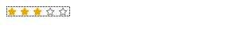 | 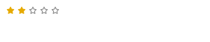 |  |  |  |  |

## Text input

### edit

```nim
proc edit*(s: var string; w = 0; password = false;
           enabled = true): bool {.discardable.}
```

A one-line text box bound to `s`; true when the text changed.

Example:

```nim
form 0:
  field "&Name:":
    edit(name)
  field "&Password:":
    edit(secret, password = true)
```

| Normal | Keyboard focus | Disabled | Touch screen | Dark scheme |
|---|---|---|---|---|
|  |  |  |  |  |

### editArea

```nim
proc editArea*(s: var string; lines = 6; w = 0;
               enabled = true; wrap = true): bool {.discardable.}
```

A multi-line text box with a scroll bar. `lines` < 0 fills the
height left in the window. Long lines wrap at the words (`wrap`
false: they scroll sideways).

Example:

```nim
editArea(notes, lines = 4)
```

| Normal | Keyboard focus | Disabled | Touch screen | Dark scheme |
|---|---|---|---|---|
|  |  |  |  |  |

### searchBox

```nim
proc searchBox*(s: var string; placeholder = "Search"; w = 0;
                enabled = true): bool {.discardable.}
```

A text box with a magnifier and a clear button; true when the text
changed. Esc clears it.

Example:

```nim
searchBox(query, "Search invoices")
```

| Normal | Keyboard focus | Disabled | Touch screen | Dark scheme |
|---|---|---|---|---|
|  |  |  |  |  |

### maskedEdit

```nim
proc maskedEdit*(value: var string; mask: string; w = 0;
                 enabled = true): bool {.discardable.}
```

A field typed into `mask` (see `maskFormat`): the literals are there
already, the caret jumps over them, only what a slot takes goes in
(Arabic-Indic digits become digits). `value` holds the characters
typed, without the literals (`maskFormat` shows them, `maskFull`
tells when it is complete). Left, Right, Home, End, Backspace,
Delete, Ctrl+C / Ctrl+V. True when `value` changed.

```nim
proc maskFormat*(value, mask: string; blank = '_'): string
```

`value` (the characters typed) laid into `mask`:
`maskFormat("96891234567", "+### #### ####")` is "+968 9123 4567";
slots not typed yet show `blank`. Mask characters: `#` or `9` a
digit, `A` a letter, `U` a letter made upper case, `L` lower case,
`X` a letter or digit, `*` any; ``\`` takes the next one as it is; the
rest is shown as it is.

```nim
proc maskFull*(value, mask: string): bool
```

Every slot of `mask` is typed, each with what it takes.

```nim
proc maskRaw*(text, mask: string): string
```

The characters typed, from a text laid out like `mask` (or typed
loosely: what does not fit the next slot is skipped).

Example:

```nim
row:
  label "&Phone:"
  maskedEdit(phone, "+### #### ####")
```

| Normal | Keyboard focus | Disabled | Touch screen | Dark scheme |
|---|---|---|---|---|
|  |  |  |  |  |

### comboEdit (suggests as you type)

```nim
proc comboEdit*(text: var string; items: openArray[string]; w = 0;
                enabled = true): bool {.discardable.}
```

A text field that suggests matching `items` as you type (or lists
them all from its button). Up/Down, Enter, Esc work in the list; none
is picked until Down (or the mouse) points at one, so Enter on its own
keeps what was typed.

Example:

```nim
comboEdit(city, ["Berlin", "Bern", "Beirut", "Muscat", "Sohar"], w = 180,
          )
```

| Normal | Clicked / open | Touch screen | Dark scheme |
|---|---|---|---|
|  |  |  |  |

### hotkeyEdit

```nim
proc hotkeyEdit*(keys: var string; w = 0; enabled = true): bool {.discardable.}
```

A box that takes the next key pressed, with its Ctrl, Alt and Shift,
as a shortcut ("Ctrl+Shift+S"); Backspace or Delete alone clears it,
Tab and Esc leave it. True when it changed.

```nim
proc hotkeyText*(key: KeyCode; mods: set[Modifier]): string
```

"Ctrl+Shift+S" for Ctrl + Shift + S.

```nim
proc parseHotkey*(s: string): tuple[key: KeyCode; mods: set[Modifier]]
```

"Ctrl+Shift+S" -> (KeyS, {CtrlPressed, ShiftPressed}); KeyNone when it
is not a shortcut.

```nim
proc hotkeyPressed*(s: string): bool
```

The shortcut `s` ("Ctrl+S") was pressed this frame (and not used yet);
uses it.

Example:

```nim
row:
  label "&Save as:"
  hotkeyEdit(hotkey)
```

| Normal | Keyboard focus | Disabled | Touch screen | Dark scheme |
|---|---|---|---|---|
|  |  |  |  |  |

## Numbers, dates, colors

### spin, intEdit, numberEdit

```nim
proc spin*(v: var int; lo, hi: int; w = 80; step = 1;
           enabled = true): bool {.discardable.}
```

A number box with up and down arrows bound to `v` in `lo..hi`: type a
number, click or hold the arrows, or with the focus Up / Down (`step`),
Page Up / Page Down (ten steps) and the wheel.

```nim
proc intEdit*(v: var int; w = 80; lo = low(int); hi = high(int);
              thousands = false; enabled = true): bool {.discardable.}
```

A right-aligned whole-number field.
Only whole numbers from `lo` to `hi` are taken (true when `v` changed).

```nim
proc numberEdit*(v: var float; decimals = 2; w = 110; lo = NegInf;
                 hi = Inf; thousands = true;
                 enabled = true): bool {.discardable.}
```

A right-aligned number field; shows `decimals` places (0 to 12) and
thousands separators when it does not have the focus. Only numbers
from `lo` to `hi` are taken (true when `v` changed).

Example:

```nim
form 0:
  field "&Copies:":
    spin(copies, 1, 99)
  field "&Quantity:":
    intEdit(qty)
  field "&Amount:":
    numberEdit(amount)
```

| Normal | Keyboard focus | Disabled | Touch screen | Dark scheme |
|---|---|---|---|---|
|  |  |  |  |  |

### slider, progress

```nim
proc slider*(v: var int; lo, hi: int; w = 0; ticks = 10;
             enabled = true): bool {.discardable.}
```

A track bar bound to `v` in `lo..hi`; arrows, PgUp/PgDn, Home/End.
On touch screens the thumb is large enough for a finger.

```nim
proc progress*(value: float; w = 0; showText = true)
```

A progress bar, `value` from 0.0 to 1.0, with the percentage.

```nim
proc progress*(t: TextFile): float
```

How much of the file has been looked at (0..1).

Example:

```nim
slider(volume, 0, 100)
progress(0.62)
```

| Normal | Keyboard focus | Pressed | Disabled | Touch screen | Dark scheme |
|---|---|---|---|---|---|
|  |  |  |  |  |  |

### datePicker

```nim
proc datePicker*(d: var Date; w = 0; enabled = true): bool {.discardable.}
```

A date field (typed in `dateStyle`) with a drop-down calendar (its
button, Alt+Down or F4). With the focus, Up / Down move a day and
Page Up / Page Down a month.

Example:

```nim
datePicker(day)
```

| Normal | Keyboard focus | Clicked / open | Disabled | Touch screen | Dark scheme |
|---|---|---|---|---|---|
|  |  |  |  |  |  |

### calendar

```nim
proc calendar*(d: var Date; enabled = true): bool {.discardable.}
```

A month calendar bound to `d`: click or tap a day; the arrows move a
day or a week, Page Up / Page Down a month, Home / End the first /
last day; the wheel and the < > buttons show other months.

Example:

```nim
calendar(day)
```

| Normal | Keyboard focus | Touch screen | Dark scheme |
|---|---|---|---|
|  |  |  |  |

### dateRange, presetRange

```nim
proc dateRange*(a, b: var Date; presets = true; key = ""): bool {.discardable.}
```

From and to dates (each with its drop-down calendar) and, with
`presets`, a list of periods (Today, This month, Last year...) that
sets both; it shows the period the dates make, else "Custom". The
"to" date is never before the "from" one. True when they changed.

```nim
proc presetRange*(p: RangePreset; day = today()): tuple[a, b: Date]
```

The first and last day of the period `p` around `day` (weeks start on
`firstWeekday`).

Example:

```nim
dateRange(fromDay, toDay)
```

| Normal | Keyboard focus | Touch screen | Dark scheme |
|---|---|---|---|
|  |  |  |  |

### timePicker

```nim
proc timePicker*(h, m: var int; enabled = true): bool {.discardable.}
```

Hours (0..23) and minutes as two spin boxes.

Example:

```nim
timePicker(hh, mm)
```

| Normal | Keyboard focus | Disabled | Touch screen | Dark scheme |
|---|---|---|---|---|
|  |  |  |  |  |

### colorPicker

```nim
proc colorPicker*(c: var Color; enabled = true): bool {.discardable.}
```

The 48 basic colors of the 3.1 color dialog to pick from (a click, a
tap, or the arrow keys with the focus), a preview and a "#RRGGBB" box
to type any color in. True when `c` changed.

Example:

```nim
colorPicker(pick)
```

| Normal | Keyboard focus | Disabled | Dark scheme |
|---|---|---|---|
|  |  |  |  |

## Lists

### listbox

```nim
proc listbox*(items: openArray[string]; sel: var int; rows = 6; w = 0;
              tabs: openArray[int] = []; enabled = true): bool {.discardable.}
```

A list bound to the selected index `sel`; true when it changed.
Items may hold '\t' columns aligned on `tabs` (pixels).

Example:

```nim
listbox(fruits, fruit, rows = 5)
```

| Normal | Keyboard focus | Mouse over | Disabled | Touch screen | Dark scheme |
|---|---|---|---|---|---|
|  |  |  |  |  |  |

### combo

```nim
proc combo*(items: openArray[string]; sel: var int; w = 0;
            enabled = true; preview: ItemPreview = nil): bool {.discardable.}
```

A drop-down list bound to the selected index `sel`; `preview` draws
its items in the list (a font's name in the font).

Example:

```nim
combo(fruits, fruitCombo, w = 160)
```

| Normal | Keyboard focus | Clicked / open | Disabled | Touch screen | Dark scheme |
|---|---|---|---|---|---|
|  |  |  |  |  |  |

### checkList

```nim
proc checkList*(items: openArray[string]; checked: var seq[bool]; rows = 6;
                w = 0; enabled = true): bool {.discardable.}
```

A list with a check box on each item: a click, a tap or Space flips
the item; Up, Down, Page Up, Page Down, Home, End move.

Example:

```nim
checkList(["Cash", "Bank", "Cards", "Vouchers"], checks, rows = 4,
          )
```

| Normal | Keyboard focus | Disabled | Touch screen | Dark scheme |
|---|---|---|---|---|
|  |  |  |  |  |

### grid

```nim
proc grid*(cols: var seq[Column]; rows: int; cell: proc (row, col: int): string;
           sel: var int; height = 10; w = 0; sortColumn = -1;
           sortDescending = false; enabled = true;
           icon: proc (row: int): Icon = nil; typeToEdit = true;
           tapActivates = false; style: proc (row, col: int): CellStyle = nil;
           rowHeaders = false; footer: proc (col: int): string = nil): GridEvent
          {.discardable.}
```

A table of `rows` rows; `cell(row, col)` gives the text of the cells
on screen (so a million rows cost what the visible ones cost). Click a
header to sort, drag its edge to resize; arrows, Enter, F2 to edit an
`editable` cell (or just type). `height` is in rows (-1 fills).
`sortColumn`, `sortDescending`: the order the rows are in, for the
arrow in the header (else the grid remembers the last header click).
`icon(row)`: a 16x16 icon before the first column's text.
`typeToEdit` false: typing jumps to the row that starts with it.
`tapActivates`: on a touch screen one tap opens a row (as in a file
manager), not two.

Columns can hold more than text (`Column.kind`: `checkColumn`,
`colorColumn`, `progressColumn`, `choiceColumn`, `buttonColumn`,
`linkColumn`, `iconColumn`, `numberColumn`): a check box cell flips on
a click or Space (`toggled`, `edited` with "1" / "0"), a drop-down cell
opens its `choices` (F4, a click on the current cell; `edited`), a
button or link reports `clicked`. `style(row, col)` gives cells their
own colors and weight; `rowHeaders` adds the record indicator column
(an arrow at the current row); `footer(col)` a totals row.

```nim
proc grid*(cols: var seq[Column]; rows: int; cell: proc (row, col: int): string;
           sel: var int; marked: var seq[bool]; height = 10; w = 0;
           sortColumn = -1; sortDescending = false; enabled = true;
           icon: proc (row: int): Icon = nil; typeToEdit = true;
           tapActivates = false; checkboxes = false; dragRows = false;
           dropOk: proc (row: int): bool = nil;
           style: proc (row, col: int): CellStyle = nil; rowHeaders = false;
           footer: proc (col: int): string = nil): GridEvent {.discardable.}
```

A grid where many rows can be selected: `marked[row]`; `sel` is the
row with the focus. Ctrl+click toggles a row, Shift+click selects a
range, Ctrl+A all, dragging from below the rows draws a selection
rectangle; `checkboxes` adds a check box to every row. On a touch
screen, once a row is marked (long press, or its check box), taps mark
more rows. `dragRows`: dragging a row reports `dragStarted` (call
`startDrag`); `dropOk(row)` says which rows take a drop (-1: the empty
part), reported as `dropOver` and `dropped`.

```nim
proc grid*(cols: var seq[Column]; data: seq[seq[string]]; sel: var int;
           height = 10; w = 0; sortColumn = -1; sortDescending = false;
           enabled = true; style: proc (row, col: int): CellStyle = nil;
           rowHeaders = false; footer: proc (col: int): string = nil): GridEvent
          {.discardable.}
```

A table showing `data` (rows of cells).

```nim
proc column*(title: string; width = 100; align = alLeft;
             editable = false; kind = ckText; choices: openArray[string] = []): Column
```

A column of text (or of `kind`); the others below are short cuts.

```nim
proc column*(t: DataTable; col: int): seq[float]
```

The numbers of a column (NaN where a cell is not one).

```nim
proc column*(t: DataTable; name: string): seq[float]
```

The numbers of the column called `name` (empty if there is none).

```nim
proc sortRows*(data: var seq[seq[string]]; col: int; descending = false)
```

Sort table rows by column `col`: as numbers when every cell is one
(thousands separators allowed), else alphabetically ignoring case.

```nim
proc gridEdit*(row, col: int; selectTo = -1)
```

Open the editor on cell `row`, `col` of the next grid drawn (a
"Rename" command, say). `selectTo`: select only the text before it
(a file name without its extension); -1 selects all.

Example:

```nim
grid(cols, @[@["Paper", "10", "4.50"], @["Ink", "2", "21.00"],
             @["Pens", "40", "0.80"]], gridSel, height = 4,
     )
```

| Normal | Keyboard focus | Disabled | Touch screen | Dark scheme |
|---|---|---|---|---|
|  |  |  |  |  |

### grid with cell kinds, colors, record indicator and totals

```nim
proc numberColumn*(title: string; width = 90; editable = false): Column
```

Numbers, right aligned.

```nim
proc checkColumn*(title: string; width = 40; editable = true): Column
```

Check boxes; a click flips them.

```nim
proc colorColumn*(title: string; width = 34): Column
```

Blocks of color (status lights).

```nim
proc choiceColumn*(title: string; choices: openArray[string]; width = 120;
                   editable = true): Column
```

Text picked from `choices` in a drop-down list.

```nim
proc buttonColumn*(title: string; width = 80): Column
```

Push buttons showing the text; a click is `clicked`.

```nim
proc progressColumn*(title: string; width = 100): Column
```

Progress bars ("0.62" or "62%").

```nim
proc linkColumn*(title: string; width = 100): Column
```

Links (blue underlined text); a click is `clicked`.

```nim
proc iconColumn*(title: string; width = 28): Column
```

Icons: the text is a pixel icon ("Sheet", "pxSheet" or `pxSheet`
itself) or an icon-font glyph.

```nim
proc customColumn*(title: string; width: int;
                   paint: proc (row: int; r: Rect; selected: bool)): Column
```

Cells drawn by `paint` (a sparkline, a rating, a gauge...).

```nim
proc cellStyle*(fg = Color(); bg = Color(); bold = false): CellStyle
```

A cell's look for `grid`'s `style` (a color left out is the grid's).

```nim
proc namedColor*(s: string): Color
```

"#RRGGBB", "#RGB" or a 3.1 palette name ("green", "red", "navy",
"orange"...); alpha 0 when it is none.

```nim
proc isChecked*(s: string): bool
```

How a check box cell reads its text.

Example:

```nim
grid(orderCols, orders.len, proc (r, c: int): string =
  orders[r][c], orderSel, height = 3, rowHeaders = true, style = proc (r, c: int): CellStyle =
  if c == 1 and r == 0:
    cellStyle(fg = color(200, 0, 0), bold = true)
  else:
    CellStyle()
  , footer = proc (c: int): string =
  if c == 0:
    "Total"
  elif c == 1:
    "175.955"
  else:
    ""
  )
```

| Normal | Keyboard focus | Touch screen | Dark scheme |
|---|---|---|---|
|  |  |  |  |

### tree, branch, leaf

```nim
template tree*(sel: var string; rows: int; body: untyped)
```

A tree view; `sel` is the path ("Parent/Child") of the selected node.
Inside, `branch` and `leaf` make the nodes.

```nim
template branch*(label: string; expanded: var bool; body: untyped)
```

A node with children, shown in `body` while `expanded`.

```nim
template branch*(label: string; expanded: var bool; pic: Icon; id: string;
                 hasKids: bool; body: untyped)
```

A node with its own icon and identity (`id`, e.g. a folder's path);
`body` runs only while it is open, so children can be loaded lazily.

```nim
proc leaf*(label: string; icon = true; pic = Icon(); id = ""): bool {.discardable.}
```

A node without children; true when it was clicked.

```nim
proc beginTree*(sel: var string; rows = 10; w = 0; enabled = true)
```

Starts a tree view (see `tree`): `rows` rows high (-1: the room left).

```nim
proc beginNode*(label: string; expanded: var bool; leaf = false;
                icon = true; pic = Icon(); id = ""; hasKids = true): bool
```

A node; `pic` replaces the built-in folder/page icon, `id` (a file's
full path, say) replaces the "Parent/Child" path as the node's
identity in `sel`, `hasKids` false hides the +/- box.

Example:

```nim
tree(treeSel, 7):
  branch("My computer", treeOpen):
    leaf("Documents")
    branch("Pictures", treeOpen2):
      leaf("Holidays")
    leaf("Music")
```

| Normal | Keyboard focus | Touch screen | Dark scheme |
|---|---|---|---|
|  |  |  |  |

### treeGrid

```nim
proc treeGrid*(cols: var seq[Column]; rows: var seq[TreeRow]; sel: var int;
               height = 10; w = 0; boldParents = true): TreeGridEvent {.discardable.}
```

A tree whose rows have columns (accounts with their balances, parts
with their quantities): rows with deeper rows after them open and
close with their [+] box, a double click, Right / Left or Space;
Up, Down, Page Up, Page Down, Home, End move; Enter (or a double click
on a row without children) activates. Drag a header's edge to resize
its column. `height` in rows (-1 fills). Parents are bold.

Example:

```nim
treeGrid(accCols, accRows, accSel, height = 4)
```

| Normal | Keyboard focus | Touch screen | Dark scheme |
|---|---|---|---|
|  |  |  |  |

### iconView

```nim
proc iconView*(count: int; label: proc (i: int): string;
               picture: proc (i: int; r: Rect); sel: var int;
               marked: var seq[bool]; tile = 0; height = -1;
               tapActivates = false; checkboxes = false;
               enabled = true; picSize = 0; detail: proc (i: int): string = nil;
               dragItems = false; dropOk: proc (i: int): bool = nil;
               oneLine = false): GridEvent {.discardable.}
```

Items as large pictures with their names under them, in rows (the
"Large icons" view of a file manager); with `detail` as tiles: the
picture at the left, the name and a line or two of `detail(i)` beside
it. `picture(i, r)` draws item `i` into `r` (an icon, a thumbnail with
`drawBitmap`). With `oneLine`, small tiles of one line each: the
picture and the name beside it ("Small icons"). Selection, keys,
touch, selection rectangles (drag on
the empty part), `dragItems` and `dropOk` work as in the multi-select
`grid`; arrows move in two dimensions.

Example:

```nim
iconView(6, proc (i: int): string =
  ["Reports", "Budget", "Photos", "Music", "Notes", "Setup"][i], proc (i: int;
    r: Rect) =
  let g = [pxFolder, pxSheet, pxPictures, pxMusic, pxText, pxApp][i]
  image(r.x + (r.w - 32) div 2, r.y + (r.h - 32) div 2,
        glyphIcon(g, ui.theme.text, 32)), iconSel, iconMarked, height = 130)
```

| Normal | Keyboard focus | Touch screen | Dark scheme |
|---|---|---|---|
|  |  |  |  |

### lineView (huge texts, logs)

```nim
proc lineView*(count: int; line: proc (i: int): string; sel: var int;
               height = -1; w = 0; mono = true; numbers = false;
               wrap = false): LineViewEvent {.discardable.}
```

A fast read-only view of `count` lines (only the visible ones are asked
for): logs, big text files, hex dumps. A click (or the arrows) selects
a line, Shift or a mouse drag extends, Ctrl+A all, Ctrl+C copies them.
The wheel scrolls (Shift + the wheel sideways), a finger drags. `wrap`
is off: long lines scroll sideways.

Example:

```nim
lineView(100000, proc (i: int): string =
  "2026-10-27 10:" & $(i mod 60) & " request " & $i & " ok", logSel,
         height = 100, numbers = true)
```

| Normal | Keyboard focus | Dark scheme |
|---|---|---|
|  |  |  |

### dualList

```nim
proc dualList*(available, chosen: var seq[string]; rows = 8;
               titles = ("&Available:", "&Chosen:"); sortAvailable = true;
               key = ""): bool {.discardable.}
```

Two lists and the buttons between them: > moves the item picked on
the left to the right, >> all of them, < and << back; a double click
(or Enter) moves an item across. Up / Down buttons order the chosen
ones. On phones the lists are stacked. True when the lists changed.

Example:

```nim
dualList(avail, chosen, rows = 5)
```

| Normal | Keyboard focus | Touch screen | Dark scheme |
|---|---|---|---|
|  |  |  |  |

### propertyGrid

```nim
proc propertyGrid*(props: var seq[Prop]; sel: var int; height = -1;
                   help = true; key = ""): int {.discardable.}
```

Properties as names and values in two columns, by `category` (a
category folds away with its [-] box), the chosen one edited in place:
text and numbers typed, Yes / No flipped with a click or Space,
choices dropped down (or flipped through with a double click), colors
typed as #RRGGBB or picked, dates with their calendar. The `help` line
under it tells what the chosen property is. Up / Down move, Enter (or
typing) edits, Esc goes back to the list. Drag the line between the
columns to resize them. Returns the index of the property changed this
frame, -1 if none.

```nim
proc textProp*(name, value: string; category = ""; help = ""): Prop
```

A line of text to edit.

```nim
proc numberProp*(name: string; value: float; decimals = 2; category = "";
                 help = ""): Prop
```

A number to edit, shown with `decimals` places.

```nim
proc intProp*(name: string; value: int; category = ""; help = ""): Prop
```

A whole number to edit.

```nim
proc boolProp*(name: string; value: bool; category = ""; help = ""): Prop
```

A check box.

```nim
proc choiceProp*(name: string; choices: openArray[string]; chosen = 0;
                 category = ""; help = ""): Prop
```

One of `choices` (`chosen` is the index of the one chosen).

```nim
proc colorProp*(name: string; value: Color; category = ""; help = ""): Prop
```

A color to pick.

```nim
proc dateProp*(name: string; value: Date; category = ""; help = ""): Prop
```

A date to pick.

```nim
proc infoProp*(name, value: string; category = ""; help = ""): Prop
```

Text shown, not edited.

```nim
proc valueText*(p: Prop): string
```

A property's value as the grid shows it.

Example:

```nim
propertyGrid(props, propSel, height = 220)
```

| Normal | Keyboard focus | Touch screen | Dark scheme |
|---|---|---|---|
|  |  |  |  |

## Progress and status

### progressRing, spinner, sparkline, usageBar

```nim
proc progressRing*(value: float; size = 0; color = Color(); showText = true)
```

A round progress indicator, `value` from 0.0 to 1.0.

```nim
proc spinner*(size = 0; color = Color())
```

A busy indicator: dots going round (animates by itself).

```nim
proc sparkline*(values: openArray[float]; w = 0; h = 0; color = Color();
                fillUnder = true)
```

A tiny line chart without axes, for a trend next to a number.

```nim
proc usageBar*(used, total: int64; w = 0; h = 0)
```

How full something is (a drive): a bar, red when over 90%.

Example:

```nim
row:
  progressRing(0.62)
  spinner()
  col:
    sparkline([3.0, 5, 4, 7, 6, 9, 8, 11], w = 140, h = 30)
    usageBar(62, 100, w = 140)
```

| Normal | Touch screen | Dark scheme |
|---|---|---|
|  |  |  |

### banner

```nim
proc banner*(msg: string; kind = bkInfo; actions: openArray[string] = [];
             closable = true): int
```

A colored strip with an icon, a message and buttons ("Update", "Undo"):
the button clicked (1-based), 0 when closed with its x, -1 if none.

Example:

```nim
discard banner("A new version is ready.", bkInfo, ["Update"])
discard banner("Low on storage: 300 MB left.", bkWarning, closable = false)
```

| Normal | Mouse over | Touch screen | Dark scheme |
|---|---|---|---|
|  |  |  |  |

### emptyState, busyState

```nim
proc emptyState*(glyph, msg: string; h = -1; detail = "")
```

A framed area with a large glyph and a message ("This folder is
empty", "No results"); `h` -1: the room left.

```nim
proc busyState*(msg: string; h = -1)
```

A framed area with busy dots and a message ("Loading...").

Example:

```nim
row([-1, -1]):
  emptyState(pxInbox, "No messages", 100)
  busyState("Loading...", 100)
```

| Normal | Touch screen | Dark scheme |
|---|---|---|
|  |  |  |

### statusbar

```nim
proc statusbar*(parts: varargs[string])
```

The status bar at the bottom of the window: the first part takes the
spare room. Content above it can fill down to it (`rows = -1`).

Example:

```nim
statusbar("Ready", "NUM", "12:30")
```

| Normal | Touch screen | Dark scheme |
|---|---|---|
|  |  |  |

## Containers

### group, card, separator

```nim
template group*(title: string; body: untyped)
```

A group box: a frame with a title around `body`.

```nim
template card*(title: string; body: untyped)
```

A panel drawn as a 3.1 group box (its title set into the top line);
in an `adaptive` row, cards make a dashboard that reflows from one
column (phone) to several.

```nim
```
adaptive(260):
card "Sales": label "12,400"
card "Orders": label "318"

```nim
proc separator*()
```

A horizontal etched line.

Example:

```nim
row([-1, -1]):
  group("Group box"):
    label "In a 3.1 group box"
  card("Card"):
    label "A raised panel"
```

| Normal | Touch screen | Dark scheme |
|---|---|---|
|  |  |  |

### tabs

```nim
template tabs*(sel: var int; labels: openArray[string]; body: untyped)
```

Tabs bound to `sel`; draw the page for `sel` in `body`.

```nim
template tabs*(sel: var int; labels: openArray[string]; sameHeight: bool;
               body: untyped)
```

Tabs whose page keeps the height of the tallest one shown so far
(property sheets, settings dialogs).

```nim
proc beginTabs*(sel: var int; labels: openArray[string]; sameHeight = false)
```

Tabs over a page (see `tabs`). When they do not fit, two arrow
buttons scroll them, as on Windows 95; the chosen one is kept in view.
`sameHeight`: the page keeps the height of the tallest page shown so
far (a settings dialog does not jump when another tab is chosen).

Example:

```nim
tabs(tabSel, ["&General", "&Look", "&Advanced"], sameHeight = true):
  label("The page of tab " & $(tabSel + 1))
```

| Normal | Keyboard focus | Touch screen | Dark scheme |
|---|---|---|---|
|  |  |  |  |

### tabStrip (document tabs)

```nim
proc tabStrip*(labels: openArray[string]; sel: var int; glyphs: openArray[string] = [];
               closable = true; addButton = true; dropKind = "";
               enabled = true; look = tabLook): TabStripEvent
```

Document tabs (a browser's, a file manager's): a strip of tabs with
an x to close each and a + to add one; the page is yours to draw under
it. Tabs shrink when there are many, and scroll when they still do not
fit (arrow buttons, the wheel, a finger). With `dropKind`, a drag of
that kind resting on a tab selects it, and dropping on it is reported.
Keys: Ctrl+Tab / Ctrl+Shift+Tab anywhere; Left, Right, Home, End when
the strip has the focus. The middle button closes a tab; a right click
or a long press reports `menu` (show a menu with `contextMenu` after).

Example:

```nim
discard tabStrip(docTabs, docTab, [pxText, pxMarkdown, pxSheet])
```

| Normal | Keyboard focus | Mouse over | Touch screen | Dark scheme |
|---|---|---|---|---|
|  |  |  |  |  |

### expander

```nim
template expander*(label: string; open: var bool; body: untyped)
```

A section that opens and closes (click its header, or Left/Right).

Example:

```nim
expander("Advanced settings", more):
  label "Hidden until it is opened"
```

| Normal | Keyboard focus | Touch screen | Dark scheme |
|---|---|---|---|
|  |  |  |  |

### form, field

```nim
template form*(labelWidth: int; body: untyped)
```

`field` rows with a label column `labelWidth` design pixels wide, or,
with 0, as wide as the widest caption.

```nim
template field*(caption: string; body: untyped)
```

A form row: `caption` in a label column, then the control(s). In a
narrow space (a phone) the caption goes above the control instead.

Example:

```nim
form 0:
  field "&Customer:":
    edit name
  field "&Amount:":
    numberEdit amount
```

| Normal | Touch screen | Dark scheme |
|---|---|---|
|  |  |  |

### split, vsplit

```nim
template split*(pos: var int; height: int; left, right: untyped)
```

Two panes side by side; drag the bar between them (`pos` is its x).

```nim
```
split(listW, 300):
listbox items, sel, rows = -1
do:
editArea text, lines = -1

```nim
template vsplit*(pos: var int; height: int; upper, lower: untyped)
```

Two panes above each other; drag the bar between them.

```nim
proc splitBar*(): int
```

The thickness of the bar of `split` and `vsplit`.

Example:

```nim
split(split1, 100):
  listbox(fruits, fruit, rows = -1)
do:
  paragraph("Drag the bar between the panes.")
```

| Normal | Touch screen | Dark scheme |
|---|---|---|
|  |  |  |

### sidePane

```nim
template sidePane*(show: bool; paneW, paneH: var int; main, pane: untyped)
```

`main` with a `pane` beside it (`paneW` wide, in design pixels) when
there is room, else under it (`paneH` tall): the details pane of an
explorer, the inspector of an editor. Dragging the bar between them
changes `paneW` or `paneH` (keep them in the app's settings).

```nim
```
sidePane(showDetails, detailsW, detailsH):
listbox items, sel, rows = -1
do:
factList(details(items[sel]))

```nim
proc paneBeside*(paneW: int; minMain = 320): bool
```

A pane `paneW` logical pixels wide fits beside content that needs
`minMain` (not on phones held upright).

Example:

```nim
sidePane(true, paneW, paneH):
  listbox(fruits, fruit, rows = -1)
do:
  factList({"Name": fruits[fruit], "Kind": "Fruit"})
```

| Normal | Touch screen | Dark scheme |
|---|---|---|
|  |  |  |

## Menus and bars

### menubar, menu, menuItem, submenu

```nim
template menubar*(body: untyped)
```

The menu bar at the top of the window; call it first.

```nim
template menu*(title: string; body: untyped)
```

A menu of the menu bar; `body` (its items) runs only while it is open.

```nim
proc menuItem*(label: string; shortcut = ""; checked = false;
               enabled = true): bool
```

An item of the open menu; true when chosen.

```nim
template submenu*(label: string; body: untyped)
```

An item that opens a menu of its own (one level deep).

```nim
proc menuSeparator*()
```

A line between groups of menu items.

Example:

```nim
menubar:
  menu "&File":
    discard menuItem("&New", "Ctrl+N")
    discard menuItem("&Open...", "Ctrl+O")
    menuSeparator()
    discard menuItem("&Save", "Ctrl+S", enabled = false)
    discard menuItem("&Word wrap", checked = true)
  menu "&Edit":(discard menuItem("&Undo", "Ctrl+Z"))
```

| Normal | Clicked / open | Touch screen | Dark scheme |
|---|---|---|---|
|  |  |  |  |

### breadcrumb

```nim
proc breadcrumb*(parts: openArray[string]; w = 0;
                 enabled = true): int {.discardable.}
```

The parts of a path as buttons in a row ("C: > Users > me"); returns
the index of the part clicked, -1 if none. Parts that do not fit are
folded into a "<<" button at the start.

Example:

```nim
breadcrumb(["C:", "Users", "Foxoman", "Documents"])
```

| Normal | Mouse over | Touch screen | Dark scheme |
|---|---|---|---|
|  |  |  |  |

### pager, stepper

```nim
proc pager*(page: var int; pages: int; enabled = true): bool {.discardable.}
```

Page buttons: "< 1 ... 4 5 6 ... 20 >"; `page` is 0-based. True when
it changed.

```nim
proc stepper*(steps: openArray[string]; current: int; enabled = true): int
```

The steps of a task (a wizard, a checkout) as numbered circles joined
by a line: done ones ticked, the current one highlighted. Returns the
step clicked (only steps already done can be), -1 if none.

Example:

```nim
pager(page, 12)
discard stepper(["Cart", "Address", "Payment"], stepAt)
```

| Normal | Keyboard focus | Touch screen | Dark scheme |
|---|---|---|---|
|  |  |  |  |

### recordNav

```nim
proc recordNav*(pos: var int; count: int; dirty = false; canAdd = true;
                canDelete = true; key = ""): RecordAction {.discardable.}
```

The navigator of a form over records: first, previous, "Record 3 of
20" (type a number to go there), next, last, then New, Delete, Save and
Cancel (Save and Cancel while the record is `dirty`). `pos` is the
record shown (0-based); the moves change it. Ctrl+Home / Ctrl+End,
Ctrl+PageUp / Ctrl+PageDown move too. On phones it is shorter.

Example:

```nim
discard recordNav(recPos, 20, dirty = true)
```

| Normal | Keyboard focus | Touch screen | Dark scheme |
|---|---|---|---|
|  |  |  |  |

### findBar, findIn, replaceAllIn

```nim
proc findBar*(f: var FindState; key = ""): FindEvent
```

A bar to find (and replace) text in: Enter or F3 finds the next match,
Shift+Enter or Shift+F3 the previous one, Esc closes it. With
`replacing`, a second line replaces the match or all of them. The app
does the finding (`findIn`, `replaceAllIn`) on its text.

```nim
proc findIn*(text, what: string; start: int; matchCase = false; wholeWord = false;
             backwards = false; wrap = true): int
```

Where `what` is in `text` from `start` on (backwards: before it); it
goes round the end when `wrap`. -1 when it is not there.

```nim
proc replaceAllIn*(text: var string; what, with: string; matchCase = false;
                   wholeWord = false): int {.discardable.}
```

Replaces every match; returns how many.

Example:

```nim
discard findBar(findState)
```

| Normal | Touch screen | Dark scheme |
|---|---|---|
|  |  |  |

## Dialogs

### msgBox

```nim
proc msgBox*(open: var bool; title, msg: string;
             buttons: openArray[string] = ["OK"]; icon = miInfo): int
```

A message box while `open`. Returns the number of the button clicked
(1 = first) once, closing it; Esc counts as the last button.

```nim
proc msgIcon*(kind: MsgIcon)
```

A 32x32 message box icon.

Example:

```nim
discard msgBox(msgOpen, "Retro Files",
               "Delete \"Budget.csv\" for good?\nThis cannot be undone.",
               ["&Delete", "Cancel"], miWarning)
```

| Normal | Touch screen | Dark scheme |
|---|---|---|
|  |  |  |

### inputBox

```nim
proc inputBox*(open: var bool; title, prompt: string; text: var string;
               password = false; width = 320): int
```

Asks for one line of text while `open`; returns 1 for OK, 2 for
Cancel or Esc (once, closing it).

Example:

```nim
discard inputBox(inputOpen, "Save as", "&File name:", inputText)
```

| Normal | Touch screen | Dark scheme |
|---|---|---|
|  |  |  |

### dialog

```nim
template dialog*(open: var bool; title: string; width: int; body: untyped)
```

A modal dialog, `width` pixels wide, shown while `open` is true. Esc
and the control-menu box close it; drag it by its title. Work that
takes a while in it (its OK) is named by its title in the box that
comes up.

```nim
proc beginDialog*(open: var bool; title: string; width: int): bool
```

Starts a modal dialog (see `dialog`): true while it is `open`.

Example:

```nim
dialog(dlgOpen, "Page setup", 300):
  form 0:
    field "&Copies:":
      spin(copies, 1, 99)
    field "":
      checkbox("&Collate", autoSave)
  row:
    spring()
    if button("OK", isDefault = true):
      dlgOpen = true
    discard button("Cancel")
```

| Normal | Touch screen | Dark scheme |
|---|---|---|
|  |  |  |

### wizard, stepDone

```nim
template wizard*(open: var bool; title: string; step: var int;
                 steps: openArray[string]; width: int; body: untyped): WizardAction
```

A dialog of `steps` (their names at the left, Back, Next >, Finish and
Cancel at the bottom); `body` draws the page of `step` (a `case
step`). Call `stepDone(false)` in a page whose fields are not filled in
yet. Returns what was pressed: `waFinish` (then `open` is false),
`waCancel` (also Esc), `waNext`, `waBack` (`step` already moved).

```nim
proc stepDone*(ok: bool)
```

In a `wizard`'s page: Next (or Finish) is enabled only when `ok`
(what this page asks is filled in).

Example:

```nim
discard wizard(wizOpen, "New company", wizStep,
               ["Name", "Address", "Bank", "Done"], 480) do:
  label "&Street:"
  edit name
```

| Normal | Touch screen | Dark scheme |
|---|---|---|
|  |  |  |

### aboutBox

```nim
proc aboutBox*(open: var bool; app: string; version = ""; lines: openArray[string] = [];
               glyph = ""; width = 460; tagline = ""; whatsNew: openArray[string] = [];
               credits: openArray[string] = []; icon: Bitmap = nil; iconPng = "";
               url = "")
```

The About dialog: a banner in the blue of a 1994 Setup screen with the
program's icon (`icon`, or a PNG's bytes in `iconPng`, else `glyph`),
its name, version and `tagline`; then pages (tabs as the docked
panels'): About -- `lines` (what it is, copyright, licence; each wraps)
and what it runs on; What's New -- `whatsNew`, a line each; Credits --
`credits`. Copy Info puts the facts on the clipboard; OK closes it.

Example:

```nim
aboutBox(aboutOpen, "Ledger", "2.0",
         ["(c) 2026 Foxoman. Small business accounts."], glyph = pxSheet,
         tagline = "Small business accounts",
         whatsNew = ["Invoices in PDF", "Bank files read"],
         credits = ["Fonts: Retro Sans (CC BY-SA 3.0)"])
```

| Normal | Dark scheme |
|---|---|
|  |  |

## App parts

### settingToggle, settingChoice, settingSlider, settingButtons, settingCombo, settingLink

```nim
proc settingToggle*(title: string; v: var bool; detail = "";
                    enabled = true): bool {.discardable.}
```

A settings row: a title, a line or two of detail, and a switch at the
right; a click anywhere on the row flips it. True when it changed.

```nim
proc settingChoice*(title: string; options: openArray[string]; v: var int;
                    detail = ""; enabled = true): bool {.discardable.}
```

A settings row with a choice of a few (segmented buttons), under the
title when the row is narrow.

```nim
proc settingSlider*(title: string; v: var int; lo, hi: int; detail = "";
                    suffix = ""; enabled = true): bool {.discardable.}
```

A settings row with a slider and its value ("120%").

```nim
proc settingButtons*(title: string; buttons: openArray[string]; detail = "";
                     enabled = true): int
```

A settings row with buttons (`["Smaller", "Normal", "Larger"]`);
which was clicked (1-based), 0 if none.

```nim
proc settingCombo*(title: string; options: openArray[string]; v: var int;
                   detail = ""; enabled = true): bool {.discardable.}
```

A settings row with a drop-down list at the right (a choice of many).

```nim
proc settingLink*(title: string; detail = ""; glyph = nfChevronRight;
                  enabled = true): bool
```

A settings row that leads somewhere (another page, a dialog): true
when clicked.

Example:

```nim
settingToggle("Notifications", setOn, "For new messages")
discard settingChoice("Sync", ["Hourly", "Daily", "Never"], setChoice)
discard settingSlider("Brightness", setLevel, 0, 100, suffix = "%")
discard settingCombo("Color scheme", ["Classic", "Ocean", "Desert"], setCombo)
discard settingButtons("Cache", ["Clear"], "12 MB")
```

| Normal | Keyboard focus | Touch screen | Dark scheme |
|---|---|---|---|
|  |  |  |  |

### avatar, factList

```nim
proc avatar*(name: string; size = 0; color = Color()): bool {.discardable.}
```

A round badge with someone's initials, in a color of their own (from
the name); true when clicked.

```nim
proc initialsOf*(name: string): string
```

"Sultan Al-Said" -> "SA" (the first letters of the first two words).

```nim
proc factList*(facts: openArray[(string, string)]; w = 0)
```

Label / value lines as a widget: `factList({"Size": "4.5 KB",
"Modified": "today"})`; long values wrap under themselves.

Example:

```nim
row:
  avatar("Sultan Al-Said")
  avatar("Maryam Ali")
  col:
    factList({"Orders": "10", "Best month": "May"})
```

| Normal | Touch screen | Dark scheme |
|---|---|---|
|  |  |  |

### bottomNav, fab (phone app parts)

```nim
proc bottomNav*(items: openArray[(string, string)]; sel: var int): bool {.discardable.}
```

The navigation bar of a phone app at the bottom of the window: a glyph
and a label per place (`[(nfHome, "Home"), (nfSearch, "Search")]`).
Call it before the content (like `statusbar`). True when `sel` changed.

```nim
proc fab*(glyph: string; tip = ""; color = Color()): bool
```

The round "floating action button" at the bottom right, over the
content (the main action of a screen: new message, add item). Call it
after the status or navigation bar and before the content.

Example:

```nim
label "Content"
discard bottomNav([(pxHome, "Home"), (pxSearch, "Search"), (pxUser, "Me")], nav)
discard fab(nfPlus, "New")
```

| Normal | Touch screen | Dark scheme |
|---|---|---|
|  |  |  |

### mdiArea, mdiWindow, mdiWindowMenu

```nim
template mdiArea*(height: int; body: untyped)
```

A workspace for `mdiWindow`s: `mdiArea(-1): mdiWindow(w1): ...`.

```nim
template mdiArea*(height: int; key: string; body: untyped)
```

An area with its own windows when there are several (`key` names it
for `mdiCascade`, `mdiTile` and `mdiWindowMenu`).

```nim
template mdiWindow*(w: var MdiWindow; body: untyped)
```

A window of the `mdiArea` around it; `body` is its content (it
scrolls when taller than the window).

```nim
proc mdiWindowMenu*(key = "")
```

The items of a 3.1 Window menu (inside `menu "&Window":`): Cascade,
Tile, then the windows, the active one checked.

Example:

```nim
mdiArea(-1):
  mdiWindow(mdi1):
    label "Cash   5,000"
    label "Bank  10,000"
  mdiWindow(mdi2):
    label "Invoice 42"
  mdiWindow(mdi3):
    label "Notes"
```

| Normal | Touch screen | Dark scheme |
|---|---|---|
|  |  |  |

## Files

### pathBar (as in Explorer: folders to click, arrows for their folders)

```nim
proc pathBar*(path: string; key = ""; editNow = false; w = 0): PathBarEvent
```

The folder `path` as a row of its folders, as in Windows Explorer:
click one to go there, click the arrow after it for a menu of the
folders in it, "<<" for the folders that do not fit, drop files on one
to move them there (`ev.go` / `ev.drop`); a click on the empty part, or
`editNow` (F4, Alt+D, Ctrl+L), turns it into a box to type a path in,
with the folders that match suggested. `key` tells several apart.

Example:

```nim
discard pathBar("/home/sultan/Documents/Reports/2026")
```

| Normal | Mouse over | Touch screen | Dark scheme |
|---|---|---|---|
|  |  |  |  |

### driveBar (the drive buttons of File Manager)

```nim
proc driveBar*(current: string; favorites: openArray[string] = [];
               extra: openArray[tuple[label, glyph, id: string]] = [];
               key = ""): DriveBarEvent
```

The drive bar of the 1990s file managers, for today's places: a strip
of small buttons (home, documents, downloads, the disks and cards,
the `favorites`, the `extra` ones such as the trash), the one holding
`current` framed. A click goes there; files dropped on one go there.
It scrolls (the wheel, a finger) when it does not fit.

Example:

```nim
discard driveBar(getHomeDir(), ["/home/sultan/Projects"])
```

| Normal | Mouse over | Touch screen | Dark scheme |
|---|---|---|---|
|  |  |  |  |

## Charts

### chart

```nim
proc chart*(title: string; kind: ChartKind; labels: openArray[string];
            series: openArray[Series]; height = 0; w = 0;
            opts = ChartOpts()): ChartEvent {.discardable.}
```

A chart of `series` over `labels`, with everything a reader expects:
round axis numbers, a legend (click an entry to hide that series), a
tooltip (the mouse, a tap, or Left / Right once the chart has the
focus), click events. `height` in pixels (0: a good height for the
screen, -1: the room left); `opts` for the rest (its title is
`title`).

```nim
proc chart*(kind: ChartKind; labels: openArray[string]; series: openArray[Series];
            opts: ChartOpts; height = 0; w = 0): ChartEvent {.discardable.}
```

`chart` with every option in `opts`.

```nim
proc chart*(title: string; kind: ChartKind; t: DataTable; labelCol: string;
            valueCols: openArray[string]; height = 0; w = 0;
            opts = ChartOpts()): ChartEvent {.discardable.}
```

A chart of a table's columns: the labels from `labelCol`, the values
from `valueCols` (see `tableSeries`):
`chart("Sales", chBar, readCsv("sales.csv"), "Month", ["2025", "2026"])`.

```nim
proc series*(name: string; values: openArray[float]; color = Color()): Series
```

A series of values, one per label.

```nim
proc lineSeries*(name: string; values: openArray[float]; color = Color()): Series
```

A series a combo chart draws as a line on its right axis.

```nim
proc xySeries*(name: string; xs, ys: openArray[float]; sizes: openArray[float] = [];
               color = Color()): Series
```

Points for scatter and bubble charts.

```nim
proc ohlcSeries*(name: string; opens, highs, lows, closes: openArray[float];
                 color = Color()): Series
```

Prices for candlesticks.

Example:

```nim
chart("Sales by month", chBar, chMonths, [
    series("2025", [120.0, 150, 90, 180, 210, 250]),
    series("2026", [140.0, 170, 130, 190, 240, 280])], height = 220)
```

| Normal | Keyboard focus | Mouse over | Touch screen | Dark scheme |
|---|---|---|---|---|
|  |  |  |  |  |

### a combo chart: bars, and a line on a second axis

Example:

```nim
chart(chCombo, chMonths, [series("Revenue", [120.0, 150, 90, 180, 210, 250]), lineSeries(
    "Margin", [0.21, 0.25, 0.18, 0.27, 0.3, 0.33])], ChartOpts(
    title: "Revenue and margin", format: NumFormat(prefix: "$", suffix: "K"),
    format2: NumFormat(percent: true), dataLabels: false), height = 220)
```

| Normal | Dark scheme |
|---|---|
|  |  |

### gauge

```nim
proc gauge*(title: string; value: float; lo = 0.0; hi = NaN; target = NaN;
            format = NumFormat(); height = 0; w = 0): ChartEvent {.discardable.}
```

A dial showing `value` (with a `target` mark) from `lo` to `hi`.

Example:

```nim
gauge("Sales vs target", 78, hi = 100, target = 90,
      format = NumFormat(suffix: "%"), height = 180)
```

| Normal | Dark scheme |
|---|---|
|  |  |

### the 21 kinds of chart, from one CSV table

```nim
proc parseCsv*(text: string; sep = '\0'; header = true): DataTable
```

Reads CSV text: fields separated by `sep` (`'\0'`: `,`, `;` or tab,
whichever the first line has most of), quoted fields with `""` and
line breaks in them, CRLF or LF lines, a byte-order mark. The first
row is the header (`header` false, or a first row of numbers only: the
columns are named "Column 1"...). Huge inputs are cut short.

```nim
proc readCsv*(path: string; sep = '\0'; header = true): DataTable
```

The CSV file `path` as a table (see `parseCsv`); `error` tells why
when it cannot be read (it never raises).

```nim
proc tableSeries*(t: DataTable; kind: ChartKind; cols: openArray[int]): seq[Series]
```

The columns `cols` of a table as the series `kind` takes: one series
per column for most kinds; x, y (and size) for scatter and bubbles;
open, high, low, close for candlesticks; values and targets for
bullets.

```nim
proc exportPng*(r: Rect; path: string)
```

Saves the part `r` of the window -- a chart: `ui.lastRect` right after
it -- as the PNG file `path`, as it is drawn on the next frame (without
tooltips); `exportResult` tells when it is written.

Example:

```nim
adaptive(230):
  for k in ChartKind:
    card($k):
      chart("", k, salesTable, "Month", kindCols(k), height = 150)
```

| Normal |
|---|
|  |

## Planning and dashboards

### kpiTile, statCard, kpiRow

```nim
proc kpiTile*(label, value: string; delta = NaN; deltaNote = "";
              lowerIsBetter = false; trend: openArray[float] = [];
              target = NaN; color = Color(); w = 0): bool {.discardable.}
```

A number of a dashboard: what it is, the value (big), how it moved
(`delta` a fraction: 0.125 shows "▲ 12.5 %", green when that is good,
red when it is not -- costs and complaints are better lower:
`lowerIsBetter`), with a `deltaNote` ("vs last month"), the `trend`
drawn small and how much of a `target` is reached (0..1). `w`: its width
(0: the room there is; see `kpiRow`). True when clicked (or Enter),
to show what is behind the number.

```nim
proc statCard*(glyph, label, value: string; detail = ""; color = Color();
               w = 0): bool {.discardable.}
```

A tile with an icon (a pixel icon or an icon-font glyph) beside a
label, a value and a line of detail ("12 new today"). True when clicked.

```nim
template kpiRow*(minW: int; body: untyped)
```

Tiles side by side, as many as fit (each at least `minW` design pixels
wide), wrapping onto more lines on phones.

```nim
template kpiRow*(body: untyped)
```

Tiles side by side, as many as fit, wrapping onto more lines on phones.

Example:

```nim
kpiRow:
  kpiTile("Revenue", "OMR 84,120", 0.125, "vs last month",
          trend = [3.0, 4, 3.5, 5, 6, 5.5, 7], target = 0.68)
  kpiTile("Complaints", "12", -0.2, "vs last month", lowerIsBetter = true,
          color = color(219, 68, 55))
  statCard(pxUser, "Guests", "214", "38 arriving today", color(15, 157, 88))
```

| Normal | Keyboard focus | Touch screen | Dark scheme |
|---|---|---|---|
|  |  |  |  |

### kanbanBoard

```nim
proc kanbanBoard*(lanes: var seq[KanbanLane]; sel: var KanbanPos; height = -1;
                  key = ""): KanbanEvent {.discardable.}
```

A board of `lanes` side by side, each a list of cards, for work that
moves through stages (To do, Doing, Done). Drag a card to another place
or lane (a finger: hold it, then move); Ctrl + the arrows move the
chosen card too. The arrows choose, Enter or a double click opens
(`opened`), "+ Add card" (or Insert) asks for a new card (`added`).
Lanes over their `limit` show their count in red. Lanes scroll on their
own, the board sideways when they do not fit (a phone shows about one
and a half). `height` in pixels (-1: the room left).

Example:

```nim
kanbanBoard(kanbanLanes, kanbanSel)
```

| Normal | Keyboard focus | Touch screen | Dark scheme |
|---|---|---|---|
|  |  |  |  |

### ganttView

```nim
proc ganttView*(tasks: var seq[GanttTask]; sel: var int; scale: var GanttScale;
                height = -1; listW = 0; weekend: openArray[int] = [0, 6];
                key = ""): GanttEvent {.discardable.}
```

Tasks on a time line: their names at the left (deeper ones indented
under the task they are part of, which shows as a summary bar and folds
with its [-] box), their bars at the right with how much is done, the
`deps` as arrows, milestones as diamonds, today as a red line, the
`weekend` days (0 Sunday .. 6 Saturday) shaded. Drag a bar to move it,
its ends to change its dates (whole days; a finger: hold, then move);
Ctrl + Left / Right move the chosen task a day, Ctrl + Shift + Left /
Right change its end. Zoom with the - and + buttons, the - and + keys or
Ctrl + the wheel; T or "Today" scrolls to today. Up, Down, Page Up, Page
Down, Home, End choose; Space folds; Enter or a double click opens.
`listW`: the width of the names (design pixels; 0: chosen; drag the
line to change it). `height` in pixels (-1: the room left).

Example:

```nim
ganttView(ganttTasks, taskSel, ganttScale)
```

| Normal | Keyboard focus | Touch screen | Dark scheme |
|---|---|---|---|
|  |  |  |  |

### agendaView

```nim
proc agendaView*(items: var seq[Appointment]; day: var Date; mode: var AgendaMode;
                 height = -1; key = ""): AgendaEvent {.discardable.}
```

Appointments by month (a grid of weeks with the entries of each day,
"+3 more" when they do not fit), by week (seven days of hours, the
all-day ones on top) or by day; `day` is the day in focus. Previous,
Next and Today (also Page Up, Page Down, Home) move through time, the
arrows move the day. A click on an entry opens it (`opened`), on an
empty day or time asks for a new one (`added`); drag an entry to
another day or time (a finger: hold, then move), or its lower edge to
change when it ends (15 minutes at a time). `height` in pixels (-1: the
room left).

Example:

```nim
agendaView(agendaItems, agendaDay, agendaMode)
```

| Normal | Keyboard focus | Touch screen | Dark scheme |
|---|---|---|---|
|  |  |  |  |

### orgChart

```nim
proc orgChart*(nodes: var seq[OrgNode]; sel: var int; height = -1;
               key = ""): OrgEvent {.discardable.}
```

Who reports to whom: each node a box (name, title) under the one in
its `parent`, joined by lines; a box with ones under it folds with the
[-] box at its foot. Click to choose, double-click (or Enter) to open;
Up goes to the one above, Down to the first under, Left and Right to
the ones beside; Space folds. Bigger than its room, it scrolls (the
bars, the wheel -- Shift for sideways --, a finger). `height` in pixels
(-1: the room left).

Example:

```nim
orgChart(orgStaff, orgSel)
```

| Normal | Keyboard focus | Touch screen | Dark scheme |
|---|---|---|---|
|  |  |  |  |

## Maps and 3D

### mapView

```nim
proc mapView*(m: var MapState; height = -1;
              values: openArray[(string, float)] = [];
              markers: openArray[MapMarker] = [];
              routes: openArray[MapRoute] = [];
              legend = true; legendTitle = "";
              countryLabels = true; markerLabels = true;
              valueText: proc (v: float): string = nil;
              key = ""): MapEvent {.discardable.}
```

The world map, `height` pixels high (-1: the room left), as wide as
the space it is in. `values` color the countries (ISO alpha-2 or
alpha-3 codes, or names) from `lowColor` to `highColor`, with a legend;
`markers` and `routes` are drawn over it. Drag to move it, the wheel,
a double click, + / - (with the focus) or its buttons zoom; arrows
move it and Home shows the whole world. The country and marker under
the mouse are named; `clicked` reports a click or a tap.

```nim
proc cityMarker*(name: string; label = "\0"; size = 0.0; color = Color();
                 info = ""): MapMarker
```

A marker at one of the cities the map knows (else at a country of that
name or code), labeled with its name unless `label` is given.

```nim
proc fitTo*(m: var MapState; codes: openArray[string])
```

Zooms the view onto these countries (codes or names). Before the map
was first drawn, it happens when it is.

```nim
proc zoomTo*(m: var MapState; lat, lon: float; zoom: float)
```

Centers the view on a place at a zoom (1: the whole world).

```nim
proc resetView*(m: var MapState)
```

The whole world.

```nim
proc resetView*(cam: var Camera3)
```

Back to where `camera3` or `fitView` put it.

```nim
proc countryName*(code: string): string
```

The name of the country with this code (or other name); "" if none.

```nim
proc countryCode*(name: string; alpha3 = true): string
```

The ISO code of the country called `name` (alpha-3, or alpha-2).

```nim
proc latLonOf*(code: string): tuple[lat, lon: float]
```

A point well inside the country (for its label or a marker); (0, 0)
when there is no such country.

Example:

```nim
mapView(worldMap, height = 300, values = [("OM", 120.0), ("AE", 340.0),
    ("SA", 510.0), ("IN", 800.0), ("GB", 380.0), ("US", 950.0)],
        markers = [cityMarker("Muscat", size = 6), cityMarker("London")], routes = [
    MapRoute(fromLat: 23.59, fromLon: 58.41, toLat: 51.51, toLon: -0.13)],
        legendTitle = "Sales")
```

| Normal | Mouse over | Touch screen | Dark scheme |
|---|---|---|---|
|  |  |  |  |

### view3d

```nim
proc view3d*(scene: var Scene3; cam: var Camera3; height = -1; w = 0; key = "";
             controls = true): View3DEvent {.discardable.}
```

The scene seen by `cam`, `height` pixels high (-1: the room left).
Drag to turn it, Shift or Ctrl + drag (or a finger held a moment,
then moved) to move it, the wheel to zoom; with the focus: arrows turn,
+ / - zoom, Home goes back to the first view. `controls`: zoom and home
buttons in the corner (handy for fingers). A click reports the mesh
under it (`picked`), the mouse resting over one `hovered`.

```nim
proc box*(r: Rect; c: Color; t = 1)
```

A rectangle outline `t` pixels thick, inside `r`.

```nim
proc box*(w, h, d: float; color = color(0, 0, 160); name = "box"): Mesh3
```

A box `w` wide (x), `h` high (y) and `d` deep (z), centered.

```nim
proc sphere*(radius: float; color = color(0, 0, 160); segments = 24; rings = 16;
             name = "sphere"): Mesh3
```

A sphere, shaded smoothly.

```nim
proc cylinder*(radius, height: float; color = color(0, 0, 160); segments = 24;
               name = "cylinder"): Mesh3
```

A cylinder standing on the y axis, centered.

```nim
proc cone*(radius, height: float; color = color(0, 0, 160); segments = 24;
           name = "cone"): Mesh3
```

A cone pointing up the y axis, centered.

```nim
proc plane*(w, d: float; color = color(192, 192, 192); name = "plane"): Mesh3
```

A flat rectangle in the x-z plane (seen from both sides).

```nim
proc loadModel*(path: string): Mesh3
```

An OBJ or STL file (by its extension), centered at the origin and
scaled to 2 units across. Raises `ValueError` or `IOError`.

```nim
proc addGrid*(scene: var Scene3; size = 10.0; divisions = 10; y = 0.0;
              color = color(160, 160, 160))
```

A square grid of lines in the x-z plane, `size` across.

```nim
proc addAxes*(scene: var Scene3; length = 1.0)
```

The x (red), y (green) and z (blue) axes from the origin.

```nim
proc fitView*(scene: Scene3; cam: var Camera3)
```

Aims the camera at the middle of the scene, far enough to see all of
it; Home (and the home button) come back to this view.

```nim
proc camera3*(yaw = 35.0; pitch = 25.0; distance = 6.0; target = vec3(0, 0, 0);
              fov = 40.0): Camera3
```

A camera looking at `target` (see `Camera3`); `resetView` comes back
to it.

```nim
proc render3d*(scene: Scene3; cam: Camera3; w, h: int; background = Color()): Bitmap
```

The scene seen by `cam`, `w` x `h` pixels (to save with `encodePng`),
on `background` (else the scene's). Labels are not in it.

Example:

```nim
view3d(modelScene, modelCam, height = 240)
```

| Normal | Keyboard focus | Touch screen | Dark scheme |
|---|---|---|---|
|  |  |  |  |

### bars3d (a 3D bar chart)

```nim
proc bars3d*(values: openArray[seq[float]]; rowLabels: openArray[string] = [];
             colLabels: openArray[string] = []; colors: openArray[Color] = [];
             showValues = false): Scene3
```

A 3D bar chart: `values[row][col]` stand as bars on a floor, a row of
bars per series (front to back), one color per row (`colors`, else the
kit's), labels along the sides and, with `showValues`, on the bars.
Negative values go down. Pair it with `fitView`.

Example:

```nim
view3d(barsScene, barsCam, height = 240)
```

| Normal | Dark scheme |
|---|---|
|  |  |

## HTML and Markdown

### htmlView, htmlBlock

```nim
proc htmlView*(html: string; baseDir = ""; height = -1; key = ""): HtmlEvent {.discardable.}
```

HTML in a framed view that scrolls (wheel, finger, scroll bar, arrows,
Page keys); pictures load from `baseDir`. Returns the link clicked;
links to "#a-heading" scroll there themselves. `key` tells several
views apart.

```nim
proc htmlBlock*(html: string; baseDir = ""; w = 0): HtmlEvent {.discardable.}
```

HTML flowing in the layout at its natural height (in a page that
scrolls, a card, a dialog).

```nim
proc htmlToMarkdown*(html: string): string
```

`html` as Markdown the kit draws (inline styles kept as the few HTML
tags `markdown` understands). Scripts, styles, frames and forms are
left out.

```nim
proc webView*(url: string; height = -1; key = ""): WebEvent {.discardable.}
```

A web page in the window, `height` pixels high (-1: the room left).
`url` is "https://...", a "file://" address or a path, or "html:" and
the HTML itself; giving another address shows that page.

On Android the page is the system's WebView (the phone's browser
engine: scripts, forms, video), placed over the widget: links are
followed in it, Back (`webGoBack`) returns, other kinds of links (mail,
phone, maps) open their apps. It is hidden while a menu or a dialog of
the app is over it, and when the widget is not drawn. The app needs
the INTERNET permission (`retroapk --permission:INTERNET`).

Elsewhere local pages are shown by the kit itself (`htmlView`: no
scripts, no network; links to other local pages are followed, others
open in the browser), and pages on the web get a button that opens them
in the browser.

Example:

```nim
htmlView("<h3>Sales <u>report</u></h3><p>Up <b>12%</b>, costs " &
    "<span style=\"color:#c00\">down</span>, <mark>new store</mark> open.</p>" &
    "<table><tr><th>Month</th><th align=right>Sales</th></tr>" &
    "<tr><td>August</td><td align=right>1,020</td></tr>" &
    "<tr><td>September</td><td align=right>980</td></tr></table>" &
    "<ul><li>North<li>South</ul>", height = 210)
```

| Normal | Keyboard focus | Touch screen | Dark scheme |
|---|---|---|---|
|  |  |  |  |

### markdownView, markdown

```nim
proc markdownView*(md: string; height = -1; w = 0; baseDir = "";
                   key = ""): MdEvent {.discardable.}
```

Markdown in a framed view that scrolls (wheel, finger, scroll bar,
arrows and Page keys). Returns the link or task box clicked; links to
"#a-heading" scroll there themselves. Pictures load from `baseDir`.
`key` tells views apart (each keeps where it is scrolled to).

```nim
proc markdown*(md: string; baseDir = ""; w = 0): MdEvent {.discardable.}
```

Markdown flowing in the layout at its natural height (in a page that
scrolls, a card, a dialog). See `markdownView` for a framed, scrolling
view.

Example:

```nim
markdownView("# Notes\n\nSome **bold**, *italic* and `code`.\n\n" &
    "- [x] Invoices sent\n- [ ] Stock count\n\n" &
    "| Item | Qty |\n|---|--:|\n| Paper | 10 |\n| Ink | 2 |\n", height = 210)
```

| Normal | Keyboard focus | Touch screen | Dark scheme |
|---|---|---|---|
|  |  |  |  |

## Canvas and reports

### canvas2d (the HTML5 Canvas 2D API)

```nim
template canvas2d*(ctx: untyped; w, h: int; body: untyped)
```

A canvas `w` x `h` (logical pixels; `w` <= 0: the room's width) in the
layout, its context named `ctx` in `body`:

```nim
```
canvas2d(ctx, 300, 200):
ctx.fillStyle = "navy"
ctx.fillRect(10, 10, 100, 50)
if ctx.input.clicked: echo "clicked at ", ctx.input.x, ", ", ctx.input.y

```nim
template canvas2dWith*(ctx: untyped; w, h: int; options: CanvasOptions; body: untyped)
```

`canvas2d` with options: `canvas2dWith(ctx, 400, 300,
CanvasOptions(retained: true, key: "pad")): ...`.

```nim
proc beginCanvas2D*(w, h: int; key = ""; retained = false; focusable = false;
                    captureDrag = true; captureWheel = false): Canvas2D
```

A canvas `w` x `h` logical pixels in the layout (`w` <= 0: as wide as
the room); draw on what it returns, then call `endCanvas2D` (the
`canvas2d` template does both). Each frame starts with a fresh state;
the pixels are made again only when the drawing changed. `retained`:
the picture stays from frame to frame and only what you draw is added
(`reset` clears it). `focusable`: it takes the keyboard (Tab, a click)
and reports keys in `input`. `captureDrag`: a finger dragging on it
draws (reported in `input`) instead of scrolling the page.
`captureWheel`: the wheel over it is the canvas's, not the page's.

```nim
proc newCanvas2D*(w, h: int; pixelRatio = 1.0): Canvas2D
```

A canvas of `w` x `h` (logical pixels) without a window: draw on it,
then take `toBitmap`, `getImageData` or `savePng`. `pixelRatio`:
backing pixels per logical pixel (2 for a sharper picture). Sizes are
capped at 8192 pixels a side.

```nim
proc createLinearGradient*(c: Canvas2D; x0, y0, x1, y1: float): CanvasGradient
```

A gradient along the line from (`x0`, `y0`) to (`x1`, `y1`), in the
coordinates of the shape it fills (the transform when drawing applies).

```nim
proc createRadialGradient*(c: Canvas2D; x0, y0, r0, x1, y1, r1: float): CanvasGradient
```

A gradient between two circles (the first at offset 0).

```nim
proc addColorStop*(g: CanvasGradient; offset: float; color: string)
```

A color at `offset` (0 at the start, 1 at the end) of the gradient.
Offsets outside 0..1 and colors that are not colors are ignored.

```nim
proc addColorStop*(g: CanvasGradient; offset: float; color: Color)
```

A color (a kit `Color`) at `offset` of the gradient.

```nim
proc fillText*(c: Canvas2D; text: string; x, y: float; maxWidth = 0.0)
```

Draws `text` with `font`, `fillStyle`, `textAlign` and `textBaseline`
(Arabic joined and right to left, as everywhere in the kit);
`maxWidth` > 0 squeezes it to fit.

```nim
proc isPointInPath*(c: Canvas2D; x, y: float; rule = frNonZero): bool
```

Whether the point `x`, `y` (the canvas's logical pixels, like
`input.x`) is inside the current path.

```nim
proc isPointInPath*(c: Canvas2D; path: Path2D; x, y: float; rule = frNonZero): bool
```

Whether the point is inside a kept path (drawn with the current
transform).

```nim
proc drawImage*(c: Canvas2D; img: Bitmap; dx, dy: float)
```

Draws a picture with its top-left at `dx`, `dy`, one logical pixel per
picture pixel.

```nim
proc drawImage*(c: Canvas2D; img: Bitmap; dx, dy, dw, dh: float)
```

Draws a picture scaled into the rectangle `dx`, `dy`, `dw`, `dh`.

```nim
proc drawImage*(c: Canvas2D; img: Bitmap; sx, sy, sw, sh, dx, dy, dw, dh: float)
```

Draws the part `sx`, `sy`, `sw`, `sh` of a picture (in its pixels)
into the rectangle `dx`, `dy`, `dw`, `dh`.

```nim
proc getImageData*(c: Canvas2D; sx, sy, sw, sh: int): ImageData
```

A copy of the canvas's pixels in the rectangle (in the canvas's own
pixels: `pixelWidth` x `pixelHeight`); outside the canvas they are
transparent.

Example:

```nim
canvas2d(ctx, 360, 210):
  let sky = ctx.createLinearGradient(0, 0, 0, 210)
  sky.addColorStop(0, "#000080")
  sky.addColorStop(1, "#1084d0")
  ctx.fillStyle = sky
  ctx.fillRect(0, 0, 360, 210)
  ctx.fillStyle = "#2e7d32"
  ctx.beginPath()
  ctx.moveTo(0, 210)
  ctx.bezierCurveTo(110, 100, 220, 220, 360, 130)
  ctx.lineTo(360, 210)
  ctx.closePath()
  ctx.fill()
  ctx.shadowColor = "rgba(0, 0, 0, 0.5)"
  ctx.shadowBlur = 8
  ctx.shadowOffsetX = 4
  ctx.shadowOffsetY = 4
  ctx.fillStyle = "gold"
  ctx.beginPath()
  ctx.arc(270, 60, 34, 0, 2 * PI)
  ctx.fill()
  ctx.shadowColor = "transparent"
  ctx.font = "bold 20px sans-serif"
  ctx.fillStyle = "white"
  ctx.fillText("Retro canvas", 16, 34)
```

| Normal | Dark scheme |
|---|---|
|  |  |

### reportView (from an HTML template: PDF, printing)

```nim
proc reportView*(r: Report; height = -1; key = ""): ReportViewEvent {.discardable.}
```

The pages of `r` on a gray desk, one under the other, with page
buttons and a zoom list above them (fit the width, the whole page, 50%
to 200%; 100% is the paper's real size on a 96 dpi screen). The wheel
and the standard scroll bars move through the pages (Shift + the wheel
sideways, Ctrl + the wheel zooms); a finger or a mouse drag moves them;
with the keyboard focus: arrows, Page Up / Page Down, Home / End, + and
-. A click on a link reports it in `link`. `height` -1 takes the room
left; `key` tells two views apart. Pages are drawn once per zoom and
kept (the last 6), so scrolling is quick.

```nim
proc reportFromHtml*(html: string; baseDir = ""; title = ""): Report
```

A document from HTML -- typically a filled-in template
(`reportFromHtml(renderTemplate(tpl, data))`). It reads:

- `h1`-`h4` (titles), `p`, `div`, `br`, `hr`, `pre`, `blockquote`,
`ul` / `ol` / `li`
- `b` / `strong`, `i` / `em`, `u`, `code` / `tt` / `kbd`, `small`,
`a href` (links), `span` and `font` with `style="color: #c00;
font-weight: bold; font-style: italic; font-size: 14px"`
- `table` (`border="1"`: lines around every cell), `thead` / `tbody` / `tfoot`
(totals), `tr`, `th`, `td`
with `colspan`, `align`, `width` (px, pt or %) and a background
(`bgcolor`, `style="background: ..."`); a header cell's `align` is
its column's; `class="plain"`: no lines or shading (for layout)
- `img src width height` (PNG, JPEG, BMP files, relative to
`baseDir`; in a table cell, above the cell's text)
- `style="text-align: center | right"` and `dir="rtl"` on blocks,
`style="page-break-before: always"` (or `class="page-break"`) for a
new page
- `<header>` and `<footer>`: the text of every page's top and bottom;
with spans in them, the first goes left, the last right
(`{page}` and `{pages}` are filled in); `<title>`: the title

Scripts, styles and forms are left out. Anything else shows its text.

```nim
proc renderTemplate*(tpl: string; data: JsonNode): string
```

The template `tpl` filled in from `data` (see the module's notes for
what a template holds). Parsed templates are kept, so rendering the
same one again is quick.

```nim
proc renderTemplate*[T: not JsonNode](tpl: string; data: T): string
```

The template filled in from any Nim value that `%` (std/json) turns
into JSON: objects, tables, sequences, tuples.

```nim
proc newReport*(title = ""; author = ""; page = A4): Report
```

An empty document with 2 cm margins and 10 pt text.

```nim
proc header*(r: Report; left = ""; center = ""; right = "")
```

The text at the top of every page, at the left, middle and right.
`{page}`, `{pages}`, `{title}` and `{date}` are filled in.

```nim
proc footer*(r: Report; left = ""; center = ""; right = "")
```

The text at the bottom of every page (see `header`):
`doc.footer("", "Page {page} of {pages}", "")`.

```nim
proc newTable*(headers: openArray[string] = []; widths: openArray[float] = [];
               aligns: openArray[Align] = []; grid = false; zebra = true): ReportTable
```

A table with a header row of `headers` (repeated on every page; none
when empty). `widths`: > 0 points, < 0 shares (`[-3.0, -1, -1]`: the
first column three times as wide), `aligns` per column.

```nim
proc addRow*(t: var ReportTable; cells: openArray[string])
```

A row of plain cells.

```nim
proc addRow*(t: var ReportTable; cells: openArray[Cell])
```

A row of cells made with `cell`.

```nim
proc addTotals*(t: var ReportTable; cells: openArray[string])
```

A totals row: bold, with a line above it.

```nim
proc savePdf*(r: Report; path: string)
```

Writes the document as a PDF file -- first to a temporary file next to
it, then moved into place, so a reader never sees half a file. Raises
`IOError` (or `OSError`) when it cannot.

```nim
proc savePng*(r: Report; index: int; path: string; dpi = 150.0): bool {.discardable.}
```

Writes page `index` (from 0) as a PNG picture at `dpi`.

```nim
proc savePng*(c: Canvas2D; path: string): bool {.discardable.}
```

Saves the picture as a PNG file; false when it cannot be written.

```nim
proc printReport*(r: Report; jobName = ""; printer = ""): tuple[ok: bool; message: string]
```

Prints the document (see `printPdf` for each system): it is written as
a PDF file in a temporary folder first.

```nim
proc printPdf*(path: string; jobName = ""; printer = ""; pages = 0): tuple[ok: bool; message: string]
```

Sends the PDF file `path` to a printer, and says what happened (or why
it could not) in `message`:

- Linux, the BSDs, macOS: through CUPS (`lp`) to `printer`, or the
default one; it fails cleanly when no printer is set up.
- Windows: to the app that prints PDF files (the "print" verb), so a
PDF reader must be installed (Acrobat Reader, SumatraPDF, Foxit...).
- Android: the system's print dialog (its printers, Save as PDF);
`pages` (if known) shows there.
- iOS: not available yet.

Example:

```nim
reportView(shotReport, height = 360)
```

| Normal | Keyboard focus | Touch screen | Dark scheme |
|---|---|---|---|
|  |  |  |  |

## Sound and video

### animation (animated GIFs)

```nim
proc animation*(frames: openArray[GifFrame]; height = 0; w = 0; paused = false;
                key = ""): Rect {.discardable.}
```

Plays the frames of `loadGif` round and round, each for its delay; the
first frame's size (or `height` with its proportions kept, or `w`).
It wakes the app only when the next frame is due. `paused` holds the
frame shown. Returns where it is.

```nim
proc loadGif*(data: string): seq[GifFrame]
```

Every frame of the GIF in `data`, each a whole picture (0xAARRGGBB,
transparent where nothing was drawn yet), with its delay in
milliseconds (very short delays become 100 ms, as browsers do). A
still GIF gives one frame. Raises `ValueError` when `data` is not a
GIF or no frame could be read; a frame damaged later on ends the list.

```nim
proc playSound*(s: Sound; volume = 1.0; loop = false): SoundId
```

Plays `s` (made by `decodeWav`, `makeTone`...) over whatever else
plays, at `volume` (1 as recorded), again and again with `loop`
(until `stopSound`). `NoSound` when it cannot be played.

```nim
proc playSound*(path: string; volume = 1.0; loop = false): SoundId
```

Plays the sound file `path`: WAV everywhere; MP3, OGG, AAC, FLAC and
others where the system plays them (see the table above). `NoSound`
when the file is missing or cannot be played here.

```nim
proc tone*(hz: float; ms: int; volume = 0.5; wave = wSine): SoundId {.discardable.}
```

Plays a tone of `hz` hertz for `ms` milliseconds.

```nim
proc beep*()
```

The short beep of an app that says "no" (or "look here").

```nim
proc uiSound*(kind: UiSound; volume = 1.0)
```

A short sound for the moments apps have them: a click, a new
message, something done, a warning, an error. Made here, no files.

```nim
proc videoView*(path: string; height = -1; w = 0; autoplay = false; controls = true;
                key = ""; audio = false): VideoEvent {.discardable.}
```

A video in the window, with play / pause, a position bar and the time
under it (`controls`); Space plays and pauses, Left / Right go back
and on 5 seconds, Home to the start, when it has the focus; a click on
the picture plays and pauses. On Android the system's VideoView shows
it (hidden while a menu or a dialog is over it); on Linux GStreamer
draws it into the window; elsewhere it shows a button that opens the
file in the system's player. `key` tells several apart. `audio`: a
sound file (`audioView`).

Example:

```nim
row:
  animation(gifFrames, height = 48)
  label "An animated GIF"
```

| Normal | Touch screen | Dark scheme |
|---|---|---|
|  |  |  |

